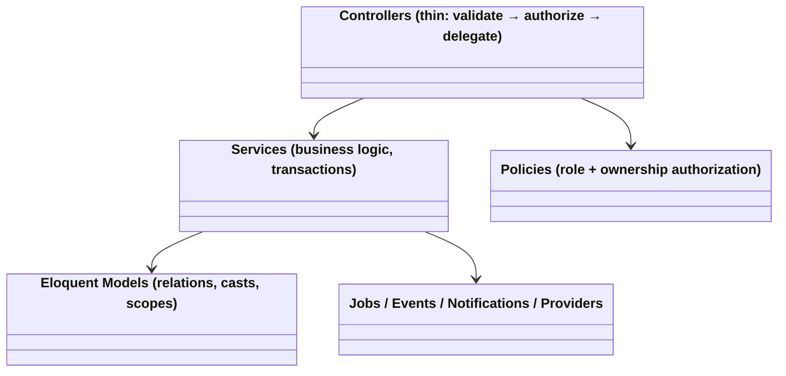

# Class Diagram — SportX India (Backend)

> **Synced with new design (v3):** reflects `Backend-Feature-Delta.md` and `SportX_Mandatory_Fields.md`. See `Database-Design.md` for the canonical schema.

Backend class/model structure for the **Laravel** application: Eloquent models, controllers, services, jobs, policies, events, and providers. Layer responsibilities are defined in `Backend-Architecture.md`.

> **Conventions:** Models = Eloquent entities from `ER-Diagram.md`. Controllers grouped per API module (route prefixes per `API-Specification.md`). Services hold business logic; controllers stay thin; policies hold authorization. `<<morph>>` notes polymorphic relations.
>
> **New-design deltas applied here:** `sponsor` role removed (→ `opportunities`); `scout` role + `TalentScoutProfile` added; OTP + guardian consent; social feed / network / messaging classes; leaderboard classes; profiles extended to 30 fields. Removed classes are marked **[REMOVED]**.

---

## 1. High-Level Layer Diagram

---

## 2. Domain Models

> **[REMOVED] classes:** `SponsorProfile`, `Scholarship`, `Sponsorship`, `SponsorshipApplication`, `ShortlistEntry` (sponsor-owned) are gone. Their responsibilities move to `Opportunity`, `OpportunityApplication` and `ScoutShortlist`.

```mermaid
classDiagram
    class User {
        +role: RoleEnum
        +name: string
        +email: ?string
        +phone: ?string
        +status: UserStatus
        +profile_visibility: Visibility
        +who_can_message: MessagePolicy
        +who_can_connect: ConnectPolicy
        +athleteProfile() HasOne
        +coachProfile() HasOne
        +academies() HasMany
        +organizerProfile() HasOne
        +talentScoutProfile() HasOne
        +generalizedProfiles() HasMany
        +adminProfile() HasOne
        +guardianConsent() HasOne
        +verificationRequests() HasMany
        +posts() HasMany
        +follows() HasMany
        +savedItems() HasMany
        +notifications() HasMany
    }

    class OtpCode {
        +purpose: OtpPurpose
        +channel: OtpChannel
        +destination: string
        +code_hash: string
        +expires_at: Carbon
        +attempts: int
        +consumed_at: ?Carbon
        +isValid(code): bool
    }

    class GuardianConsent {
        +guardian_name: string
        +guardian_phone: string
        +relationship: Relationship
        +consent_status: ConsentStatus
        +allow_messages: bool
        +allow_public_profile: bool
        +leaderboard_name_mode: NameMode
        +isMinor(): bool
    }

    class VerificationRequest {
        <<morph requestable>>
        +status: VerificationStatus
        +review_reason: ?string
        +requester() BelongsTo~User~
        +reviewer() BelongsTo ?User
    }

    class AthleteProfile {
        +skill_level: SkillLevel
        +bio: ?string
        +open_to: array
        +availability: array
        +verification_status: VerificationStatus
        +user() BelongsTo
        +ageGroup() BelongsTo
        +city() BelongsTo
        +sports() BelongsToMany
        +achievements() MorphMany
        +media() MorphMany
        +trialRegistrations() HasMany
        +tournamentRegistrations() HasMany
        +opportunityApplications() HasMany
        +leaderboardScores() HasMany
    }

    class Achievement {
        +title: string
        +achievement_type: AchievementType
        +sport_id: ?FK
        +level: ?string
        +year: ?int
        +certificate_media_id: ?FK
        +owner() MorphTo
    }

    class MediaItem {
        <<polymorphic owner>>
        +media_type: MediaType
        +path: string
        +caption: ?string
        +sport_id: ?FK
        +sort_order: int
        +owner() MorphTo
    }

    class CoachProfile {
        +full_name: string
        +coaching_level: CoachingLevel
        +experience_years: int
        +specializations: array
        +services: array
        +availability: array
        +fee_structure: ?string
        +city_id: FK
        +photo_media_id: FK ?MediaItem
        +verification_status: VerificationStatus
        +listing_status: ListingStatus
        +sports() BelongsToMany
        +programs() MorphMany
        +achievements() MorphMany
        +enquiries() MorphMany
        +computeCompleteness(): int
    }

    class Academy {
        +name: string
        +academy_type: AcademyType
        +description: text
        +training_offered: array
        +age_groups: array
        +address: string
        +city_id: FK
        +facilities_summary: array
        +year_established: ?int
        +fee_range: ?string
        +logo_media_id: FK ?MediaItem
        +cover_media_id: FK ?MediaItem
        +verification_badge: bool
        +listing_status: ListingStatus
        +owner() BelongsTo~User~
        +sports() BelongsToMany
        +coaches() HasMany~AcademyCoach~
        +facilities() HasMany~Facility~
        +programs() MorphMany
        +trials() HasMany
        +opportunities() MorphMany
        +invites() HasMany~AcademyAthleteInvite~
    }

    class Facility {
        +name: string
        +facility_type: FacilityType
        +size_spec: ?string
        +amenities: array
        +media: array
        +academy() BelongsTo~Academy~
    }

    class SportsVenue {
        +name: string
        +sport_id: FK~Sport
        +address: string
        +google_maps_url: string
        +contact_number: string
        +city_id: FK~City
        +owner_user_id: ?FK
        +booking_available: bool
        +pricing: ?string
        +listing_status: ListingStatus
        +sport() BelongsTo
        +owner() BelongsTo ?User
    }

    class OrganizerProfile {
        +organization_name: string
        +org_type: OrgType
        +event_types: array
        +city_id: FK
        +verification_status: VerificationStatus
        +sports() BelongsToMany
        +opportunities() MorphMany
    }

    class TalentScoutProfile {
        +full_name: string
        +scout_type: ScoutType
        +specializations: array
        +scouting_level: ?string
        +regions: array
        +recruitment_focus: array
        +availability: Availability
        +verification_status: VerificationStatus
        +user() BelongsTo~User~
        +sports() BelongsToMany
        +shortlists() HasMany~ScoutShortlist~
        +observations() HasMany
        +reports() HasMany~ScoutReport~
        +opportunities() MorphMany
    }

    class GeneralizedProfile {
        +category: string
        +name: string
        +specialization: string
        +description: text
        +services: array
        +city_id: FK
        +service_area: ?string
        +pricing: ?string
        +verification_status: VerificationStatus
        +listing_status: ListingStatus
        +owner() BelongsTo ?User
    }

    class Position {
        +name: string
        +sport_id: ?FK
        +is_active: bool
    }

    class Program {
        <<morph owner: CoachProfile | Academy>>
        +title: string
        +age_group: ?string
        +duration: ?string
        +mode: ProgramMode
        +price: ?string
        +schedule: ?string
        +status: ProgramStatus
        +owner() MorphTo
        +sport() BelongsTo
    }

    class Trial {
        +name: string
        +event_datetime: Carbon
        +position_id: ?FK
        +eligibility: string
        +entry_fee: string
        +required_documents: array
        +status: ListingStatus
        +expires_at: ?Carbon
        +postedBy() BelongsTo~User~
        +academy() BelongsTo ?Academy
        +sport() BelongsTo
        +registrations() HasMany
        +scopePublished(Builder)
        +isRegisterable(): bool
    }

    class TrialRegistration {
        +registration_ref: string
        +document_status: DocumentStatus
        +verification_status: VerificationStatus
        +reminder_enabled: bool
        +documents() HasMany~TrialRegistrationDocument~
    }

    class Tournament {
        +format: string
        +event_type: EventType
        +start_date: ?Carbon
        +end_date: ?Carbon
        +prize_pool: string
        +status: ListingStatus
        +organizer() BelongsTo~OrganizerProfile~
        +categories() HasMany~TournamentCategory~
        +registrations() HasMany
        +results() HasMany~TournamentResult~
        +schedules() MorphMany~EventSchedule~
    }

    class TournamentCategory {
        +capacity: int
        +waitlist_enabled: bool
        +filledCount(): int
        +hasSpots(): bool
    }

    class TournamentRegistration {
        +participation_type: ParticipationType
        +team_name: ?string
        +payment_status: ManualPaymentStatus
        +status: RegistrationStatus
    }

    class TournamentResult {
        +place: int
        +winner_name: string
        +bracket() BelongsTo ?MediaItem
        +scopePublished(Builder)
    }

    class EventSchedule {
        <<morph schedulable>>
        +day: date
        +slot_label: ?string
        +start_time: ?string
        +end_time: ?string
        +venue: ?string
    }

    class EventView {
        <<morph viewable>>
        +source: ?string
        +user() BelongsTo ?User
    }

    class Opportunity {
        <<morph provider: Academy | OrganizerProfile | CoachProfile | TalentScoutProfile | User>>
        +type: OpportunityType
        +title: string
        +sport_id: ?FK
        +eligibility: ?string
        +benefits: ?string
        +amount: ?float
        +deadline: ?Carbon
        +posted_by_admin: bool
        +status: ListingStatus
        +provider() MorphTo
        +applications() HasMany
        +scopePublished(Builder)
    }

    class OpportunityApplication {
        +pitch: ?string
        +documents: array
        +profile_snapshot: array
        +status: ApplicationStatus
        +review_note: ?string
        +athlete() BelongsTo~AthleteProfile~
        +opportunity() BelongsTo~Opportunity~
    }

    class Post {
        +body: ?string
        +media: array
        +hashtags: array
        +sport_id: ?FK
        +audience: Audience
        +likes_count: int
        +comments_count: int
        +author() BelongsTo~User~
        +likes() HasMany~PostLike~
        +comments() HasMany~PostComment~
    }

    class PostLike {
        +post() BelongsTo~Post~
        +user() BelongsTo~User~
    }

    class PostComment {
        +body: string
        +parent_id: ?FK
        +post() BelongsTo~Post~
        +user() BelongsTo~User~
    }

    class Follow {
        <<morph followable>>
        +follower() BelongsTo~User~
        +followable() MorphTo
    }

    class ConnectionRequest {
        +purpose: ?string
        +message: ?string
        +status: ConnectionStatus
        +responded_at: ?Carbon
        +requester() BelongsTo~User~
        +addressee() BelongsTo~User~
    }

    class Conversation {
        +last_message_at: ?Carbon
        +participants() HasMany~ConversationParticipant~
        +messages() HasMany~Message~
        +enquiry() HasOne~Enquiry~
    }

    class ConversationParticipant {
        +last_read_at: ?Carbon
        +user() BelongsTo~User~
    }

    class Message {
        +body: ?string
        +attachments: array
        +read_at: ?Carbon
        +sender() BelongsTo~User~
    }

    class Block {
        +blocker() BelongsTo~User~
        +blocked() BelongsTo~User~
    }

    class ScoutShortlist {
        +status: ShortlistStatus
        +tags: array
        +notes: ?string
        +scout() BelongsTo~User~
        +athlete() BelongsTo~AthleteProfile~
    }

    class Observation {
        +rating: ?int
        +note: string
        +media: array
        +scout() BelongsTo~User~
        +athlete() BelongsTo~AthleteProfile~
    }

    class ScoutReport {
        +scores: array
        +conclusion: ReportConclusion
        +notes: ?string
        +status: DraftStatus
    }

    class Review {
        <<morph rateable>>
        +rating: int
        +body: ?string
        +interaction_verified: bool
        +status: ReviewStatus
        +rater() BelongsTo~User~
    }

    class LeaderboardSeason {
        +name: string
        +starts_at: date
        +ends_at: date
        +is_active: bool
        +scores() HasMany~LeaderboardScore~
    }

    class LeaderboardScore {
        +points: int
        +breakdown: array
        +athlete() BelongsTo~AthleteProfile~
        +season() BelongsTo~LeaderboardSeason~
        +sport() BelongsTo~Sport~
    }

    class LeaderboardConfig {
        +key: string
        +value: array
    }

    class Broadcast {
        +audience: array
        +title: string
        +body: text
        +scheduled_at: ?Carbon
        +status: BroadcastStatus
        +sender() BelongsTo~User~
    }

    class AnalyticsEvent {
        +event: string
        +context: array
        +user() BelongsTo ?User
    }

    class AcademyAthleteInvite {
        +invited_name: ?string
        +invited_phone: ?string
        +status: InviteStatus
        +academy() BelongsTo~Academy~
    }

    class Enquiry {
        <<morph subject: CoachProfile | Academy | Organisation | Program | Opportunity | Facility>>
        +preferred_datetime: ?Carbon
        +athlete() BelongsTo~AthleteProfile~
        +subject() MorphTo
        +conversation() BelongsTo ?Conversation
        +messages() HasMany~EnquiryMessage~
        +latestMessage() HasOne
    }

    class EnquiryMessage {
        +body: string
        +read_at: ?Carbon
        +sender() BelongsTo~User~
    }

    class SavedItem {
        <<polymorphic item>>
        +item() MorphTo
    }

    class ListingReport {
        <<polymorphic reportable>>
        +reason: ReportReason
        +status: ReportStatus
        +reportable() MorphTo
        +resolvedBy() BelongsTo ?User
    }

    class Notification {
        <<polymorphic notifiable>>
        +type: NotificationType
        +read_at: ?Carbon
    }

    class ExpiryRule {
        +content_type: ContentType
        +trigger_field: TriggerField
        +days_after: int
        +is_active: bool
    }

    class ExpiryEvent {
        +status: ExpiryStatus
        +scheduled_at: Carbon
        +content_type: ContentType
        +content_id: int
    }

    class ReminderSubscription {
        <<polymorphic reminderable>>
        +remind_at: Carbon
        +sent_at: ?Carbon
    }

    class Sport { +name: string +is_active: bool }
    class City { +name: string +state: string }
    class AgeGroup { +name: string +min_age: ?int +max_age: ?int }

    User "1" --> "0..1" AthleteProfile
    User "1" --> "0..1" CoachProfile
    User "1" --> "0..*" Academy
    User "1" --> "0..1" OrganizerProfile
    User "1" --> "0..1" TalentScoutProfile
    User "1" --> "0..*" GeneralizedProfile
    User "1" --> "0..1" GuardianConsent
    User "1" --> "0..*" VerificationRequest
    User "1" --> "0..*" Post
    User "1" --> "0..*" Follow
    User "1" --> "0..*" ConnectionRequest
    User "1" --> "0..*" Block
    User "1" --> "0..*" Review
    User "1" --> "0..*" Broadcast
    AthleteProfile "1" --> "*" Achievement
    CoachProfile "1" --> "*" Achievement
    AthleteProfile "1" --> "*" TrialRegistration
    AthleteProfile "1" --> "*" TournamentRegistration
    AthleteProfile "1" --> "*" OpportunityApplication
    AthleteProfile "1" --> "*" LeaderboardScore
    Academy "1" --> "*" Facility
    Academy "1" --> "*" Trial
    Academy "1" --> "*" Program
    CoachProfile "1" --> "*" Program
    Academy "1" --> "*" Opportunity
    OrganizerProfile "1" --> "*" Opportunity
    CoachProfile "1" --> "*" Opportunity
    TalentScoutProfile "1" --> "*" Opportunity
    Opportunity "1" --> "*" OpportunityApplication
    Post "1" --> "*" PostLike
    Post "1" --> "*" PostComment
    Conversation "1" --> "*" ConversationParticipant
    Conversation "1" --> "*" Message
    Conversation "1" --> "0..1" Enquiry
    Enquiry "1" --> "*" EnquiryMessage
    ScoutShortlist "1" --> "1" AthleteProfile
    TalentScoutProfile "1" --> "*" Observation
    TalentScoutProfile "1" --> "*" ScoutReport
    LeaderboardSeason "1" --> "*" LeaderboardScore
    Trial "1" --> "*" TrialRegistration
    Trial "1" --> "*" EventSchedule
    Tournament "1" --> "*" TournamentCategory
    Tournament "1" --> "*" TournamentRegistration
    Tournament "1" --> "*" TournamentResult
    Tournament "1" --> "*" EventSchedule
    Sport "1" --> "*" SportsVenue
```

---

## 3. Controllers (API, grouped by module)

---

## 4. Services

```mermaid
classDiagram
    class AuthService {
        +register(dto): User
        +login(identifier, passwordOrOtp): Token
    }
    class OtpService {
        -provider: OtpProvider
        +issue(user, channel, destination, purpose): void
        +verify(user, code, purpose): bool
        +resend(user, purpose): void
    }
    class GuardianConsentService {
        +request(athlete, guardian): GuardianConsent
        +verify(consent, otp): void
        +enforce(athlete): void
    }
    class ProfileService {
        +completeness(profile): Checklist
        +syncSports(profile, sportIds)
        +attachMedia(owner, file, type)
    }
    class VerificationService {
        +submit(requester, proof): VerificationRequest
        +decide(request, admin, decision, reason): void
        +isVerified(profile): bool
    }
    class SearchService {
        +unified(query, filters): CategoryBuckets
        +perCategory(category, query, filters, page)
    }
    class FilterService {
        +applyToAcademies(q, filters)
        +applyToTrials(q, filters) +...()
    }
    class FeedService {
        +forYou(user, page) +following(user, page) +byTab(tab, page)
        +rank(posts): Collection
    }
    class PostService {
        +create(author, dto): Post
        +like(user, post) +comment(user, post, body) +remove(post)
    }
    class OpportunityService {
        +publish(provider, dto): Opportunity
        +apply(athlete, opportunity, pitch): OpportunityApplication
        +review(application, decision, note): void
    }
    class ProgramService { +create(owner, dto): Program +enquire(athlete, program, message): Enquiry }
    class FacilityService { +crud(academy, dto): Facility }
    class EnquiryService {
        +openThread(athlete, subject, message, preferredAt): Enquiry
        +reply(enquiry, sender, body): EnquiryMessage
    }
    class ConnectionService {
        +request(requester, addressee, purpose): ConnectionRequest
        +respond(request, decision): void
        +canChat(a, b): bool
    }
    class ChatService {
        +openFromConnection(a, b): Conversation
        +openFromEnquiry(enquiry): Conversation
        +send(conversation, sender, body): Message
        +markRead(conversation, user)
    }
    class RegistrationService {
        +registerForTrial(athlete, trial, payload): TrialRegistration
        +registerForTournament(athlete, category, payload): TournamentRegistration
        -assertTrialOpen(trial)
        -assertCapacity(category): RegistrationStatus
    }
    class ScoutService {
        +shortlist(scout, athlete, status, tags, note): ScoutShortlist
        +observe(scout, athlete, rating, note, media): Observation
        +report(scout, athlete, scores, conclusion): ScoutReport
        +contact(athlete, purpose, message): ConnectionRequest
    }
    class LeaderboardService {
        +recalculate(athlete, reason): LeaderboardScore
        +rank(filters): Podium
        +strip(sport): Collection
        +resetSeason(): void
    }
    class ReviewService {
        +rate(rater, rateable, stars, body): Review
        +aggregate(rateable): float
    }
    class ExpiryService {
        -rules: ExpiryRuleRepository
        +scheduleFor(content): ExpiryEvent
        +sweep(): int
        +override(event, admin)
        +restore(event, admin)
    }
    class ReminderService {
        +scheduleFor(user, content): void
        +dispatchDue(): int
        -computeRemindAt(content): Carbon
    }
    class ModerationService {
        +approve(report) +remove(report) +warnOwner(report) +suspend(report.target)
    }
    class NotificationService {
        -driver: NotificationProvider
        +send(user, NotificationDto)
        +broadcast(audience, dto)
        +broadcastExpiryOverride(event)
    }
    class AnalyticsService { +track(event, context) }

    FeedService ..> PostService : ranks posts
    ChatService ..> ConnectionService : validates chat unlock
    OpportunityService ..> NotificationService : notifies applicants
    GuardianConsentService ..> NotificationService : consent result
    RegistrationService ..> ReminderService : arms reminder on confirm
    RegistrationService ..> NotificationService : decision notify
    LeaderboardService ..> NotificationService : milestone points
    ExpiryService ..> NotificationService : owner notified on expiry
    ModerationService ..> NotificationService : warn/suspend owner
```

---

## 5. Jobs / Listeners / Notifications / Providers

```mermaid
classDiagram
    class SweepExpiredContentJob {
        <<scheduled hourly — cadence TBD>>
        +handle(ExpiryService)
    }
    class SendDueRemindersJob {
        <<scheduled>>
        +handle(ReminderService)
    }
    class SendOtpJob { +handle(OtpService) }
    class PurgeExpiredOtpsJob { +handle() }
    class RecalculateLeaderboardJob { <<on triggers + nightly rebuild>> +handle(LeaderboardService) }
    class ResetLeaderboardSeasonJob { <<scheduled / admin>> +handle(LeaderboardService) }
    class BroadcastNotificationJob { <<P1>> +handle(NotificationService) }

    class EnquiryReplied {
        <<event>>
        +enquiry: Enquiry
        +message: EnquiryMessage
    }
    class RegistrationConfirmed { +registration }
    class RegistrationDecided { +registration +decision }
    class ContentExpired { +event: ExpiryEvent }
    class VerificationDecided { +request +decision }
    class ConnectionAccepted { +connectionRequest }
    class MentionCreated { +post +mentionedUser }
    class ContentReported { +report }

    class OtpProvider {
        <<interface>>
        +send(destination, code, channel): bool
    }
    class NotificationProvider {
        <<interface>>
        +push(user, payload): void
    }
    class LogOtpProvider { +send() }
    class SmsOtpProvider { +send() }
    class DatabaseNotificationProvider { +push() }

    OtpProvider <|.. LogOtpProvider : default dev driver
    OtpProvider <|.. SmsOtpProvider : prod (vendor TBD — AS-03)
```

- Provider interfaces are injected via Laravel container; vendor selection (SMS/push) is deferred (decision → AS-03), but **phone + email OTP is P0** so an SMS driver must be selected.

---

## 6. Policies (authorization)

| Policy | Rules (summary) |
|---|---|
| `CoachProfilePolicy` | update/delete → owner user; view → any published listing |
| `AcademyPolicy` | update → `owner_user_id`; trials/facilities/programs under academy → academy owner only |
| `TrialPolicy` | create → academy owner or organizer (coach/athlete P1 via policy flag); update/close → `posted_by_user_id` (or owning academy) or admin |
| `TournamentPolicy` | CRUD → owning organizer profile only |
| `RegistrantPolicy` | view/verify/reject → trial's `posted_by` or owning academy |
| `OpportunityPolicy` | CRUD → owning provider (academy/organizer/coach/scout) or admin; apply → athlete role only |
| `OpportunityApplicationPolicy` | view/decide → owning provider; view own → athlete |
| `ProgramPolicy` | CRUD → owning coach/academy |
| `FacilityPolicy` | CRUD → owning academy |
| `PostPolicy` | edit/delete → author; view → audience rules; report → any authenticated user |
| `ConnectionPolicy` | request → any (purpose required for scout→athlete); respond → addressee |
| `ConversationPolicy` | view/send → participant AND accepted connection (or enquiry thread); minors → guardian-allowed only |
| `BlockPolicy` | manage → self |
| `ScoutDataPolicy` | shortlists/observations/reports notes → owning scout only |
| `ReviewPolicy` | create → gated to verified interaction; manage own |
| `VerificationPolicy` | submit → owner of requestable; decide → admin |
| `GuardianConsentPolicy` | manage → minor athlete + guardian OTP verification |
| `LeaderboardPolicy` | view → any; config/reset → admin |
| `ReportPolicy` | create → any authenticated user; view/act → admin only |
| `AdminPolicy` | all admin endpoints → users with `admin` role + 2FA session |

---

## 7. Notable Design Decisions (class-level)

1. **Single `users` table + per-role profiles** — one auth identity, one role each (AS-01). Roles are `athlete, coach, academy, organizer, scout, admin`; **`sponsor` removed, `scout` added**. `generalized_profiles` are ancillary directory profiles, not login roles.
2. **Polymorphic hubs** — `enquiries`, `saved_items`, `listing_reports`, `notifications`, `media_items`, `opportunities` (provider), `verification_requests` (requestable), `follows`, `reviews` keep content categories DRY, mirroring the shared UI templates (T1–T4).
3. **Services own transactions** — e.g. `RegistrationService::registerForTrial` wraps capacity/duplicate checks + row creation + reminder arming in one DB transaction.
4. **Jobs are thin shells** delegating to services so logic is testable outside the scheduler. New P0 jobs: `RecalculateLeaderboardJob`, `ResetLeaderboardSeasonJob`.
5. **Provider interfaces for undecided vendors** — `OtpProvider`/`NotificationProvider` default to log/database drivers until vendor selection (AS-03); phone-OTP (P0) requires an SMS driver.
6. **Unified opportunities + guardian enforcement + social graph** are first-class concerns baked into services (`OpportunityService`, `GuardianConsentService`, `ConnectionService`, `ChatService`) rather than ad-hoc controller logic.
