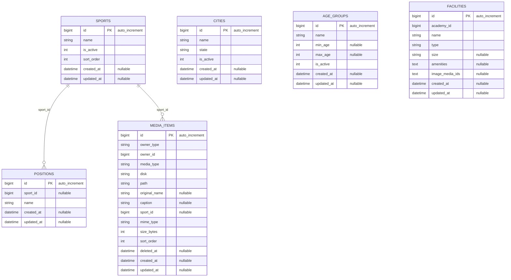
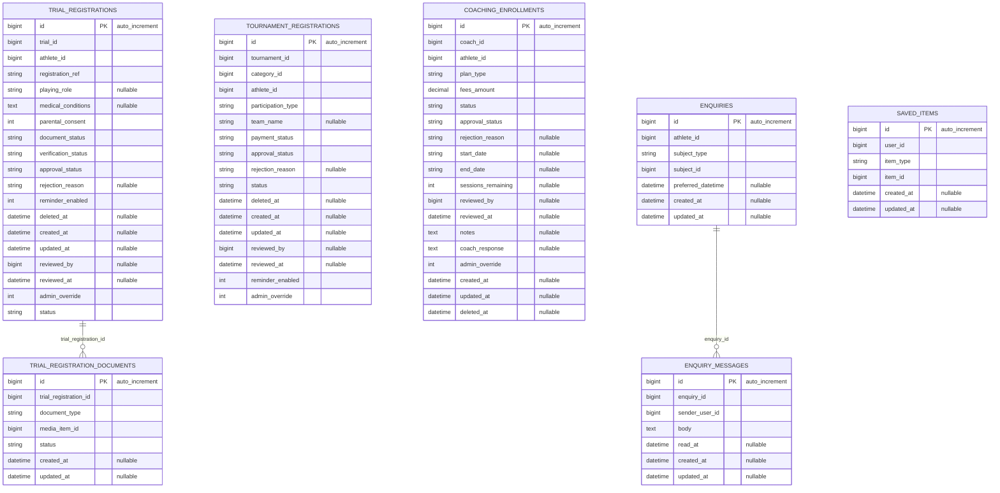
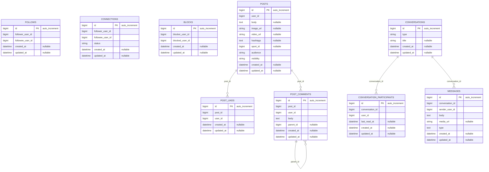

# SportX - Physical ER Diagram (Live Schema)

> **Auto-generated from the running database** (`sportx_dev`, MySQL).
> Do not hand-edit: re-run `php artisan db:show`-style introspection to refresh.
>
> This is the **physical** schema - every table, column, key and constraint that
> actually exists. For the **logical** / aspirational design (tables and columns that are
> specified but not yet implemented) see [`ER-Diagram.md`](ER-Diagram.md) and
> [`Database-Design.md`](Database-Design.md).

**Conventions** - `PK` primary key | `FK` foreign key | `UK` unique | `IDX` index |
`AI` auto-increment | `M` polymorphic (`*_type` + `*_id`) | `SD` soft-deleted.

## 1. Schema at a glance

| Metric | Value |
|---|---|
| Database | `sportx_dev` (MySQL) |
| Tables | 76 |
| Columns | 791 |
| Foreign keys | 136 |
| Indexes | 291 (150 unique) |
| Tables with a soft-delete column | 12 |
| Polymorphic pairs (`*_type` + `*_id`) | 8 tables |

## 2. Relationship diagrams

Each domain below is a separate Mermaid block so no single diagram becomes
unreadable. Relationship labels are derived from the actual foreign keys.

### 2.1 Identity, Auth & Roles

```mermaid
erDiagram
    USERS {
        bigint id PK "auto_increment"
        string role
        string name
        string email
        datetime email_verified_at "nullable"
        string verification_token "nullable"
        datetime admin_2fa_verified_at "nullable"
        string google2fa_secret "nullable"
        string phone "nullable"
        string password "nullable"
        string status
        text notification_prefs "nullable"
        text social_links "nullable"
        text privacy_settings "nullable"
        string language
        string remember_token "nullable"
        datetime created_at "nullable"
        datetime updated_at "nullable"
        string reset_password_token "nullable"
        datetime reset_password_sent_at "nullable"
    }
    OTP_CODES {
        bigint id PK "auto_increment"
        bigint user_id "nullable"
        string channel
        string destination
        string code_hash
        string purpose
        datetime expires_at
        int attempts
        datetime consumed_at "nullable"
        datetime created_at "nullable"
        datetime updated_at "nullable"
    }
    SOCIAL_ACCOUNTS {
        bigint id PK "auto_increment"
        bigint user_id
        string provider
        string provider_user_id
        string email "nullable"
        string name "nullable"
        string avatar_url "nullable"
        text access_token "nullable"
        text refresh_token "nullable"
        datetime token_expires_at "nullable"
        string scopes "nullable"
        datetime created_at "nullable"
        datetime updated_at "nullable"
    }
    ADMIN_PROFILES {
        bigint id PK "auto_increment"
        bigint user_id
        string two_factor_secret "nullable"
        int is_super_admin
        datetime created_at "nullable"
        datetime updated_at "nullable"
    }
    GUARDIAN_CONSENTS {
        bigint id PK "auto_increment"
        bigint athlete_user_id
        string guardian_name
        string guardian_phone
        string relationship
        string consent_status
        int allow_messages
        int allow_public_profile
        string leaderboard_name_mode
        datetime verified_at "nullable"
        datetime revoked_at "nullable"
        datetime created_at "nullable"
        datetime updated_at "nullable"
    }
    VERIFICATION_REQUESTS {
        bigint id PK "auto_increment"
        bigint requester_user_id
        string verifiable_type
        bigint verifiable_id
        string status
        text proof_media_ids "nullable"
        text notes "nullable"
        bigint reviewed_by "nullable"
        text decision_reason "nullable"
        datetime reviewed_at "nullable"
        datetime created_at "nullable"
        datetime updated_at "nullable"
    }
    ATHLETE_PROFILES {
        bigint id PK "auto_increment"
        string verification_badge "nullable"
        bigint user_id
        string full_name
        string date_of_birth
        string gender
        bigint age_group_id
        int skill_level
        text bio "nullable"
        bigint city_id "nullable"
        string phone "nullable"
        bigint academy_id "nullable"
        bigint coach_id "nullable"
        string position "nullable"
        string experience "nullable"
        bigint photo_media_id "nullable"
        datetime created_at "nullable"
        datetime updated_at "nullable"
    }
    COACH_PROFILES {
        bigint id PK "auto_increment"
        bigint user_id
        string full_name
        bigint sport_id
        bigint city_id "nullable"
        string contact_number
        string experience
        string qualification "nullable"
        text certifications "nullable"
        bigint academy_id "nullable"
        text languages "nullable"
        string email "nullable"
        int personal_coaching
        string fee_structure "nullable"
        text bio "nullable"
        bigint photo_media_id "nullable"
        string listing_status
        int profile_completeness
        string headline "nullable"
        string location "nullable"
        decimal fee_per_session "nullable"
        decimal fee_monthly "nullable"
        decimal fee_quarterly "nullable"
        text availability "nullable"
        text achievements "nullable"
        datetime created_at "nullable"
        datetime updated_at "nullable"
    }
    ACADEMIES {
        bigint id PK "auto_increment"
        bigint owner_user_id
        string name
        text description
        string academy_type "nullable"
        text sports_offered "nullable"
        string address
        bigint city_id "nullable"
        string contact_number
        string google_maps_url "nullable"
        text facilities "nullable"
        string fee_range "nullable"
        string timings "nullable"
        text age_groups "nullable"
        int year_established "nullable"
        text achievements "nullable"
        string email "nullable"
        string website "nullable"
        bigint head_coach_id "nullable"
        bigint logo_media_id "nullable"
        bigint cover_media_id "nullable"
        int verification_badge
        string listing_status
        datetime created_at "nullable"
        datetime updated_at "nullable"
    }
    ACADEMY_SPORTS {
        bigint id PK "auto_increment"
        bigint academy_id
        bigint sport_id
        datetime created_at "nullable"
        datetime updated_at "nullable"
    }
    ACADEMY_COACHES {
        bigint id PK "auto_increment"
        bigint academy_id
        bigint coach_user_id "nullable"
        string display_name "nullable"
        datetime created_at "nullable"
        datetime updated_at "nullable"
    }
    ORGANIZER_PROFILES {
        bigint id PK "auto_increment"
        bigint user_id
        string organization_name
        string org_type
        string verification_status
        datetime created_at "nullable"
        datetime updated_at "nullable"
        bigint logo_media_id "nullable"
        bigint cover_media_id "nullable"
        bigint city_id "nullable"
        text description "nullable"
        text event_types "nullable"
        string registration_number "nullable"
        string website "nullable"
        bigint verification_doc_media_id "nullable"
    }
    ORGANIZER_SPORTS {
        bigint id PK "auto_increment"
        bigint organizer_id
        bigint sport_id
        datetime created_at "nullable"
        datetime updated_at "nullable"
    }
    SPONSOR_PROFILES {
        bigint id PK "auto_increment"
        bigint user_id
        string brand_name
        bigint logo_media_id "nullable"
        string category "nullable"
        string verification_status
        datetime created_at "nullable"
        datetime updated_at "nullable"
    }
    TALENT_SCOUT_PROFILES {
        bigint id PK "auto_increment"
        string verification_badge "nullable"
        bigint user_id
        string organization "nullable"
        string affiliation "nullable"
        text sports_specialization
        int experience_years "nullable"
        bigint city_id "nullable"
        text bio "nullable"
        string photo_media_id "nullable"
        int listing_status
        datetime created_at "nullable"
        datetime updated_at "nullable"
        datetime deleted_at "nullable"
    }
    TALENT_SCOUT_SPORTS {
        bigint id PK "auto_increment"
        bigint talent_scout_profile_id
        bigint sport_id
        datetime created_at "nullable"
        datetime updated_at "nullable"
    }
    USERS ||--o{ OTP_CODES : "user_id"
    USERS ||--o{ SOCIAL_ACCOUNTS : "user_id"
    USERS ||--o{ ADMIN_PROFILES : "user_id"
    USERS ||--o{ GUARDIAN_CONSENTS : "athlete_user_id"
    USERS ||--o{ VERIFICATION_REQUESTS : "requester_user_id"
    USERS ||--o{ VERIFICATION_REQUESTS : "reviewed_by"
    ACADEMIES ||--o{ ATHLETE_PROFILES : "academy_id"
    COACH_PROFILES ||--o{ ATHLETE_PROFILES : "coach_id"
    USERS ||--o{ ATHLETE_PROFILES : "user_id"
    ACADEMIES ||--o{ COACH_PROFILES : "academy_id"
    USERS ||--o{ COACH_PROFILES : "user_id"
    USERS ||--o{ ACADEMIES : "head_coach_id"
    USERS ||--o{ ACADEMIES : "owner_user_id"
    ACADEMIES ||--o{ ACADEMY_SPORTS : "academy_id"
    ACADEMIES ||--o{ ACADEMY_COACHES : "academy_id"
    USERS ||--o{ ACADEMY_COACHES : "coach_user_id"
    USERS ||--o{ ORGANIZER_PROFILES : "user_id"
    ORGANIZER_PROFILES ||--o{ ORGANIZER_SPORTS : "organizer_id"
    USERS ||--o{ SPONSOR_PROFILES : "user_id"
    USERS ||--o{ TALENT_SCOUT_PROFILES : "user_id"
    TALENT_SCOUT_PROFILES ||--o{ TALENT_SCOUT_SPORTS : "talent_scout_profile_id"
```

### 2.2 Master Data & Media

### 2.3 Listings, Programs & Opportunities

```mermaid
erDiagram
    TRIALS {
        bigint id PK "auto_increment"
        bigint posted_by_user_id
        bigint academy_id "nullable"
        string name
        string organization_name "nullable"
        bigint sport_id
        datetime event_datetime
        string venue
        string google_maps_url "nullable"
        bigint city_id "nullable"
        string contact_number
        datetime registration_deadline "nullable"
        text eligibility "nullable"
        text required_documents "nullable"
        int vacancies "nullable"
        text benefits "nullable"
        string entry_fee "nullable"
        string status
        datetime expires_at "nullable"
        datetime deleted_at "nullable"
        datetime created_at "nullable"
        datetime updated_at "nullable"
    }
    TOURNAMENTS {
        bigint id PK "auto_increment"
        bigint organizer_id
        bigint sport_id
        string name
        string organizer_name "nullable"
        string format "nullable"
        string start_date
        string end_date "nullable"
        string registration_deadline "nullable"
        string venue
        string google_maps_url "nullable"
        bigint city_id "nullable"
        string entry_fee "nullable"
        string contact_number "nullable"
        string registration_link "nullable"
        string prize_pool "nullable"
        text rules "nullable"
        bigint banner_media_id "nullable"
        string gender "nullable"
        string status
        datetime expires_at "nullable"
        datetime deleted_at "nullable"
        datetime created_at "nullable"
        datetime updated_at "nullable"
    }
    TOURNAMENT_CATEGORIES {
        bigint id PK "auto_increment"
        bigint tournament_id
        bigint age_group_id
        string name "nullable"
        int capacity
        int waitlist_enabled
        datetime created_at "nullable"
        datetime updated_at "nullable"
    }
    TOURNAMENT_RESULTS {
        bigint id PK "auto_increment"
        bigint tournament_id
        bigint category_id
        int place
        string winner_name
        bigint bracket_media_id "nullable"
        datetime published_at "nullable"
        datetime created_at "nullable"
        datetime updated_at "nullable"
    }
    SPORTS_VENUES {
        bigint id PK "auto_increment"
        string name
        bigint sport_id
        string address
        string google_maps_url "nullable"
        string contact_number
        bigint city_id "nullable"
        text photos "nullable"
        int booking_available
        string pricing "nullable"
        text facilities "nullable"
        string working_hours "nullable"
        string listing_status
        datetime deleted_at "nullable"
        datetime created_at "nullable"
        datetime updated_at "nullable"
    }
    OPPORTUNITIES {
        bigint id PK "auto_increment"
        string provider_type
        bigint provider_id
        bigint created_by_user_id
        string type
        string title
        bigint sport_id "nullable"
        bigint age_group_id "nullable"
        text eligibility "nullable"
        text benefits "nullable"
        decimal amount "nullable"
        string deadline "nullable"
        text documents_required "nullable"
        text description "nullable"
        bigint logo_media_id "nullable"
        string status
        string legacy_type "nullable"
        bigint legacy_id "nullable"
        datetime expires_at "nullable"
        datetime created_at "nullable"
        datetime updated_at "nullable"
        datetime deleted_at "nullable"
    }
    OPPORTUNITY_APPLICATIONS {
        bigint id PK "auto_increment"
        bigint opportunity_id
        bigint athlete_id
        text pitch
        text document_media_ids "nullable"
        text snapshot "nullable"
        string status
        string decision_note "nullable"
        datetime replied_at "nullable"
        datetime created_at "nullable"
        datetime updated_at "nullable"
    }
    PROGRAMS {
        bigint id PK "auto_increment"
        string owner_type
        bigint owner_id
        bigint created_by_user_id
        string title
        bigint sport_id "nullable"
        bigint age_group_id "nullable"
        string duration "nullable"
        string mode
        decimal price "nullable"
        text schedule "nullable"
        text about "nullable"
        string status
        datetime created_at "nullable"
        datetime updated_at "nullable"
        datetime deleted_at "nullable"
    }
    SCHOLARSHIPS {
        bigint id PK "auto_increment"
        string organization_name
        string name
        bigint sport_id "nullable"
        text eligibility
        string deadline
        string application_link
        string contact_email "nullable"
        string contact_phone "nullable"
        decimal amount "nullable"
        string currency
        text benefits "nullable"
        text documents_required "nullable"
        text description "nullable"
        bigint logo_media_id "nullable"
        string status
        bigint created_by "nullable"
        datetime deleted_at "nullable"
        datetime created_at "nullable"
        datetime updated_at "nullable"
    }
    SPONSORSHIPS {
        bigint id PK "auto_increment"
        bigint sponsor_id
        string organization_name "nullable"
        bigint sport_id
        string title
        text eligibility_criteria
        string deadline
        string application_link "nullable"
        string contact_email "nullable"
        string contact_phone "nullable"
        text benefits_offered "nullable"
        decimal amount "nullable"
        text documents_required "nullable"
        text description "nullable"
        bigint logo_media_id "nullable"
        string status
        datetime expires_at "nullable"
        datetime deleted_at "nullable"
        datetime created_at "nullable"
        datetime updated_at "nullable"
    }
    SPONSORSHIP_APPLICATIONS {
        bigint id PK "auto_increment"
        bigint sponsorship_id
        bigint athlete_id
        text pitch_note
        string status
        datetime replied_at "nullable"
        datetime created_at "nullable"
        datetime updated_at "nullable"
    }
    SHORTLIST_ENTRIES {
        bigint id PK "auto_increment"
        bigint sponsor_id
        bigint athlete_id
        text note "nullable"
        datetime created_at "nullable"
        datetime updated_at "nullable"
    }
    TOURNAMENTS ||--o{ TOURNAMENT_CATEGORIES : "tournament_id"
    TOURNAMENT_CATEGORIES ||--o{ TOURNAMENT_RESULTS : "category_id"
    TOURNAMENTS ||--o{ TOURNAMENT_RESULTS : "tournament_id"
    OPPORTUNITIES ||--o{ OPPORTUNITY_APPLICATIONS : "opportunity_id"
    SPONSORSHIPS ||--o{ SPONSORSHIP_APPLICATIONS : "sponsorship_id"
```

### 2.4 Registrations & Enquiries

### 2.5 Social Graph, Feed & Messaging

### 2.6 Scouting & Leaderboard

```mermaid
erDiagram
    SCOUT_SHORTLISTS {
        bigint id PK "auto_increment"
        bigint talent_scout_profile_id
        bigint athlete_profile_id
        string status
        text tags "nullable"
        text notes "nullable"
        datetime created_at "nullable"
        datetime updated_at "nullable"
    }
    SCOUT_CONNECTIONS {
        bigint id PK "auto_increment"
        bigint talent_scout_profile_id
        bigint athlete_profile_id
        bigint requested_by_user_id "nullable"
        string status
        text message "nullable"
        datetime created_at "nullable"
        datetime updated_at "nullable"
    }
    OBSERVATIONS {
        bigint id PK "auto_increment"
        bigint talent_scout_profile_id
        bigint athlete_profile_id
        int rating "nullable"
        text note "nullable"
        bigint media_id "nullable"
        datetime created_at "nullable"
        datetime updated_at "nullable"
    }
    LEADERBOARD_SEASONS {
        bigint id PK "auto_increment"
        string name
        string starts_on
        string ends_on "nullable"
        int is_active
        datetime created_at "nullable"
        datetime updated_at "nullable"
    }
    LEADERBOARD_SCORES {
        bigint id PK "auto_increment"
        bigint athlete_profile_id
        bigint sport_id "nullable"
        bigint season_id "nullable"
        int points
        datetime created_at "nullable"
        datetime updated_at "nullable"
    }
    LEADERBOARD_SEASONS ||--o{ LEADERBOARD_SCORES : "season_id"
```

### 2.7 Platform & Operations

```mermaid
erDiagram
    NOTIFICATIONS {
        bigint id PK "auto_increment"
        bigint user_id
        string type
        string channel
        string title
        string body
        string category "nullable"
        string image_url "nullable"
        string priority
        string notifiable_type "nullable"
        bigint notifiable_id "nullable"
        string action_url "nullable"
        text metadata "nullable"
        datetime pushed_at "nullable"
        string push_status "nullable"
        datetime read_at "nullable"
        datetime created_at "nullable"
        datetime updated_at "nullable"
    }
    USER_DEVICE_TOKENS {
        bigint id PK "auto_increment"
        bigint user_id
        string token
        string device_type
        string device_id "nullable"
        int is_active
        datetime last_seen_at "nullable"
        int failure_count
        datetime created_at "nullable"
        datetime updated_at "nullable"
    }
    DEVICE_TOKENS {
        bigint id PK "auto_increment"
        bigint user_id
        string token
        string platform
        datetime last_used_at "nullable"
        datetime created_at "nullable"
        datetime updated_at "nullable"
    }
    ANALYTICS_EVENTS {
        bigint id PK "auto_increment"
        bigint user_id "nullable"
        string event
        text props "nullable"
        datetime created_at "nullable"
        datetime updated_at "nullable"
    }
    AUDIT_LOGS {
        bigint id PK "auto_increment"
        bigint user_id "nullable"
        string user_name "nullable"
        string user_role "nullable"
        string action
        string auditable_type
        bigint auditable_id "nullable"
        string auditable_label "nullable"
        text old_values "nullable"
        text new_values "nullable"
        text changed_fields "nullable"
        string ip_address "nullable"
        string user_agent "nullable"
        string route "nullable"
        datetime created_at "nullable"
        datetime updated_at "nullable"
    }
    LISTING_REPORTS {
        bigint id PK "auto_increment"
        bigint reporter_user_id
        string reportable_type
        bigint reportable_id
        string reason
        text comment "nullable"
        string status
        bigint resolved_by "nullable"
        datetime resolved_at "nullable"
        datetime created_at "nullable"
        datetime updated_at "nullable"
    }
    EXPIRY_RULES {
        bigint id PK "auto_increment"
        string content_type
        string trigger_field
        int days_after
        int is_active
        datetime created_at "nullable"
        datetime updated_at "nullable"
    }
    EXPIRY_EVENTS {
        bigint id PK "auto_increment"
        string content_type
        bigint content_id
        datetime scheduled_at
        datetime executed_at "nullable"
        string status
        bigint overridden_by "nullable"
        datetime created_at "nullable"
        datetime updated_at "nullable"
    }
    RECENT_SEARCHES {
        bigint id PK "auto_increment"
        bigint user_id
        string query
        datetime created_at "nullable"
        datetime updated_at "nullable"
    }
    ACHIEVEMENTS {
        bigint id PK "auto_increment"
        bigint athlete_id
        bigint coach_profile_id "nullable"
        string title "nullable"
        string type "nullable"
        bigint sport_id "nullable"
        string level "nullable"
        int year "nullable"
        bigint certificate_media_id "nullable"
        text description "nullable"
        string text
        int sort_order
        datetime created_at "nullable"
        datetime updated_at "nullable"
    }
    REMINDER_SUBSCRIPTIONS {
        bigint id PK "auto_increment"
        bigint user_id
        string reminderable_type
        bigint reminderable_id
        datetime remind_at
        datetime sent_at "nullable"
        datetime created_at "nullable"
        datetime updated_at "nullable"
    }
    ATHLETE_SPORTS {
        bigint id PK "auto_increment"
        bigint athlete_id
        bigint sport_id
        string playing_role "nullable"
        string level "nullable"
        int experience_years "nullable"
        int is_primary
        datetime created_at "nullable"
        datetime updated_at "nullable"
    }
    REGISTRATION_ACTIVITY_LOGS {
        bigint id PK "auto_increment"
        string registration_type
        bigint registration_id
        string action
        string actor_type
        bigint actor_id
        text metadata "nullable"
        string ip_address "nullable"
        text user_agent "nullable"
        datetime created_at "nullable"
        datetime updated_at "nullable"
    }
```

### 2.8 Cross-domain foreign keys

These relationships cross the domain boundaries above.

| From | Column | To | On delete |
|---|---|---|---|

## 3. Physical schema reference

Every table, with columns, keys, indexes and current row count.

### Identity, Auth & Roles

#### `users`

Rows: **26** | Engine: `InnoDB` | Collation: `utf8mb4_unicode_ci`

| Column | Type | Null | Default | Key | Extra |
|---|---|---|---|---|---|
| `id` | `bigint(20) unsigned` | no | - | **PK** | auto_increment |
| `role` | `enum('athlete','coach','academy','organizer','sponsor','admin','talent_scout')` | no | - | IDX |  |
| `name` | `varchar(255)` | no | - |  |  |
| `email` | `varchar(255)` | no | - | UK |  |
| `email_verified_at` | `timestamp` | yes | 'NULL' |  |  |
| `verification_token` | `varchar(64)` | yes | 'NULL' |  |  |
| `admin_2fa_verified_at` | `timestamp` | yes | 'NULL' |  |  |
| `google2fa_secret` | `varchar(64)` | yes | 'NULL' |  |  |
| `phone` | `varchar(255)` | yes | 'NULL' |  |  |
| `password` | `varchar(255)` | yes | 'NULL' |  |  |
| `status` | `enum('active','pending','suspended','deleted')` | no | ''active'' |  |  |
| `notification_prefs` | `longtext` | yes | 'NULL' |  |  |
| `social_links` | `longtext` | yes | 'NULL' |  |  |
| `privacy_settings` | `longtext` | yes | 'NULL' |  |  |
| `language` | `varchar(10)` | no | ''en'' |  |  |
| `remember_token` | `varchar(100)` | yes | 'NULL' |  |  |
| `created_at` | `timestamp` | yes | 'NULL' |  |  |
| `updated_at` | `timestamp` | yes | 'NULL' |  |  |
| `reset_password_token` | `varchar(64)` | yes | 'NULL' |  |  |
| `reset_password_sent_at` | `timestamp` | yes | 'NULL' |  |  |

**Indexes** - UNIQUE `users_email_unique` (`email`) | `users_role_index` (`role`) | `users_role_status_index` (`role`, `status`)

#### `otp_codes`

Rows: **0** | Engine: `InnoDB` | Collation: `utf8mb4_unicode_ci`

| Column | Type | Null | Default | Key | Extra |
|---|---|---|---|---|---|
| `id` | `bigint(20) unsigned` | no | - | **PK** | auto_increment |
| `user_id` | `bigint(20) unsigned` | yes | 'NULL' | FK IDX |  |
| `channel` | `enum('email','phone')` | no | ''email'' |  |  |
| `destination` | `varchar(191)` | no | - |  |  |
| `code_hash` | `varchar(191)` | no | - |  |  |
| `purpose` | `varchar(32)` | no | ''login'' |  |  |
| `expires_at` | `timestamp` | no | 'current_timestamp()' | IDX | on update current_timestamp() |
| `attempts` | `tinyint(3) unsigned` | no | '0' |  |  |
| `consumed_at` | `timestamp` | yes | 'NULL' |  |  |
| `created_at` | `timestamp` | yes | 'NULL' |  |  |
| `updated_at` | `timestamp` | yes | 'NULL' |  |  |

**Foreign keys**

| Column | -> References | On delete | On update |
|---|---|---|---|
| `user_id` | `users.id` | CASCADE | RESTRICT |

**Indexes** - `otp_codes_expires_at_consumed_at_index` (`expires_at`, `consumed_at`) | `otp_codes_lookup_index` (`user_id`, `channel`, `destination`, `created_at`)

#### `social_accounts`

Rows: **2** | Engine: `InnoDB` | Collation: `utf8mb4_unicode_ci`

| Column | Type | Null | Default | Key | Extra |
|---|---|---|---|---|---|
| `id` | `bigint(20) unsigned` | no | - | **PK** | auto_increment |
| `user_id` | `bigint(20) unsigned` | no | - | FK IDX |  |
| `provider` | `varchar(32)` | no | - | IDX |  |
| `provider_user_id` | `varchar(191)` | no | - |  |  |
| `email` | `varchar(255)` | yes | 'NULL' |  |  |
| `name` | `varchar(255)` | yes | 'NULL' |  |  |
| `avatar_url` | `varchar(500)` | yes | 'NULL' |  |  |
| `access_token` | `text` | yes | 'NULL' |  |  |
| `refresh_token` | `text` | yes | 'NULL' |  |  |
| `token_expires_at` | `timestamp` | yes | 'NULL' |  |  |
| `scopes` | `varchar(255)` | yes | 'NULL' |  |  |
| `created_at` | `timestamp` | yes | 'NULL' |  |  |
| `updated_at` | `timestamp` | yes | 'NULL' |  |  |

**Foreign keys**

| Column | -> References | On delete | On update |
|---|---|---|---|
| `user_id` | `users.id` | CASCADE | RESTRICT |

**Indexes** - UNIQUE `social_accounts_provider_user_unique` (`provider`, `provider_user_id`) | `social_accounts_user_id_provider_index` (`user_id`, `provider`)

#### `admin_profiles`

Rows: **1** | Engine: `InnoDB` | Collation: `utf8mb4_unicode_ci`

| Column | Type | Null | Default | Key | Extra |
|---|---|---|---|---|---|
| `id` | `bigint(20) unsigned` | no | - | **PK** | auto_increment |
| `user_id` | `bigint(20) unsigned` | no | - | FK UK |  |
| `two_factor_secret` | `varchar(255)` | yes | 'NULL' |  |  |
| `is_super_admin` | `tinyint(1)` | no | '0' |  |  |
| `created_at` | `timestamp` | yes | 'NULL' |  |  |
| `updated_at` | `timestamp` | yes | 'NULL' |  |  |

**Foreign keys**

| Column | -> References | On delete | On update |
|---|---|---|---|
| `user_id` | `users.id` | CASCADE | RESTRICT |

**Indexes** - UNIQUE `admin_profiles_user_id_unique` (`user_id`)

#### `guardian_consents`

Rows: **4** | Engine: `InnoDB` | Collation: `utf8mb4_unicode_ci`

| Column | Type | Null | Default | Key | Extra |
|---|---|---|---|---|---|
| `id` | `bigint(20) unsigned` | no | - | **PK** | auto_increment |
| `athlete_user_id` | `bigint(20) unsigned` | no | - | FK IDX |  |
| `guardian_name` | `varchar(120)` | no | - |  |  |
| `guardian_phone` | `varchar(20)` | no | - |  |  |
| `relationship` | `varchar(40)` | no | - |  |  |
| `consent_status` | `enum('pending','verified','revoked')` | no | ''pending'' | IDX |  |
| `allow_messages` | `tinyint(1)` | no | '1' |  |  |
| `allow_public_profile` | `tinyint(1)` | no | '0' |  |  |
| `leaderboard_name_mode` | `varchar(32)` | no | ''first_name_initial'' |  |  |
| `verified_at` | `timestamp` | yes | 'NULL' |  |  |
| `revoked_at` | `timestamp` | yes | 'NULL' |  |  |
| `created_at` | `timestamp` | yes | 'NULL' |  |  |
| `updated_at` | `timestamp` | yes | 'NULL' |  |  |

**Foreign keys**

| Column | -> References | On delete | On update |
|---|---|---|---|
| `athlete_user_id` | `users.id` | CASCADE | RESTRICT |

**Indexes** - `guardian_consents_athlete_user_id_consent_status_index` (`athlete_user_id`, `consent_status`) | `guardian_consents_consent_status_index` (`consent_status`)

#### `verification_requests`

Rows: **6** | Engine: `InnoDB` | Collation: `utf8mb4_unicode_ci`

| Column | Type | Null | Default | Key | Extra |
|---|---|---|---|---|---|
| `id` | `bigint(20) unsigned` | no | - | **PK** | auto_increment |
| `requester_user_id` | `bigint(20) unsigned` | no | - | FK IDX |  |
| `verifiable_type` | `varchar(255)` | no | - | IDX |  |
| `verifiable_id` | `bigint(20) unsigned` | no | - |  |  |
| `status` | `enum('pending','approved','rejected')` | no | ''pending'' | IDX |  |
| `proof_media_ids` | `longtext` | yes | 'NULL' |  |  |
| `notes` | `text` | yes | 'NULL' |  |  |
| `reviewed_by` | `bigint(20) unsigned` | yes | 'NULL' | FK IDX |  |
| `decision_reason` | `text` | yes | 'NULL' |  |  |
| `reviewed_at` | `timestamp` | yes | 'NULL' |  |  |
| `created_at` | `timestamp` | yes | 'NULL' |  |  |
| `updated_at` | `timestamp` | yes | 'NULL' |  |  |

**Foreign keys**

| Column | -> References | On delete | On update |
|---|---|---|---|
| `requester_user_id` | `users.id` | CASCADE | RESTRICT |
| `reviewed_by` | `users.id` | SET NULL | RESTRICT |

**Indexes** - `verification_requests_requester_user_id_foreign` (`requester_user_id`) | `verification_requests_reviewed_by_foreign` (`reviewed_by`) | `verification_requests_status_created_index` (`status`, `created_at`) | `verification_requests_status_index` (`status`) | `verification_requests_verifiable_type_verifiable_id_index` (`verifiable_type`, `verifiable_id`)

#### `athlete_profiles`

Rows: **8** | Engine: `InnoDB` | Collation: `utf8mb4_unicode_ci`

| Column | Type | Null | Default | Key | Extra |
|---|---|---|---|---|---|
| `id` | `bigint(20) unsigned` | no | - | **PK** | auto_increment |
| `verification_badge` | `varchar(20)` | yes | 'NULL' |  |  |
| `user_id` | `bigint(20) unsigned` | no | - | FK UK |  |
| `full_name` | `varchar(255)` | no | - |  |  |
| `date_of_birth` | `date` | no | - | IDX |  |
| `gender` | `enum('male','female','other','prefer_not_to_say')` | no | - |  |  |
| `age_group_id` | `bigint(20) unsigned` | no | - | FK IDX |  |
| `skill_level` | `enum('beginner','intermediate','advanced','competitive')` | no | - |  |  |
| `bio` | `text` | yes | 'NULL' |  |  |
| `city_id` | `bigint(20) unsigned` | yes | 'NULL' | FK IDX |  |
| `phone` | `varchar(20)` | yes | 'NULL' |  |  |
| `academy_id` | `bigint(20) unsigned` | yes | 'NULL' | FK IDX |  |
| `coach_id` | `bigint(20) unsigned` | yes | 'NULL' | FK IDX |  |
| `position` | `varchar(100)` | yes | 'NULL' |  |  |
| `experience` | `varchar(255)` | yes | 'NULL' |  |  |
| `photo_media_id` | `bigint(20) unsigned` | yes | 'NULL' | FK IDX |  |
| `created_at` | `timestamp` | yes | 'NULL' |  |  |
| `updated_at` | `timestamp` | yes | 'NULL' |  |  |

**Foreign keys**

| Column | -> References | On delete | On update |
|---|---|---|---|
| `academy_id` | `academies.id` | SET NULL | RESTRICT |
| `age_group_id` | `age_groups.id` | RESTRICT | RESTRICT |
| `city_id` | `cities.id` | SET NULL | RESTRICT |
| `coach_id` | `coach_profiles.id` | SET NULL | RESTRICT |
| `photo_media_id` | `media_items.id` | SET NULL | RESTRICT |
| `user_id` | `users.id` | CASCADE | RESTRICT |

**Indexes** - `athlete_profiles_academy_id_foreign` (`academy_id`) | `athlete_profiles_age_group_id_foreign` (`age_group_id`) | `athlete_profiles_city_id_foreign` (`city_id`) | `athlete_profiles_coach_id_foreign` (`coach_id`) | `athlete_profiles_date_of_birth_index` (`date_of_birth`) | `athlete_profiles_photo_media_id_foreign` (`photo_media_id`) | UNIQUE `athlete_profiles_user_id_unique` (`user_id`)

#### `coach_profiles`

Rows: **4** | Engine: `InnoDB` | Collation: `utf8mb4_unicode_ci`

| Column | Type | Null | Default | Key | Extra |
|---|---|---|---|---|---|
| `id` | `bigint(20) unsigned` | no | - | **PK** | auto_increment |
| `user_id` | `bigint(20) unsigned` | no | - | FK UK |  |
| `full_name` | `varchar(255)` | no | - |  |  |
| `sport_id` | `bigint(20) unsigned` | no | - | FK IDX |  |
| `city_id` | `bigint(20) unsigned` | yes | 'NULL' | FK IDX |  |
| `contact_number` | `varchar(20)` | no | - |  |  |
| `experience` | `varchar(255)` | no | - |  |  |
| `qualification` | `varchar(255)` | yes | 'NULL' |  |  |
| `certifications` | `longtext` | yes | 'NULL' |  |  |
| `academy_id` | `bigint(20) unsigned` | yes | 'NULL' | FK IDX |  |
| `languages` | `longtext` | yes | 'NULL' |  |  |
| `email` | `varchar(190)` | yes | 'NULL' |  |  |
| `personal_coaching` | `tinyint(1)` | no | '0' |  |  |
| `fee_structure` | `varchar(120)` | yes | 'NULL' |  |  |
| `bio` | `text` | yes | 'NULL' |  |  |
| `photo_media_id` | `bigint(20) unsigned` | yes | 'NULL' | FK IDX |  |
| `listing_status` | `enum('draft','published','closed','removed')` | no | ''draft'' | IDX |  |
| `profile_completeness` | `tinyint(3) unsigned` | no | '0' |  |  |
| `headline` | `varchar(255)` | yes | 'NULL' |  |  |
| `location` | `varchar(255)` | yes | 'NULL' |  |  |
| `fee_per_session` | `decimal(8,2)` | yes | 'NULL' |  |  |
| `fee_monthly` | `decimal(8,2)` | yes | 'NULL' |  |  |
| `fee_quarterly` | `decimal(8,2)` | yes | 'NULL' |  |  |
| `availability` | `longtext` | yes | 'NULL' |  |  |
| `achievements` | `longtext` | yes | 'NULL' |  |  |
| `created_at` | `timestamp` | yes | 'NULL' |  |  |
| `updated_at` | `timestamp` | yes | 'NULL' |  |  |

**Foreign keys**

| Column | -> References | On delete | On update |
|---|---|---|---|
| `academy_id` | `academies.id` | SET NULL | RESTRICT |
| `city_id` | `cities.id` | SET NULL | RESTRICT |
| `photo_media_id` | `media_items.id` | SET NULL | RESTRICT |
| `sport_id` | `sports.id` | RESTRICT | RESTRICT |
| `user_id` | `users.id` | CASCADE | RESTRICT |

**Indexes** - `coach_profiles_academy_id_foreign` (`academy_id`) | `coach_profiles_city_id_foreign` (`city_id`) | `coach_profiles_listing_status_city_id_index` (`listing_status`, `city_id`) | `coach_profiles_photo_media_id_foreign` (`photo_media_id`) | `coach_profiles_sport_id_foreign` (`sport_id`) | UNIQUE `coach_profiles_user_id_unique` (`user_id`)

#### `academies`

Rows: **4** | Engine: `InnoDB` | Collation: `utf8mb4_unicode_ci`

| Column | Type | Null | Default | Key | Extra |
|---|---|---|---|---|---|
| `id` | `bigint(20) unsigned` | no | - | **PK** | auto_increment |
| `owner_user_id` | `bigint(20) unsigned` | no | - | FK IDX |  |
| `name` | `varchar(150)` | no | - |  |  |
| `description` | `text` | no | - |  |  |
| `academy_type` | `varchar(30)` | yes | 'NULL' |  |  |
| `sports_offered` | `longtext` | yes | 'NULL' |  |  |
| `address` | `varchar(255)` | no | - |  |  |
| `city_id` | `bigint(20) unsigned` | yes | 'NULL' | FK IDX |  |
| `contact_number` | `varchar(20)` | no | - |  |  |
| `google_maps_url` | `varchar(255)` | yes | 'NULL' |  |  |
| `facilities` | `longtext` | yes | 'NULL' |  |  |
| `fee_range` | `varchar(60)` | yes | 'NULL' |  |  |
| `timings` | `varchar(120)` | yes | 'NULL' |  |  |
| `age_groups` | `longtext` | yes | 'NULL' |  |  |
| `year_established` | `smallint(5) unsigned` | yes | 'NULL' |  |  |
| `achievements` | `longtext` | yes | 'NULL' |  |  |
| `email` | `varchar(190)` | yes | 'NULL' |  |  |
| `website` | `varchar(255)` | yes | 'NULL' |  |  |
| `head_coach_id` | `bigint(20) unsigned` | yes | 'NULL' | FK IDX |  |
| `logo_media_id` | `bigint(20) unsigned` | yes | 'NULL' | FK IDX |  |
| `cover_media_id` | `bigint(20) unsigned` | yes | 'NULL' | FK IDX |  |
| `verification_badge` | `tinyint(1)` | no | '0' |  |  |
| `listing_status` | `enum('draft','published','closed','expired','removed')` | no | ''draft'' | IDX |  |
| `created_at` | `timestamp` | yes | 'NULL' |  |  |
| `updated_at` | `timestamp` | yes | 'NULL' |  |  |

**Foreign keys**

| Column | -> References | On delete | On update |
|---|---|---|---|
| `city_id` | `cities.id` | SET NULL | RESTRICT |
| `cover_media_id` | `media_items.id` | SET NULL | RESTRICT |
| `head_coach_id` | `users.id` | SET NULL | RESTRICT |
| `logo_media_id` | `media_items.id` | SET NULL | RESTRICT |
| `owner_user_id` | `users.id` | CASCADE | RESTRICT |

**Indexes** - `academies_city_id_foreign` (`city_id`) | `academies_cover_media_id_foreign` (`cover_media_id`) | `academies_head_coach_id_foreign` (`head_coach_id`) | `academies_listing_status_city_id_index` (`listing_status`, `city_id`) | `academies_logo_media_id_foreign` (`logo_media_id`) | `academies_owner_user_id_foreign` (`owner_user_id`)

#### `academy_sports`

Rows: **7** | Engine: `InnoDB` | Collation: `utf8mb4_unicode_ci`

| Column | Type | Null | Default | Key | Extra |
|---|---|---|---|---|---|
| `id` | `bigint(20) unsigned` | no | - | **PK** | auto_increment |
| `academy_id` | `bigint(20) unsigned` | no | - | FK IDX |  |
| `sport_id` | `bigint(20) unsigned` | no | - | FK IDX |  |
| `created_at` | `timestamp` | yes | 'NULL' |  |  |
| `updated_at` | `timestamp` | yes | 'NULL' |  |  |

**Foreign keys**

| Column | -> References | On delete | On update |
|---|---|---|---|
| `academy_id` | `academies.id` | CASCADE | RESTRICT |
| `sport_id` | `sports.id` | RESTRICT | RESTRICT |

**Indexes** - UNIQUE `academy_sports_academy_id_sport_id_unique` (`academy_id`, `sport_id`) | `academy_sports_sport_id_foreign` (`sport_id`)

#### `academy_coaches`

Rows: **4** | Engine: `InnoDB` | Collation: `utf8mb4_unicode_ci`

| Column | Type | Null | Default | Key | Extra |
|---|---|---|---|---|---|
| `id` | `bigint(20) unsigned` | no | - | **PK** | auto_increment |
| `academy_id` | `bigint(20) unsigned` | no | - | FK IDX |  |
| `coach_user_id` | `bigint(20) unsigned` | yes | 'NULL' | FK IDX |  |
| `display_name` | `varchar(100)` | yes | 'NULL' |  |  |
| `created_at` | `timestamp` | yes | 'NULL' |  |  |
| `updated_at` | `timestamp` | yes | 'NULL' |  |  |

**Foreign keys**

| Column | -> References | On delete | On update |
|---|---|---|---|
| `academy_id` | `academies.id` | CASCADE | RESTRICT |
| `coach_user_id` | `users.id` | SET NULL | RESTRICT |

**Indexes** - `academy_coaches_academy_id_foreign` (`academy_id`) | `academy_coaches_coach_user_id_foreign` (`coach_user_id`)

#### `organizer_profiles`

Rows: **3** | Engine: `InnoDB` | Collation: `utf8mb4_unicode_ci`

| Column | Type | Null | Default | Key | Extra |
|---|---|---|---|---|---|
| `id` | `bigint(20) unsigned` | no | - | **PK** | auto_increment |
| `user_id` | `bigint(20) unsigned` | no | - | FK UK |  |
| `organization_name` | `varchar(150)` | no | - |  |  |
| `org_type` | `enum('event_company','individual','club','college','federation','ngo','other')` | no | - |  |  |
| `verification_status` | `enum('pending','verified','rejected')` | no | ''pending'' |  |  |
| `created_at` | `timestamp` | yes | 'NULL' |  |  |
| `updated_at` | `timestamp` | yes | 'NULL' |  |  |
| `logo_media_id` | `bigint(20) unsigned` | yes | 'NULL' | FK IDX |  |
| `cover_media_id` | `bigint(20) unsigned` | yes | 'NULL' | FK IDX |  |
| `city_id` | `bigint(20) unsigned` | yes | 'NULL' | FK IDX |  |
| `description` | `text` | yes | 'NULL' |  |  |
| `event_types` | `longtext` | yes | 'NULL' |  |  |
| `registration_number` | `varchar(100)` | yes | 'NULL' |  |  |
| `website` | `varchar(255)` | yes | 'NULL' |  |  |
| `verification_doc_media_id` | `bigint(20) unsigned` | yes | 'NULL' | FK IDX |  |

**Foreign keys**

| Column | -> References | On delete | On update |
|---|---|---|---|
| `city_id` | `cities.id` | SET NULL | RESTRICT |
| `cover_media_id` | `media_items.id` | SET NULL | RESTRICT |
| `logo_media_id` | `media_items.id` | SET NULL | RESTRICT |
| `user_id` | `users.id` | CASCADE | RESTRICT |
| `verification_doc_media_id` | `media_items.id` | SET NULL | RESTRICT |

**Indexes** - `organizer_profiles_city_id_foreign` (`city_id`) | `organizer_profiles_cover_media_id_foreign` (`cover_media_id`) | `organizer_profiles_logo_media_id_foreign` (`logo_media_id`) | UNIQUE `organizer_profiles_user_id_unique` (`user_id`) | `organizer_profiles_verification_doc_media_id_foreign` (`verification_doc_media_id`)

#### `organizer_sports`

Rows: **7** | Engine: `InnoDB` | Collation: `utf8mb4_unicode_ci`

| Column | Type | Null | Default | Key | Extra |
|---|---|---|---|---|---|
| `id` | `bigint(20) unsigned` | no | - | **PK** | auto_increment |
| `organizer_id` | `bigint(20) unsigned` | no | - | FK IDX |  |
| `sport_id` | `bigint(20) unsigned` | no | - | FK IDX |  |
| `created_at` | `timestamp` | yes | 'NULL' |  |  |
| `updated_at` | `timestamp` | yes | 'NULL' |  |  |

**Foreign keys**

| Column | -> References | On delete | On update |
|---|---|---|---|
| `organizer_id` | `organizer_profiles.id` | CASCADE | RESTRICT |
| `sport_id` | `sports.id` | RESTRICT | RESTRICT |

**Indexes** - UNIQUE `organizer_sports_organizer_id_sport_id_unique` (`organizer_id`, `sport_id`) | `organizer_sports_sport_id_foreign` (`sport_id`)

#### `sponsor_profiles`

Rows: **1** | Engine: `InnoDB` | Collation: `utf8mb4_unicode_ci`

| Column | Type | Null | Default | Key | Extra |
|---|---|---|---|---|---|
| `id` | `bigint(20) unsigned` | no | - | **PK** | auto_increment |
| `user_id` | `bigint(20) unsigned` | no | - | FK UK |  |
| `brand_name` | `varchar(150)` | no | - |  |  |
| `logo_media_id` | `bigint(20) unsigned` | yes | 'NULL' | FK IDX |  |
| `category` | `varchar(80)` | yes | 'NULL' |  |  |
| `verification_status` | `enum('pending','verified','rejected')` | no | ''pending'' |  |  |
| `created_at` | `timestamp` | yes | 'NULL' |  |  |
| `updated_at` | `timestamp` | yes | 'NULL' |  |  |

**Foreign keys**

| Column | -> References | On delete | On update |
|---|---|---|---|
| `logo_media_id` | `media_items.id` | SET NULL | RESTRICT |
| `user_id` | `users.id` | CASCADE | RESTRICT |

**Indexes** - `sponsor_profiles_logo_media_id_foreign` (`logo_media_id`) | UNIQUE `sponsor_profiles_user_id_unique` (`user_id`)

#### `talent_scout_profiles`

Rows: **3** | Engine: `InnoDB` | Collation: `utf8mb4_unicode_ci`

| Column | Type | Null | Default | Key | Extra |
|---|---|---|---|---|---|
| `id` | `bigint(20) unsigned` | no | - | **PK** | auto_increment |
| `verification_badge` | `varchar(20)` | yes | 'NULL' |  |  |
| `user_id` | `bigint(20) unsigned` | no | - | FK IDX |  |
| `organization` | `varchar(255)` | yes | 'NULL' |  |  |
| `affiliation` | `varchar(255)` | yes | 'NULL' |  |  |
| `sports_specialization` | `longtext` | no | - |  |  |
| `experience_years` | `int(11)` | yes | 'NULL' |  |  |
| `city_id` | `bigint(20) unsigned` | yes | 'NULL' | FK IDX |  |
| `bio` | `text` | yes | 'NULL' |  |  |
| `photo_media_id` | `varchar(255)` | yes | 'NULL' |  |  |
| `listing_status` | `tinyint(1)` | no | '1' |  |  |
| `created_at` | `timestamp` | yes | 'NULL' |  |  |
| `updated_at` | `timestamp` | yes | 'NULL' |  |  |
| `deleted_at` | `timestamp` | yes | 'NULL' |  |  |

**Foreign keys**

| Column | -> References | On delete | On update |
|---|---|---|---|
| `city_id` | `cities.id` | RESTRICT | RESTRICT |
| `user_id` | `users.id` | CASCADE | RESTRICT |

**Indexes** - `talent_scout_profiles_city_id_foreign` (`city_id`) | `talent_scout_profiles_user_id_foreign` (`user_id`)

#### `talent_scout_sports`

Rows: **0** | Engine: `InnoDB` | Collation: `utf8mb4_unicode_ci`

| Column | Type | Null | Default | Key | Extra |
|---|---|---|---|---|---|
| `id` | `bigint(20) unsigned` | no | - | **PK** | auto_increment |
| `talent_scout_profile_id` | `bigint(20) unsigned` | no | - | FK IDX |  |
| `sport_id` | `bigint(20) unsigned` | no | - | FK IDX |  |
| `created_at` | `timestamp` | yes | 'NULL' |  |  |
| `updated_at` | `timestamp` | yes | 'NULL' |  |  |

**Foreign keys**

| Column | -> References | On delete | On update |
|---|---|---|---|
| `sport_id` | `sports.id` | CASCADE | RESTRICT |
| `talent_scout_profile_id` | `talent_scout_profiles.id` | CASCADE | RESTRICT |

**Indexes** - `talent_scout_sports_sport_id_foreign` (`sport_id`) | UNIQUE `ts_sports_unique` (`talent_scout_profile_id`, `sport_id`)

### Master Data & Media

#### `sports`

Rows: **10** | Engine: `InnoDB` | Collation: `utf8mb4_unicode_ci`

| Column | Type | Null | Default | Key | Extra |
|---|---|---|---|---|---|
| `id` | `bigint(20) unsigned` | no | - | **PK** | auto_increment |
| `name` | `varchar(60)` | no | - | UK |  |
| `is_active` | `tinyint(1)` | no | '1' |  |  |
| `sort_order` | `smallint(5) unsigned` | no | '0' |  |  |
| `created_at` | `timestamp` | yes | 'NULL' |  |  |
| `updated_at` | `timestamp` | yes | 'NULL' |  |  |

**Indexes** - UNIQUE `sports_name_unique` (`name`)

#### `cities`

Rows: **12** | Engine: `InnoDB` | Collation: `utf8mb4_unicode_ci`

| Column | Type | Null | Default | Key | Extra |
|---|---|---|---|---|---|
| `id` | `bigint(20) unsigned` | no | - | **PK** | auto_increment |
| `name` | `varchar(100)` | no | - | IDX |  |
| `state` | `varchar(100)` | no | - | IDX |  |
| `is_active` | `tinyint(1)` | no | '1' |  |  |
| `created_at` | `timestamp` | yes | 'NULL' |  |  |
| `updated_at` | `timestamp` | yes | 'NULL' |  |  |

**Indexes** - UNIQUE `cities_name_state_unique` (`name`, `state`) | `cities_state_index` (`state`)

#### `age_groups`

Rows: **6** | Engine: `InnoDB` | Collation: `utf8mb4_unicode_ci`

| Column | Type | Null | Default | Key | Extra |
|---|---|---|---|---|---|
| `id` | `bigint(20) unsigned` | no | - | **PK** | auto_increment |
| `name` | `varchar(30)` | no | - | UK |  |
| `min_age` | `tinyint(3) unsigned` | yes | 'NULL' |  |  |
| `max_age` | `tinyint(3) unsigned` | yes | 'NULL' |  |  |
| `is_active` | `tinyint(1)` | no | '1' |  |  |
| `created_at` | `timestamp` | yes | 'NULL' |  |  |
| `updated_at` | `timestamp` | yes | 'NULL' |  |  |

**Indexes** - UNIQUE `age_groups_name_unique` (`name`)

#### `positions`

Rows: **59** | Engine: `InnoDB` | Collation: `utf8mb4_unicode_ci`

| Column | Type | Null | Default | Key | Extra |
|---|---|---|---|---|---|
| `id` | `bigint(20) unsigned` | no | - | **PK** | auto_increment |
| `sport_id` | `bigint(20) unsigned` | yes | 'NULL' | FK IDX |  |
| `name` | `varchar(100)` | no | - |  |  |
| `created_at` | `timestamp` | yes | 'NULL' |  |  |
| `updated_at` | `timestamp` | yes | 'NULL' |  |  |

**Foreign keys**

| Column | -> References | On delete | On update |
|---|---|---|---|
| `sport_id` | `sports.id` | SET NULL | RESTRICT |

**Indexes** - `positions_sport_id_index` (`sport_id`) | UNIQUE `positions_sport_id_name_unique` (`sport_id`, `name`)

#### `media_items`

Rows: **50** | Engine: `InnoDB` | Collation: `utf8mb4_unicode_ci`

| Column | Type | Null | Default | Key | Extra |
|---|---|---|---|---|---|
| `id` | `bigint(20) unsigned` | no | - | **PK** | auto_increment |
| `owner_type` | `varchar(255)` | no | - | IDX |  |
| `owner_id` | `bigint(20) unsigned` | no | - |  |  |
| `media_type` | `enum('photo','video','document')` | no | - |  |  |
| `disk` | `varchar(255)` | no | ''local'' |  |  |
| `path` | `varchar(255)` | no | - |  |  |
| `original_name` | `varchar(190)` | yes | 'NULL' |  |  |
| `caption` | `varchar(280)` | yes | 'NULL' |  |  |
| `sport_id` | `bigint(20) unsigned` | yes | 'NULL' | FK IDX |  |
| `mime_type` | `varchar(80)` | no | - |  |  |
| `size_bytes` | `int(10) unsigned` | no | - |  |  |
| `sort_order` | `smallint(5) unsigned` | no | '0' |  |  |
| `deleted_at` | `timestamp` | yes | 'NULL' |  |  |
| `created_at` | `timestamp` | yes | 'NULL' |  |  |
| `updated_at` | `timestamp` | yes | 'NULL' |  |  |

**Foreign keys**

| Column | -> References | On delete | On update |
|---|---|---|---|
| `sport_id` | `sports.id` | SET NULL | RESTRICT |

**Indexes** - `media_items_owner_type_owner_id_sort_order_index` (`owner_type`, `owner_id`, `sort_order`) | `media_items_sport_id_foreign` (`sport_id`)

#### `facilities`

Rows: **7** | Engine: `InnoDB` | Collation: `utf8mb4_unicode_ci`

| Column | Type | Null | Default | Key | Extra |
|---|---|---|---|---|---|
| `id` | `bigint(20) unsigned` | no | - | **PK** | auto_increment |
| `academy_id` | `bigint(20) unsigned` | no | - | FK IDX |  |
| `name` | `varchar(150)` | no | - |  |  |
| `type` | `varchar(30)` | no | ''other'' |  |  |
| `size` | `varchar(120)` | yes | 'NULL' |  |  |
| `amenities` | `longtext` | yes | 'NULL' |  |  |
| `image_media_ids` | `longtext` | yes | 'NULL' |  |  |
| `created_at` | `timestamp` | yes | 'NULL' |  |  |
| `updated_at` | `timestamp` | yes | 'NULL' |  |  |

**Foreign keys**

| Column | -> References | On delete | On update |
|---|---|---|---|
| `academy_id` | `academies.id` | CASCADE | RESTRICT |

**Indexes** - `facilities_academy_id_index` (`academy_id`)

### Listings, Programs & Opportunities

#### `trials`

Rows: **10** | Engine: `InnoDB` | Collation: `utf8mb4_unicode_ci`

| Column | Type | Null | Default | Key | Extra |
|---|---|---|---|---|---|
| `id` | `bigint(20) unsigned` | no | - | **PK** | auto_increment |
| `posted_by_user_id` | `bigint(20) unsigned` | no | - | FK IDX |  |
| `academy_id` | `bigint(20) unsigned` | yes | 'NULL' | FK IDX |  |
| `name` | `varchar(150)` | no | - |  |  |
| `organization_name` | `varchar(150)` | yes | 'NULL' |  |  |
| `sport_id` | `bigint(20) unsigned` | no | - | FK IDX |  |
| `event_datetime` | `timestamp` | no | 'current_timestamp()' | IDX | on update current_timestamp() |
| `venue` | `varchar(190)` | no | - |  |  |
| `google_maps_url` | `varchar(255)` | yes | 'NULL' |  |  |
| `city_id` | `bigint(20) unsigned` | yes | 'NULL' | FK IDX |  |
| `contact_number` | `varchar(20)` | no | - |  |  |
| `registration_deadline` | `timestamp` | yes | 'NULL' | IDX |  |
| `eligibility` | `text` | yes | 'NULL' |  |  |
| `required_documents` | `longtext` | yes | 'NULL' |  |  |
| `vacancies` | `smallint(5) unsigned` | yes | 'NULL' |  |  |
| `benefits` | `text` | yes | 'NULL' |  |  |
| `entry_fee` | `varchar(60)` | yes | 'NULL' |  |  |
| `status` | `enum('draft','published','closed','expired','removed')` | no | ''draft'' | IDX |  |
| `expires_at` | `timestamp` | yes | 'NULL' | IDX |  |
| `deleted_at` | `timestamp` | yes | 'NULL' |  |  |
| `created_at` | `timestamp` | yes | 'NULL' |  |  |
| `updated_at` | `timestamp` | yes | 'NULL' |  |  |

**Foreign keys**

| Column | -> References | On delete | On update |
|---|---|---|---|
| `academy_id` | `academies.id` | SET NULL | RESTRICT |
| `city_id` | `cities.id` | SET NULL | RESTRICT |
| `posted_by_user_id` | `users.id` | CASCADE | RESTRICT |
| `sport_id` | `sports.id` | RESTRICT | RESTRICT |

**Indexes** - `trials_academy_id_foreign` (`academy_id`) | `trials_city_id_foreign` (`city_id`) | `trials_event_datetime_index` (`event_datetime`) | `trials_expires_at_index` (`expires_at`) | `trials_posted_by_user_id_status_index` (`posted_by_user_id`, `status`) | `trials_registration_deadline_index` (`registration_deadline`) | `trials_sport_id_city_id_status_index` (`sport_id`, `city_id`, `status`) | `trials_status_event_datetime_index` (`status`, `event_datetime`) | `trials_status_expires_at_index` (`status`, `expires_at`) | `trials_status_index` (`status`)

#### `tournaments`

Rows: **11** | Engine: `InnoDB` | Collation: `utf8mb4_unicode_ci`

| Column | Type | Null | Default | Key | Extra |
|---|---|---|---|---|---|
| `id` | `bigint(20) unsigned` | no | - | **PK** | auto_increment |
| `organizer_id` | `bigint(20) unsigned` | no | - | FK IDX |  |
| `sport_id` | `bigint(20) unsigned` | no | - | FK IDX |  |
| `name` | `varchar(150)` | no | - |  |  |
| `organizer_name` | `varchar(150)` | yes | 'NULL' |  |  |
| `format` | `varchar(40)` | yes | 'NULL' |  |  |
| `start_date` | `date` | no | - |  |  |
| `end_date` | `date` | yes | 'NULL' |  |  |
| `registration_deadline` | `date` | yes | 'NULL' | IDX |  |
| `venue` | `varchar(190)` | no | - |  |  |
| `google_maps_url` | `varchar(255)` | yes | 'NULL' |  |  |
| `city_id` | `bigint(20) unsigned` | yes | 'NULL' | FK IDX |  |
| `entry_fee` | `varchar(60)` | yes | 'NULL' |  |  |
| `contact_number` | `varchar(20)` | yes | 'NULL' |  |  |
| `registration_link` | `varchar(255)` | yes | 'NULL' |  |  |
| `prize_pool` | `varchar(60)` | yes | 'NULL' |  |  |
| `rules` | `text` | yes | 'NULL' |  |  |
| `banner_media_id` | `bigint(20) unsigned` | yes | 'NULL' | FK IDX |  |
| `gender` | `enum('male','female','mixed','open')` | yes | 'NULL' |  |  |
| `status` | `enum('draft','published','closed','expired','removed')` | no | ''draft'' | IDX |  |
| `expires_at` | `timestamp` | yes | 'NULL' |  |  |
| `deleted_at` | `timestamp` | yes | 'NULL' |  |  |
| `created_at` | `timestamp` | yes | 'NULL' |  |  |
| `updated_at` | `timestamp` | yes | 'NULL' |  |  |

**Foreign keys**

| Column | -> References | On delete | On update |
|---|---|---|---|
| `banner_media_id` | `media_items.id` | SET NULL | RESTRICT |
| `city_id` | `cities.id` | SET NULL | RESTRICT |
| `organizer_id` | `organizer_profiles.id` | CASCADE | RESTRICT |
| `sport_id` | `sports.id` | RESTRICT | RESTRICT |

**Indexes** - `tournaments_banner_media_id_foreign` (`banner_media_id`) | `tournaments_city_id_foreign` (`city_id`) | `tournaments_organizer_id_status_index` (`organizer_id`, `status`) | `tournaments_registration_deadline_index` (`registration_deadline`) | `tournaments_sport_id_city_id_status_index` (`sport_id`, `city_id`, `status`) | `tournaments_status_start_date_index` (`status`, `start_date`)

#### `tournament_categories`

Rows: **41** | Engine: `InnoDB` | Collation: `utf8mb4_unicode_ci`

| Column | Type | Null | Default | Key | Extra |
|---|---|---|---|---|---|
| `id` | `bigint(20) unsigned` | no | - | **PK** | auto_increment |
| `tournament_id` | `bigint(20) unsigned` | no | - | FK IDX |  |
| `age_group_id` | `bigint(20) unsigned` | no | - | FK IDX |  |
| `name` | `varchar(60)` | yes | 'NULL' |  |  |
| `capacity` | `smallint(5) unsigned` | no | - |  |  |
| `waitlist_enabled` | `tinyint(1)` | no | '0' |  |  |
| `created_at` | `timestamp` | yes | 'NULL' |  |  |
| `updated_at` | `timestamp` | yes | 'NULL' |  |  |

**Foreign keys**

| Column | -> References | On delete | On update |
|---|---|---|---|
| `age_group_id` | `age_groups.id` | RESTRICT | RESTRICT |
| `tournament_id` | `tournaments.id` | CASCADE | RESTRICT |

**Indexes** - `tournament_categories_age_group_id_foreign` (`age_group_id`) | UNIQUE `tournament_categories_tournament_id_age_group_id_unique` (`tournament_id`, `age_group_id`)

#### `tournament_results`

Rows: **3** | Engine: `InnoDB` | Collation: `utf8mb4_unicode_ci`

| Column | Type | Null | Default | Key | Extra |
|---|---|---|---|---|---|
| `id` | `bigint(20) unsigned` | no | - | **PK** | auto_increment |
| `tournament_id` | `bigint(20) unsigned` | no | - | FK IDX |  |
| `category_id` | `bigint(20) unsigned` | no | - | FK IDX |  |
| `place` | `tinyint(3) unsigned` | no | - |  |  |
| `winner_name` | `varchar(150)` | no | - |  |  |
| `bracket_media_id` | `bigint(20) unsigned` | yes | 'NULL' | FK IDX |  |
| `published_at` | `timestamp` | yes | 'NULL' |  |  |
| `created_at` | `timestamp` | yes | 'NULL' |  |  |
| `updated_at` | `timestamp` | yes | 'NULL' |  |  |

**Foreign keys**

| Column | -> References | On delete | On update |
|---|---|---|---|
| `bracket_media_id` | `media_items.id` | SET NULL | RESTRICT |
| `category_id` | `tournament_categories.id` | CASCADE | RESTRICT |
| `tournament_id` | `tournaments.id` | CASCADE | RESTRICT |

**Indexes** - `tournament_results_bracket_media_id_foreign` (`bracket_media_id`) | UNIQUE `tournament_results_category_id_place_unique` (`category_id`, `place`) | `tournament_results_tournament_id_foreign` (`tournament_id`)

#### `sports_venues`

Rows: **3** | Engine: `InnoDB` | Collation: `utf8mb4_unicode_ci`

| Column | Type | Null | Default | Key | Extra |
|---|---|---|---|---|---|
| `id` | `bigint(20) unsigned` | no | - | **PK** | auto_increment |
| `name` | `varchar(150)` | no | - |  |  |
| `sport_id` | `bigint(20) unsigned` | no | - | FK IDX |  |
| `address` | `varchar(255)` | no | - |  |  |
| `google_maps_url` | `varchar(255)` | yes | 'NULL' |  |  |
| `contact_number` | `varchar(20)` | no | - |  |  |
| `city_id` | `bigint(20) unsigned` | yes | 'NULL' | FK IDX |  |
| `photos` | `longtext` | yes | 'NULL' |  |  |
| `booking_available` | `tinyint(1)` | no | '0' |  |  |
| `pricing` | `varchar(120)` | yes | 'NULL' |  |  |
| `facilities` | `longtext` | yes | 'NULL' |  |  |
| `working_hours` | `varchar(120)` | yes | 'NULL' |  |  |
| `listing_status` | `enum('draft','published','closed','expired','removed')` | no | ''draft'' | IDX |  |
| `deleted_at` | `timestamp` | yes | 'NULL' |  |  |
| `created_at` | `timestamp` | yes | 'NULL' |  |  |
| `updated_at` | `timestamp` | yes | 'NULL' |  |  |

**Foreign keys**

| Column | -> References | On delete | On update |
|---|---|---|---|
| `city_id` | `cities.id` | SET NULL | RESTRICT |
| `sport_id` | `sports.id` | RESTRICT | RESTRICT |

**Indexes** - `sports_venues_city_id_foreign` (`city_id`) | `sports_venues_listing_status_city_id_index` (`listing_status`, `city_id`) | `sports_venues_sport_id_city_id_listing_status_index` (`sport_id`, `city_id`, `listing_status`)

#### `opportunities`

Rows: **8** | Engine: `InnoDB` | Collation: `utf8mb4_unicode_ci`

| Column | Type | Null | Default | Key | Extra |
|---|---|---|---|---|---|
| `id` | `bigint(20) unsigned` | no | - | **PK** | auto_increment |
| `provider_type` | `varchar(50)` | no | - | IDX |  |
| `provider_id` | `bigint(20) unsigned` | no | - |  |  |
| `created_by_user_id` | `bigint(20) unsigned` | no | - | FK IDX |  |
| `type` | `enum('scholarship','sponsorship','tryout','camp')` | no | - | IDX |  |
| `title` | `varchar(255)` | no | - |  |  |
| `sport_id` | `bigint(20) unsigned` | yes | 'NULL' | FK IDX |  |
| `age_group_id` | `bigint(20) unsigned` | yes | 'NULL' | FK IDX |  |
| `eligibility` | `text` | yes | 'NULL' |  |  |
| `benefits` | `text` | yes | 'NULL' |  |  |
| `amount` | `decimal(12,2)` | yes | 'NULL' |  |  |
| `deadline` | `date` | yes | 'NULL' | IDX |  |
| `documents_required` | `longtext` | yes | 'NULL' |  |  |
| `description` | `text` | yes | 'NULL' |  |  |
| `logo_media_id` | `bigint(20) unsigned` | yes | 'NULL' | FK IDX |  |
| `status` | `enum('draft','published','closed','expired')` | no | ''draft'' |  |  |
| `legacy_type` | `varchar(50)` | yes | 'NULL' | IDX |  |
| `legacy_id` | `bigint(20) unsigned` | yes | 'NULL' |  |  |
| `expires_at` | `timestamp` | yes | 'NULL' |  |  |
| `created_at` | `timestamp` | yes | 'NULL' |  |  |
| `updated_at` | `timestamp` | yes | 'NULL' |  |  |
| `deleted_at` | `timestamp` | yes | 'NULL' |  |  |

**Foreign keys**

| Column | -> References | On delete | On update |
|---|---|---|---|
| `age_group_id` | `age_groups.id` | SET NULL | RESTRICT |
| `created_by_user_id` | `users.id` | CASCADE | RESTRICT |
| `logo_media_id` | `media_items.id` | SET NULL | RESTRICT |
| `sport_id` | `sports.id` | SET NULL | RESTRICT |

**Indexes** - `opportunities_age_group_id_foreign` (`age_group_id`) | `opportunities_created_by_user_id_foreign` (`created_by_user_id`) | `opportunities_deadline_index` (`deadline`) | UNIQUE `opportunities_legacy_unique` (`legacy_type`, `legacy_id`) | `opportunities_logo_media_id_foreign` (`logo_media_id`) | `opportunities_provider_type_provider_id_index` (`provider_type`, `provider_id`) | `opportunities_sport_id_status_index` (`sport_id`, `status`) | `opportunities_type_status_index` (`type`, `status`)

#### `opportunity_applications`

Rows: **7** | Engine: `InnoDB` | Collation: `utf8mb4_unicode_ci`

| Column | Type | Null | Default | Key | Extra |
|---|---|---|---|---|---|
| `id` | `bigint(20) unsigned` | no | - | **PK** | auto_increment |
| `opportunity_id` | `bigint(20) unsigned` | no | - | FK IDX |  |
| `athlete_id` | `bigint(20) unsigned` | no | - | FK IDX |  |
| `pitch` | `text` | no | - |  |  |
| `document_media_ids` | `longtext` | yes | 'NULL' |  |  |
| `snapshot` | `longtext` | yes | 'NULL' |  |  |
| `status` | `enum('submitted','shortlisted','declined')` | no | ''submitted'' |  |  |
| `decision_note` | `varchar(1000)` | yes | 'NULL' |  |  |
| `replied_at` | `timestamp` | yes | 'NULL' |  |  |
| `created_at` | `timestamp` | yes | 'NULL' |  |  |
| `updated_at` | `timestamp` | yes | 'NULL' |  |  |

**Foreign keys**

| Column | -> References | On delete | On update |
|---|---|---|---|
| `athlete_id` | `athlete_profiles.id` | CASCADE | RESTRICT |
| `opportunity_id` | `opportunities.id` | CASCADE | RESTRICT |

**Indexes** - `opportunity_applications_athlete_id_status_index` (`athlete_id`, `status`) | UNIQUE `opp_applications_unique` (`opportunity_id`, `athlete_id`)

#### `programs`

Rows: **8** | Engine: `InnoDB` | Collation: `utf8mb4_unicode_ci`

| Column | Type | Null | Default | Key | Extra |
|---|---|---|---|---|---|
| `id` | `bigint(20) unsigned` | no | - | **PK** | auto_increment |
| `owner_type` | `varchar(50)` | no | - | IDX |  |
| `owner_id` | `bigint(20) unsigned` | no | - |  |  |
| `created_by_user_id` | `bigint(20) unsigned` | no | - | FK IDX |  |
| `title` | `varchar(255)` | no | - |  |  |
| `sport_id` | `bigint(20) unsigned` | yes | 'NULL' | FK IDX |  |
| `age_group_id` | `bigint(20) unsigned` | yes | 'NULL' | FK IDX |  |
| `duration` | `varchar(120)` | yes | 'NULL' |  |  |
| `mode` | `varchar(20)` | no | ''offline'' |  |  |
| `price` | `decimal(12,2)` | yes | 'NULL' |  |  |
| `schedule` | `text` | yes | 'NULL' |  |  |
| `about` | `text` | yes | 'NULL' |  |  |
| `status` | `enum('draft','active','past')` | no | ''draft'' | IDX |  |
| `created_at` | `timestamp` | yes | 'NULL' |  |  |
| `updated_at` | `timestamp` | yes | 'NULL' |  |  |
| `deleted_at` | `timestamp` | yes | 'NULL' |  |  |

**Foreign keys**

| Column | -> References | On delete | On update |
|---|---|---|---|
| `age_group_id` | `age_groups.id` | SET NULL | RESTRICT |
| `created_by_user_id` | `users.id` | CASCADE | RESTRICT |
| `sport_id` | `sports.id` | SET NULL | RESTRICT |

**Indexes** - `programs_age_group_id_foreign` (`age_group_id`) | `programs_created_by_user_id_foreign` (`created_by_user_id`) | `programs_owner_type_owner_id_index` (`owner_type`, `owner_id`) | `programs_sport_id_foreign` (`sport_id`) | `programs_status_sport_id_index` (`status`, `sport_id`)

#### `scholarships`

Rows: **8** | Engine: `InnoDB` | Collation: `utf8mb4_unicode_ci`

| Column | Type | Null | Default | Key | Extra |
|---|---|---|---|---|---|
| `id` | `bigint(20) unsigned` | no | - | **PK** | auto_increment |
| `organization_name` | `varchar(150)` | no | - |  |  |
| `name` | `varchar(150)` | no | - |  |  |
| `sport_id` | `bigint(20) unsigned` | yes | 'NULL' | FK IDX |  |
| `eligibility` | `text` | no | - |  |  |
| `deadline` | `date` | no | - | IDX |  |
| `application_link` | `varchar(255)` | no | - |  |  |
| `contact_email` | `varchar(190)` | yes | 'NULL' |  |  |
| `contact_phone` | `varchar(20)` | yes | 'NULL' |  |  |
| `amount` | `decimal(12,2)` | yes | 'NULL' |  |  |
| `currency` | `char(3)` | no | ''INR'' |  |  |
| `benefits` | `text` | yes | 'NULL' |  |  |
| `documents_required` | `longtext` | yes | 'NULL' |  |  |
| `description` | `text` | yes | 'NULL' |  |  |
| `logo_media_id` | `bigint(20) unsigned` | yes | 'NULL' | FK IDX |  |
| `status` | `enum('draft','published','expired','removed')` | no | ''published'' | IDX |  |
| `created_by` | `bigint(20) unsigned` | yes | 'NULL' | FK IDX |  |
| `deleted_at` | `timestamp` | yes | 'NULL' |  |  |
| `created_at` | `timestamp` | yes | 'NULL' |  |  |
| `updated_at` | `timestamp` | yes | 'NULL' |  |  |

**Foreign keys**

| Column | -> References | On delete | On update |
|---|---|---|---|
| `created_by` | `users.id` | SET NULL | RESTRICT |
| `logo_media_id` | `media_items.id` | SET NULL | RESTRICT |
| `sport_id` | `sports.id` | RESTRICT | RESTRICT |

**Indexes** - `scholarships_created_by_foreign` (`created_by`) | `scholarships_deadline_index` (`deadline`) | `scholarships_logo_media_id_foreign` (`logo_media_id`) | `scholarships_sport_id_status_index` (`sport_id`, `status`) | `scholarships_status_deadline_index` (`status`, `deadline`)

#### `sponsorships`

Rows: **8** | Engine: `InnoDB` | Collation: `utf8mb4_unicode_ci`

| Column | Type | Null | Default | Key | Extra |
|---|---|---|---|---|---|
| `id` | `bigint(20) unsigned` | no | - | **PK** | auto_increment |
| `sponsor_id` | `bigint(20) unsigned` | no | - | FK IDX |  |
| `organization_name` | `varchar(150)` | yes | 'NULL' |  |  |
| `sport_id` | `bigint(20) unsigned` | no | - | FK IDX |  |
| `title` | `varchar(150)` | no | - |  |  |
| `eligibility_criteria` | `text` | no | - |  |  |
| `deadline` | `date` | no | - | IDX |  |
| `application_link` | `varchar(255)` | yes | 'NULL' |  |  |
| `contact_email` | `varchar(190)` | yes | 'NULL' |  |  |
| `contact_phone` | `varchar(20)` | yes | 'NULL' |  |  |
| `benefits_offered` | `text` | yes | 'NULL' |  |  |
| `amount` | `decimal(12,2)` | yes | 'NULL' |  |  |
| `documents_required` | `longtext` | yes | 'NULL' |  |  |
| `description` | `text` | yes | 'NULL' |  |  |
| `logo_media_id` | `bigint(20) unsigned` | yes | 'NULL' | FK IDX |  |
| `status` | `enum('draft','published','closed','expired','removed')` | no | ''draft'' | IDX |  |
| `expires_at` | `timestamp` | yes | 'NULL' |  |  |
| `deleted_at` | `timestamp` | yes | 'NULL' |  |  |
| `created_at` | `timestamp` | yes | 'NULL' |  |  |
| `updated_at` | `timestamp` | yes | 'NULL' |  |  |

**Foreign keys**

| Column | -> References | On delete | On update |
|---|---|---|---|
| `logo_media_id` | `media_items.id` | SET NULL | RESTRICT |
| `sponsor_id` | `sponsor_profiles.id` | CASCADE | RESTRICT |
| `sport_id` | `sports.id` | RESTRICT | RESTRICT |

**Indexes** - `sponsorships_deadline_index` (`deadline`) | `sponsorships_logo_media_id_foreign` (`logo_media_id`) | `sponsorships_sponsor_id_foreign` (`sponsor_id`) | `sponsorships_sport_id_status_index` (`sport_id`, `status`) | `sponsorships_status_deadline_index` (`status`, `deadline`)

#### `sponsorship_applications`

Rows: **3** | Engine: `InnoDB` | Collation: `utf8mb4_unicode_ci`

| Column | Type | Null | Default | Key | Extra |
|---|---|---|---|---|---|
| `id` | `bigint(20) unsigned` | no | - | **PK** | auto_increment |
| `sponsorship_id` | `bigint(20) unsigned` | no | - | FK IDX |  |
| `athlete_id` | `bigint(20) unsigned` | no | - | FK IDX |  |
| `pitch_note` | `text` | no | - |  |  |
| `status` | `enum('submitted','shortlisted','rejected')` | no | ''submitted'' |  |  |
| `replied_at` | `timestamp` | yes | 'NULL' |  |  |
| `created_at` | `timestamp` | yes | 'NULL' |  |  |
| `updated_at` | `timestamp` | yes | 'NULL' |  |  |

**Foreign keys**

| Column | -> References | On delete | On update |
|---|---|---|---|
| `athlete_id` | `athlete_profiles.id` | CASCADE | RESTRICT |
| `sponsorship_id` | `sponsorships.id` | CASCADE | RESTRICT |

**Indexes** - `sponsorship_applications_athlete_id_status_index` (`athlete_id`, `status`) | UNIQUE `sponsorship_applications_sponsorship_id_athlete_id_unique` (`sponsorship_id`, `athlete_id`) | `sponsorship_applications_sponsorship_id_status_index` (`sponsorship_id`, `status`)

#### `shortlist_entries`

Rows: **2** | Engine: `InnoDB` | Collation: `utf8mb4_unicode_ci`

| Column | Type | Null | Default | Key | Extra |
|---|---|---|---|---|---|
| `id` | `bigint(20) unsigned` | no | - | **PK** | auto_increment |
| `sponsor_id` | `bigint(20) unsigned` | no | - | FK IDX |  |
| `athlete_id` | `bigint(20) unsigned` | no | - | FK IDX |  |
| `note` | `text` | yes | 'NULL' |  |  |
| `created_at` | `timestamp` | yes | 'NULL' |  |  |
| `updated_at` | `timestamp` | yes | 'NULL' |  |  |

**Foreign keys**

| Column | -> References | On delete | On update |
|---|---|---|---|
| `athlete_id` | `athlete_profiles.id` | CASCADE | RESTRICT |
| `sponsor_id` | `sponsor_profiles.id` | CASCADE | RESTRICT |

**Indexes** - `shortlist_entries_athlete_id_foreign` (`athlete_id`) | UNIQUE `shortlist_entries_sponsor_id_athlete_id_unique` (`sponsor_id`, `athlete_id`)

### Registrations & Enquiries

#### `trial_registrations`

Rows: **4** | Engine: `InnoDB` | Collation: `utf8mb4_unicode_ci`

| Column | Type | Null | Default | Key | Extra |
|---|---|---|---|---|---|
| `id` | `bigint(20) unsigned` | no | - | **PK** | auto_increment |
| `trial_id` | `bigint(20) unsigned` | no | - | FK IDX |  |
| `athlete_id` | `bigint(20) unsigned` | no | - | FK IDX |  |
| `registration_ref` | `varchar(20)` | no | - | UK |  |
| `playing_role` | `varchar(100)` | yes | 'NULL' |  |  |
| `medical_conditions` | `text` | yes | 'NULL' |  |  |
| `parental_consent` | `tinyint(1)` | no | '0' |  |  |
| `document_status` | `enum('pending','submitted')` | no | ''pending'' |  |  |
| `verification_status` | `enum('pending','verified','rejected')` | no | ''pending'' |  |  |
| `approval_status` | `varchar(255)` | no | ''pending'' | IDX |  |
| `rejection_reason` | `varchar(255)` | yes | 'NULL' |  |  |
| `reminder_enabled` | `tinyint(1)` | no | '0' |  |  |
| `deleted_at` | `timestamp` | yes | 'NULL' |  |  |
| `created_at` | `timestamp` | yes | 'NULL' |  |  |
| `updated_at` | `timestamp` | yes | 'NULL' |  |  |
| `reviewed_by` | `bigint(20) unsigned` | yes | 'NULL' | FK IDX |  |
| `reviewed_at` | `timestamp` | yes | 'NULL' |  |  |
| `admin_override` | `tinyint(1)` | no | '0' |  |  |
| `status` | `varchar(255)` | no | ''pending'' |  |  |

**Foreign keys**

| Column | -> References | On delete | On update |
|---|---|---|---|
| `athlete_id` | `athlete_profiles.id` | CASCADE | RESTRICT |
| `reviewed_by` | `users.id` | SET NULL | RESTRICT |
| `trial_id` | `trials.id` | CASCADE | RESTRICT |

**Indexes** - `trial_registrations_approval_status_index` (`approval_status`) | `trial_registrations_athlete_id_verification_status_index` (`athlete_id`, `verification_status`) | UNIQUE `trial_registrations_registration_ref_unique` (`registration_ref`) | `trial_registrations_reviewed_by_foreign` (`reviewed_by`) | UNIQUE `trial_registrations_trial_id_athlete_id_unique` (`trial_id`, `athlete_id`)

#### `trial_registration_documents`

Rows: **0** | Engine: `InnoDB` | Collation: `utf8mb4_unicode_ci`

| Column | Type | Null | Default | Key | Extra |
|---|---|---|---|---|---|
| `id` | `bigint(20) unsigned` | no | - | **PK** | auto_increment |
| `trial_registration_id` | `bigint(20) unsigned` | no | - | FK IDX |  |
| `document_type` | `varchar(60)` | no | - |  |  |
| `media_item_id` | `bigint(20) unsigned` | no | - | FK IDX |  |
| `status` | `enum('uploaded','rejected')` | no | ''uploaded'' |  |  |
| `created_at` | `timestamp` | yes | 'NULL' |  |  |
| `updated_at` | `timestamp` | yes | 'NULL' |  |  |

**Foreign keys**

| Column | -> References | On delete | On update |
|---|---|---|---|
| `media_item_id` | `media_items.id` | CASCADE | RESTRICT |
| `trial_registration_id` | `trial_registrations.id` | CASCADE | RESTRICT |

**Indexes** - `trial_registration_documents_media_item_id_foreign` (`media_item_id`) | `trial_registration_documents_trial_registration_id_foreign` (`trial_registration_id`)

#### `tournament_registrations`

Rows: **3** | Engine: `InnoDB` | Collation: `utf8mb4_unicode_ci`

| Column | Type | Null | Default | Key | Extra |
|---|---|---|---|---|---|
| `id` | `bigint(20) unsigned` | no | - | **PK** | auto_increment |
| `tournament_id` | `bigint(20) unsigned` | no | - | FK IDX |  |
| `category_id` | `bigint(20) unsigned` | no | - | FK IDX |  |
| `athlete_id` | `bigint(20) unsigned` | no | - | FK IDX |  |
| `participation_type` | `enum('individual','team')` | no | - |  |  |
| `team_name` | `varchar(120)` | yes | 'NULL' |  |  |
| `payment_status` | `enum('pending','paid','waived')` | no | ''pending'' |  |  |
| `approval_status` | `varchar(255)` | no | ''pending'' | IDX |  |
| `rejection_reason` | `varchar(255)` | yes | 'NULL' |  |  |
| `status` | `enum('pending','confirmed','waitlisted','cancelled')` | no | ''pending'' |  |  |
| `deleted_at` | `timestamp` | yes | 'NULL' |  |  |
| `created_at` | `timestamp` | yes | 'NULL' |  |  |
| `updated_at` | `timestamp` | yes | 'NULL' |  |  |
| `reviewed_by` | `bigint(20) unsigned` | yes | 'NULL' | FK IDX |  |
| `reviewed_at` | `timestamp` | yes | 'NULL' |  |  |
| `reminder_enabled` | `tinyint(1)` | no | '0' |  |  |
| `admin_override` | `tinyint(1)` | no | '0' |  |  |

**Foreign keys**

| Column | -> References | On delete | On update |
|---|---|---|---|
| `athlete_id` | `athlete_profiles.id` | CASCADE | RESTRICT |
| `category_id` | `tournament_categories.id` | CASCADE | RESTRICT |
| `reviewed_by` | `users.id` | SET NULL | RESTRICT |
| `tournament_id` | `tournaments.id` | CASCADE | RESTRICT |

**Indexes** - `tournament_registrations_approval_status_index` (`approval_status`) | `tournament_registrations_athlete_id_foreign` (`athlete_id`) | `tournament_registrations_category_id_status_index` (`category_id`, `status`) | `tournament_registrations_reviewed_by_foreign` (`reviewed_by`) | UNIQUE `tour_reg_unique` (`tournament_id`, `category_id`, `athlete_id`)

#### `coaching_enrollments`

Rows: **4** | Engine: `InnoDB` | Collation: `utf8mb4_unicode_ci`

| Column | Type | Null | Default | Key | Extra |
|---|---|---|---|---|---|
| `id` | `bigint(20) unsigned` | no | - | **PK** | auto_increment |
| `coach_id` | `bigint(20) unsigned` | no | - | FK IDX |  |
| `athlete_id` | `bigint(20) unsigned` | no | - | FK IDX |  |
| `plan_type` | `enum('session','monthly','quarterly')` | no | - |  |  |
| `fees_amount` | `decimal(10,2)` | no | '0.00' |  |  |
| `status` | `enum('active','inactive','cancelled','completed')` | no | ''inactive'' |  |  |
| `approval_status` | `enum('pending','approved','rejected')` | no | ''pending'' | IDX |  |
| `rejection_reason` | `varchar(500)` | yes | 'NULL' |  |  |
| `start_date` | `date` | yes | 'NULL' |  |  |
| `end_date` | `date` | yes | 'NULL' |  |  |
| `sessions_remaining` | `int(11)` | yes | 'NULL' |  |  |
| `reviewed_by` | `bigint(20) unsigned` | yes | 'NULL' | FK IDX |  |
| `reviewed_at` | `timestamp` | yes | 'NULL' |  |  |
| `notes` | `text` | yes | 'NULL' |  |  |
| `coach_response` | `text` | yes | 'NULL' |  |  |
| `admin_override` | `tinyint(1)` | no | '0' |  |  |
| `created_at` | `timestamp` | yes | 'NULL' |  |  |
| `updated_at` | `timestamp` | yes | 'NULL' |  |  |
| `deleted_at` | `timestamp` | yes | 'NULL' |  |  |

**Foreign keys**

| Column | -> References | On delete | On update |
|---|---|---|---|
| `athlete_id` | `athlete_profiles.id` | CASCADE | RESTRICT |
| `coach_id` | `coach_profiles.id` | CASCADE | RESTRICT |
| `reviewed_by` | `users.id` | SET NULL | RESTRICT |

**Indexes** - `coaching_enrollments_approval_status_index` (`approval_status`) | `coaching_enrollments_athlete_id_foreign` (`athlete_id`) | `coaching_enrollments_coach_id_status_index` (`coach_id`, `status`) | `coaching_enrollments_reviewed_by_foreign` (`reviewed_by`) | UNIQUE `coach_enroll_unique` (`coach_id`, `athlete_id`, `plan_type`)

#### `enquiries`

Rows: **5** | Engine: `InnoDB` | Collation: `utf8mb4_unicode_ci`

| Column | Type | Null | Default | Key | Extra |
|---|---|---|---|---|---|
| `id` | `bigint(20) unsigned` | no | - | **PK** | auto_increment |
| `athlete_id` | `bigint(20) unsigned` | no | - | FK IDX |  |
| `subject_type` | `varchar(255)` | no | - | IDX |  |
| `subject_id` | `bigint(20) unsigned` | no | - |  |  |
| `preferred_datetime` | `timestamp` | yes | 'NULL' |  |  |
| `created_at` | `timestamp` | yes | 'NULL' |  |  |
| `updated_at` | `timestamp` | yes | 'NULL' |  |  |

**Foreign keys**

| Column | -> References | On delete | On update |
|---|---|---|---|
| `athlete_id` | `athlete_profiles.id` | CASCADE | RESTRICT |

**Indexes** - `enquiries_athlete_id_updated_at_index` (`athlete_id`, `updated_at`) | `enquiries_subject_type_subject_id_updated_at_index` (`subject_type`, `subject_id`, `updated_at`)

#### `enquiry_messages`

Rows: **9** | Engine: `InnoDB` | Collation: `utf8mb4_unicode_ci`

| Column | Type | Null | Default | Key | Extra |
|---|---|---|---|---|---|
| `id` | `bigint(20) unsigned` | no | - | **PK** | auto_increment |
| `enquiry_id` | `bigint(20) unsigned` | no | - | FK IDX |  |
| `sender_user_id` | `bigint(20) unsigned` | no | - | FK IDX |  |
| `body` | `text` | no | - |  |  |
| `read_at` | `timestamp` | yes | 'NULL' |  |  |
| `created_at` | `timestamp` | yes | 'NULL' |  |  |
| `updated_at` | `timestamp` | yes | 'NULL' |  |  |

**Foreign keys**

| Column | -> References | On delete | On update |
|---|---|---|---|
| `enquiry_id` | `enquiries.id` | CASCADE | RESTRICT |
| `sender_user_id` | `users.id` | CASCADE | RESTRICT |

**Indexes** - `enquiry_messages_enquiry_id_created_at_index` (`enquiry_id`, `created_at`) | `enquiry_messages_sender_user_id_foreign` (`sender_user_id`)

#### `saved_items`

Rows: **2** | Engine: `InnoDB` | Collation: `utf8mb4_unicode_ci`

| Column | Type | Null | Default | Key | Extra |
|---|---|---|---|---|---|
| `id` | `bigint(20) unsigned` | no | - | **PK** | auto_increment |
| `user_id` | `bigint(20) unsigned` | no | - | FK IDX |  |
| `item_type` | `varchar(255)` | no | - |  |  |
| `item_id` | `bigint(20) unsigned` | no | - |  |  |
| `created_at` | `timestamp` | yes | 'NULL' |  |  |
| `updated_at` | `timestamp` | yes | 'NULL' |  |  |

**Foreign keys**

| Column | -> References | On delete | On update |
|---|---|---|---|
| `user_id` | `users.id` | CASCADE | RESTRICT |

**Indexes** - UNIQUE `saved_items_unique` (`user_id`, `item_type`, `item_id`)

### Social Graph, Feed & Messaging

#### `follows`

Rows: **12** | Engine: `InnoDB` | Collation: `utf8mb4_unicode_ci`

| Column | Type | Null | Default | Key | Extra |
|---|---|---|---|---|---|
| `id` | `bigint(20) unsigned` | no | - | **PK** | auto_increment |
| `follower_user_id` | `bigint(20) unsigned` | no | - | FK IDX |  |
| `followee_user_id` | `bigint(20) unsigned` | no | - | FK IDX |  |
| `created_at` | `timestamp` | yes | 'NULL' |  |  |
| `updated_at` | `timestamp` | yes | 'NULL' |  |  |

**Foreign keys**

| Column | -> References | On delete | On update |
|---|---|---|---|
| `followee_user_id` | `users.id` | CASCADE | RESTRICT |
| `follower_user_id` | `users.id` | CASCADE | RESTRICT |

**Indexes** - `follows_followee_user_id_index` (`followee_user_id`) | `follows_follower_user_id_index` (`follower_user_id`) | UNIQUE `follows_unique` (`follower_user_id`, `followee_user_id`)

#### `connections`

Rows: **12** | Engine: `InnoDB` | Collation: `utf8mb4_unicode_ci`

| Column | Type | Null | Default | Key | Extra |
|---|---|---|---|---|---|
| `id` | `bigint(20) unsigned` | no | - | **PK** | auto_increment |
| `follower_user_id` | `bigint(20) unsigned` | no | - | FK IDX |  |
| `followee_user_id` | `bigint(20) unsigned` | no | - | FK IDX |  |
| `status` | `enum('pending','accepted','blocked')` | no | ''pending'' |  |  |
| `created_at` | `timestamp` | yes | 'NULL' |  |  |
| `updated_at` | `timestamp` | yes | 'NULL' |  |  |

**Foreign keys**

| Column | -> References | On delete | On update |
|---|---|---|---|
| `followee_user_id` | `users.id` | CASCADE | RESTRICT |
| `follower_user_id` | `users.id` | CASCADE | RESTRICT |

**Indexes** - `connections_followee_user_id_status_index` (`followee_user_id`, `status`) | `connections_follower_user_id_status_index` (`follower_user_id`, `status`) | UNIQUE `connections_unique` (`follower_user_id`, `followee_user_id`)

#### `blocks`

Rows: **2** | Engine: `InnoDB` | Collation: `utf8mb4_unicode_ci`

| Column | Type | Null | Default | Key | Extra |
|---|---|---|---|---|---|
| `id` | `bigint(20) unsigned` | no | - | **PK** | auto_increment |
| `blocker_user_id` | `bigint(20) unsigned` | no | - | FK IDX |  |
| `blocked_user_id` | `bigint(20) unsigned` | no | - | FK IDX |  |
| `created_at` | `timestamp` | yes | 'NULL' |  |  |
| `updated_at` | `timestamp` | yes | 'NULL' |  |  |

**Foreign keys**

| Column | -> References | On delete | On update |
|---|---|---|---|
| `blocked_user_id` | `users.id` | CASCADE | RESTRICT |
| `blocker_user_id` | `users.id` | CASCADE | RESTRICT |

**Indexes** - `blocks_blocked_user_id_index` (`blocked_user_id`) | UNIQUE `blocks_unique` (`blocker_user_id`, `blocked_user_id`)

#### `posts`

Rows: **3** | Engine: `InnoDB` | Collation: `utf8mb4_unicode_ci`

| Column | Type | Null | Default | Key | Extra |
|---|---|---|---|---|---|
| `id` | `bigint(20) unsigned` | no | - | **PK** | auto_increment |
| `user_id` | `bigint(20) unsigned` | no | - | FK IDX |  |
| `body` | `text` | yes | 'NULL' |  |  |
| `image_url` | `varchar(255)` | yes | 'NULL' |  |  |
| `video_url` | `varchar(255)` | yes | 'NULL' |  |  |
| `hashtags` | `longtext` | yes | 'NULL' |  |  |
| `sport_id` | `bigint(20) unsigned` | yes | 'NULL' | FK IDX |  |
| `audience` | `varchar(20)` | no | ''public'' |  |  |
| `visibility` | `enum('public','followers')` | no | ''public'' | IDX |  |
| `created_at` | `timestamp` | yes | 'NULL' |  |  |
| `updated_at` | `timestamp` | yes | 'NULL' |  |  |

**Foreign keys**

| Column | -> References | On delete | On update |
|---|---|---|---|
| `sport_id` | `sports.id` | SET NULL | RESTRICT |
| `user_id` | `users.id` | CASCADE | RESTRICT |

**Indexes** - `posts_sport_id_foreign` (`sport_id`) | `posts_user_id_created_at_index` (`user_id`, `created_at`) | `posts_visibility_created_at_index` (`visibility`, `created_at`)

#### `post_likes`

Rows: **3** | Engine: `InnoDB` | Collation: `utf8mb4_unicode_ci`

| Column | Type | Null | Default | Key | Extra |
|---|---|---|---|---|---|
| `id` | `bigint(20) unsigned` | no | - | **PK** | auto_increment |
| `post_id` | `bigint(20) unsigned` | no | - | FK IDX |  |
| `user_id` | `bigint(20) unsigned` | no | - | FK IDX |  |
| `created_at` | `timestamp` | yes | 'NULL' |  |  |
| `updated_at` | `timestamp` | yes | 'NULL' |  |  |

**Foreign keys**

| Column | -> References | On delete | On update |
|---|---|---|---|
| `post_id` | `posts.id` | CASCADE | RESTRICT |
| `user_id` | `users.id` | CASCADE | RESTRICT |

**Indexes** - UNIQUE `post_likes_post_id_user_id_unique` (`post_id`, `user_id`) | `post_likes_user_id_foreign` (`user_id`)

#### `post_comments`

Rows: **2** | Engine: `InnoDB` | Collation: `utf8mb4_unicode_ci`

| Column | Type | Null | Default | Key | Extra |
|---|---|---|---|---|---|
| `id` | `bigint(20) unsigned` | no | - | **PK** | auto_increment |
| `post_id` | `bigint(20) unsigned` | no | - | FK IDX |  |
| `user_id` | `bigint(20) unsigned` | no | - | FK IDX |  |
| `body` | `text` | no | - |  |  |
| `parent_id` | `bigint(20) unsigned` | yes | 'NULL' | FK IDX |  |
| `created_at` | `timestamp` | yes | 'NULL' |  |  |
| `updated_at` | `timestamp` | yes | 'NULL' |  |  |

**Foreign keys**

| Column | -> References | On delete | On update |
|---|---|---|---|
| `parent_id` | `post_comments.id` | CASCADE | RESTRICT |
| `post_id` | `posts.id` | CASCADE | RESTRICT |
| `user_id` | `users.id` | CASCADE | RESTRICT |

**Indexes** - `post_comments_parent_id_foreign` (`parent_id`) | `post_comments_post_id_created_at_index` (`post_id`, `created_at`) | `post_comments_user_id_foreign` (`user_id`)

#### `conversations`

Rows: **7** | Engine: `InnoDB` | Collation: `utf8mb4_unicode_ci`

| Column | Type | Null | Default | Key | Extra |
|---|---|---|---|---|---|
| `id` | `bigint(20) unsigned` | no | - | **PK** | auto_increment |
| `type` | `enum('private','group')` | no | ''private'' |  |  |
| `title` | `varchar(255)` | yes | 'NULL' |  |  |
| `created_at` | `timestamp` | yes | 'NULL' |  |  |
| `updated_at` | `timestamp` | yes | 'NULL' |  |  |

#### `conversation_participants`

Rows: **17** | Engine: `InnoDB` | Collation: `utf8mb4_unicode_ci`

| Column | Type | Null | Default | Key | Extra |
|---|---|---|---|---|---|
| `id` | `bigint(20) unsigned` | no | - | **PK** | auto_increment |
| `conversation_id` | `bigint(20) unsigned` | no | - | FK IDX |  |
| `user_id` | `bigint(20) unsigned` | no | - | FK IDX |  |
| `last_read_at` | `timestamp` | yes | 'NULL' |  |  |
| `created_at` | `timestamp` | yes | 'NULL' |  |  |
| `updated_at` | `timestamp` | yes | 'NULL' |  |  |

**Foreign keys**

| Column | -> References | On delete | On update |
|---|---|---|---|
| `conversation_id` | `conversations.id` | CASCADE | RESTRICT |
| `user_id` | `users.id` | CASCADE | RESTRICT |

**Indexes** - UNIQUE `conversation_participants_conversation_id_user_id_unique` (`conversation_id`, `user_id`) | `conversation_participants_user_id_updated_at_index` (`user_id`, `updated_at`)

#### `messages`

Rows: **15** | Engine: `InnoDB` | Collation: `utf8mb4_unicode_ci`

| Column | Type | Null | Default | Key | Extra |
|---|---|---|---|---|---|
| `id` | `bigint(20) unsigned` | no | - | **PK** | auto_increment |
| `conversation_id` | `bigint(20) unsigned` | no | - | FK IDX |  |
| `sender_user_id` | `bigint(20) unsigned` | no | - | FK IDX |  |
| `body` | `text` | no | - |  |  |
| `media_url` | `varchar(2048)` | yes | 'NULL' |  |  |
| `type` | `enum('text','image','system')` | no | ''text'' |  |  |
| `created_at` | `timestamp` | yes | 'NULL' |  |  |
| `updated_at` | `timestamp` | yes | 'NULL' |  |  |

**Foreign keys**

| Column | -> References | On delete | On update |
|---|---|---|---|
| `conversation_id` | `conversations.id` | CASCADE | RESTRICT |
| `sender_user_id` | `users.id` | CASCADE | RESTRICT |

**Indexes** - `messages_conversation_id_created_at_index` (`conversation_id`, `created_at`) | `messages_sender_user_id_foreign` (`sender_user_id`)

### Scouting & Leaderboard

#### `scout_shortlists`

Rows: **4** | Engine: `InnoDB` | Collation: `utf8mb4_unicode_ci`

| Column | Type | Null | Default | Key | Extra |
|---|---|---|---|---|---|
| `id` | `bigint(20) unsigned` | no | - | **PK** | auto_increment |
| `talent_scout_profile_id` | `bigint(20) unsigned` | no | - | FK IDX |  |
| `athlete_profile_id` | `bigint(20) unsigned` | no | - | FK IDX |  |
| `status` | `varchar(20)` | no | ''under_review'' |  |  |
| `tags` | `longtext` | yes | 'NULL' |  |  |
| `notes` | `text` | yes | 'NULL' |  |  |
| `created_at` | `timestamp` | yes | 'NULL' |  |  |
| `updated_at` | `timestamp` | yes | 'NULL' |  |  |

**Foreign keys**

| Column | -> References | On delete | On update |
|---|---|---|---|
| `athlete_profile_id` | `athlete_profiles.id` | CASCADE | RESTRICT |
| `talent_scout_profile_id` | `talent_scout_profiles.id` | CASCADE | RESTRICT |

**Indexes** - `scout_shortlists_athlete_profile_id_foreign` (`athlete_profile_id`) | UNIQUE `scout_shortlists_unique` (`talent_scout_profile_id`, `athlete_profile_id`)

#### `scout_connections`

Rows: **4** | Engine: `InnoDB` | Collation: `utf8mb4_unicode_ci`

| Column | Type | Null | Default | Key | Extra |
|---|---|---|---|---|---|
| `id` | `bigint(20) unsigned` | no | - | **PK** | auto_increment |
| `talent_scout_profile_id` | `bigint(20) unsigned` | no | - | FK IDX |  |
| `athlete_profile_id` | `bigint(20) unsigned` | no | - | FK IDX |  |
| `requested_by_user_id` | `bigint(20) unsigned` | yes | 'NULL' | FK IDX |  |
| `status` | `enum('pending','accepted','rejected')` | no | ''pending'' |  |  |
| `message` | `text` | yes | 'NULL' |  |  |
| `created_at` | `timestamp` | yes | 'NULL' |  |  |
| `updated_at` | `timestamp` | yes | 'NULL' |  |  |

**Foreign keys**

| Column | -> References | On delete | On update |
|---|---|---|---|
| `athlete_profile_id` | `athlete_profiles.id` | CASCADE | RESTRICT |
| `requested_by_user_id` | `users.id` | SET NULL | RESTRICT |
| `talent_scout_profile_id` | `talent_scout_profiles.id` | CASCADE | RESTRICT |

**Indexes** - `scout_connections_athlete_profile_id_foreign` (`athlete_profile_id`) | `scout_connections_requested_by_user_id_foreign` (`requested_by_user_id`) | UNIQUE `scout_connections_unique` (`talent_scout_profile_id`, `athlete_profile_id`)

#### `observations`

Rows: **5** | Engine: `InnoDB` | Collation: `utf8mb4_unicode_ci`

| Column | Type | Null | Default | Key | Extra |
|---|---|---|---|---|---|
| `id` | `bigint(20) unsigned` | no | - | **PK** | auto_increment |
| `talent_scout_profile_id` | `bigint(20) unsigned` | no | - | FK IDX |  |
| `athlete_profile_id` | `bigint(20) unsigned` | no | - | FK IDX |  |
| `rating` | `tinyint(3) unsigned` | yes | 'NULL' |  |  |
| `note` | `text` | yes | 'NULL' |  |  |
| `media_id` | `bigint(20) unsigned` | yes | 'NULL' | FK IDX |  |
| `created_at` | `timestamp` | yes | 'NULL' |  |  |
| `updated_at` | `timestamp` | yes | 'NULL' |  |  |

**Foreign keys**

| Column | -> References | On delete | On update |
|---|---|---|---|
| `athlete_profile_id` | `athlete_profiles.id` | CASCADE | RESTRICT |
| `media_id` | `media_items.id` | SET NULL | RESTRICT |
| `talent_scout_profile_id` | `talent_scout_profiles.id` | CASCADE | RESTRICT |

**Indexes** - `observations_athlete_profile_id_created_at_index` (`athlete_profile_id`, `created_at`) | `observations_media_id_foreign` (`media_id`) | `observations_talent_scout_profile_id_created_at_index` (`talent_scout_profile_id`, `created_at`)

#### `leaderboard_seasons`

Rows: **2** | Engine: `InnoDB` | Collation: `utf8mb4_unicode_ci`

| Column | Type | Null | Default | Key | Extra |
|---|---|---|---|---|---|
| `id` | `bigint(20) unsigned` | no | - | **PK** | auto_increment |
| `name` | `varchar(60)` | no | - |  |  |
| `starts_on` | `date` | no | - |  |  |
| `ends_on` | `date` | yes | 'NULL' |  |  |
| `is_active` | `tinyint(1)` | no | '1' | IDX |  |
| `created_at` | `timestamp` | yes | 'NULL' |  |  |
| `updated_at` | `timestamp` | yes | 'NULL' |  |  |

**Indexes** - `leaderboard_seasons_is_active_index` (`is_active`)

#### `leaderboard_scores`

Rows: **8** | Engine: `InnoDB` | Collation: `utf8mb4_unicode_ci`

| Column | Type | Null | Default | Key | Extra |
|---|---|---|---|---|---|
| `id` | `bigint(20) unsigned` | no | - | **PK** | auto_increment |
| `athlete_profile_id` | `bigint(20) unsigned` | no | - | FK IDX |  |
| `sport_id` | `bigint(20) unsigned` | yes | 'NULL' | FK IDX |  |
| `season_id` | `bigint(20) unsigned` | yes | 'NULL' | FK IDX |  |
| `points` | `int(10) unsigned` | no | '0' |  |  |
| `created_at` | `timestamp` | yes | 'NULL' |  |  |
| `updated_at` | `timestamp` | yes | 'NULL' |  |  |

**Foreign keys**

| Column | -> References | On delete | On update |
|---|---|---|---|
| `athlete_profile_id` | `athlete_profiles.id` | CASCADE | RESTRICT |
| `season_id` | `leaderboard_seasons.id` | SET NULL | RESTRICT |
| `sport_id` | `sports.id` | SET NULL | RESTRICT |

**Indexes** - UNIQUE `lb_scores_unique` (`athlete_profile_id`, `sport_id`, `season_id`) | `leaderboard_scores_season_id_points_index` (`season_id`, `points`) | `leaderboard_scores_sport_id_points_index` (`sport_id`, `points`)

### Platform & Operations

#### `notifications`

Rows: **31** | Engine: `InnoDB` | Collation: `utf8mb4_unicode_ci`

| Column | Type | Null | Default | Key | Extra |
|---|---|---|---|---|---|
| `id` | `bigint(20) unsigned` | no | - | **PK** | auto_increment |
| `user_id` | `bigint(20) unsigned` | no | - | FK IDX |  |
| `type` | `varchar(40)` | no | ''status_update'' | IDX |  |
| `channel` | `varchar(16)` | no | ''in_app'' |  |  |
| `title` | `varchar(190)` | no | - |  |  |
| `body` | `varchar(255)` | no | - |  |  |
| `category` | `varchar(40)` | yes | 'NULL' |  |  |
| `image_url` | `varchar(500)` | yes | 'NULL' |  |  |
| `priority` | `enum('normal','high')` | no | ''normal'' |  |  |
| `notifiable_type` | `varchar(255)` | yes | 'NULL' |  |  |
| `notifiable_id` | `bigint(20) unsigned` | yes | 'NULL' |  |  |
| `action_url` | `varchar(500)` | yes | 'NULL' |  |  |
| `metadata` | `longtext` | yes | 'NULL' |  |  |
| `pushed_at` | `timestamp` | yes | 'NULL' |  |  |
| `push_status` | `varchar(16)` | yes | 'NULL' |  |  |
| `read_at` | `timestamp` | yes | 'NULL' | IDX |  |
| `created_at` | `timestamp` | yes | 'NULL' |  |  |
| `updated_at` | `timestamp` | yes | 'NULL' |  |  |

**Foreign keys**

| Column | -> References | On delete | On update |
|---|---|---|---|
| `user_id` | `users.id` | CASCADE | RESTRICT |

**Indexes** - `notifications_read_at_index` (`read_at`) | `notifications_type_created_index` (`type`, `created_at`) | `notifications_user_id_read_at_created_at_index` (`user_id`, `read_at`, `created_at`)

#### `user_device_tokens`

Rows: **10** | Engine: `InnoDB` | Collation: `utf8mb4_unicode_ci`

| Column | Type | Null | Default | Key | Extra |
|---|---|---|---|---|---|
| `id` | `bigint(20) unsigned` | no | - | **PK** | auto_increment |
| `user_id` | `bigint(20) unsigned` | no | - | FK IDX |  |
| `token` | `varchar(500)` | no | - | UK |  |
| `device_type` | `enum('ios','android','web')` | no | - |  |  |
| `device_id` | `varchar(255)` | yes | 'NULL' |  |  |
| `is_active` | `tinyint(1)` | no | '1' |  |  |
| `last_seen_at` | `timestamp` | yes | 'NULL' |  |  |
| `failure_count` | `smallint(5) unsigned` | no | '0' |  |  |
| `created_at` | `timestamp` | yes | 'NULL' |  |  |
| `updated_at` | `timestamp` | yes | 'NULL' |  |  |

**Foreign keys**

| Column | -> References | On delete | On update |
|---|---|---|---|
| `user_id` | `users.id` | CASCADE | RESTRICT |

**Indexes** - UNIQUE `user_device_tokens_token_unique` (`token`) | `user_device_tokens_user_id_is_active_index` (`user_id`, `is_active`)

#### `device_tokens`

Rows: **8** | Engine: `InnoDB` | Collation: `utf8mb4_unicode_ci`

| Column | Type | Null | Default | Key | Extra |
|---|---|---|---|---|---|
| `id` | `bigint(20) unsigned` | no | - | **PK** | auto_increment |
| `user_id` | `bigint(20) unsigned` | no | - | FK IDX |  |
| `token` | `varchar(512)` | no | - |  |  |
| `platform` | `enum('android','ios','web')` | no | ''android'' |  |  |
| `last_used_at` | `timestamp` | yes | 'NULL' |  |  |
| `created_at` | `timestamp` | yes | 'NULL' |  |  |
| `updated_at` | `timestamp` | yes | 'NULL' |  |  |

**Foreign keys**

| Column | -> References | On delete | On update |
|---|---|---|---|
| `user_id` | `users.id` | CASCADE | RESTRICT |

**Indexes** - `device_tokens_user_id_updated_at_index` (`user_id`, `updated_at`) | UNIQUE `device_tokens_user_token_unique` (`user_id`, `token`)

#### `analytics_events`

Rows: **22** | Engine: `InnoDB` | Collation: `utf8mb4_unicode_ci`

| Column | Type | Null | Default | Key | Extra |
|---|---|---|---|---|---|
| `id` | `bigint(20) unsigned` | no | - | **PK** | auto_increment |
| `user_id` | `bigint(20) unsigned` | yes | 'NULL' | FK IDX |  |
| `event` | `varchar(60)` | no | - | IDX |  |
| `props` | `longtext` | yes | 'NULL' |  |  |
| `created_at` | `timestamp` | yes | 'NULL' |  |  |
| `updated_at` | `timestamp` | yes | 'NULL' |  |  |

**Foreign keys**

| Column | -> References | On delete | On update |
|---|---|---|---|
| `user_id` | `users.id` | SET NULL | RESTRICT |

**Indexes** - `analytics_events_event_created_at_index` (`event`, `created_at`) | `analytics_events_event_index` (`event`) | `analytics_events_user_id_foreign` (`user_id`)

#### `audit_logs`

Rows: **125** | Engine: `InnoDB` | Collation: `utf8mb4_unicode_ci`

| Column | Type | Null | Default | Key | Extra |
|---|---|---|---|---|---|
| `id` | `bigint(20) unsigned` | no | - | **PK** | auto_increment |
| `user_id` | `bigint(20) unsigned` | yes | 'NULL' | FK IDX |  |
| `user_name` | `varchar(150)` | yes | 'NULL' |  |  |
| `user_role` | `varchar(30)` | yes | 'NULL' |  |  |
| `action` | `varchar(20)` | no | - | IDX |  |
| `auditable_type` | `varchar(120)` | no | - | IDX |  |
| `auditable_id` | `bigint(20) unsigned` | yes | 'NULL' | IDX |  |
| `auditable_label` | `varchar(190)` | yes | 'NULL' |  |  |
| `old_values` | `longtext` | yes | 'NULL' |  |  |
| `new_values` | `longtext` | yes | 'NULL' |  |  |
| `changed_fields` | `longtext` | yes | 'NULL' |  |  |
| `ip_address` | `varchar(45)` | yes | 'NULL' |  |  |
| `user_agent` | `varchar(500)` | yes | 'NULL' |  |  |
| `route` | `varchar(190)` | yes | 'NULL' |  |  |
| `created_at` | `timestamp` | yes | 'NULL' | IDX |  |
| `updated_at` | `timestamp` | yes | 'NULL' |  |  |

**Foreign keys**

| Column | -> References | On delete | On update |
|---|---|---|---|
| `user_id` | `users.id` | SET NULL | RESTRICT |

**Indexes** - `audit_logs_action_index` (`action`) | `audit_logs_auditable_id_index` (`auditable_id`) | `audit_logs_auditable_type_auditable_id_index` (`auditable_type`, `auditable_id`) | `audit_logs_auditable_type_index` (`auditable_type`) | `audit_logs_created_at_index` (`created_at`) | `audit_logs_user_id_created_at_index` (`user_id`, `created_at`)

#### `listing_reports`

Rows: **2** | Engine: `InnoDB` | Collation: `utf8mb4_unicode_ci`

| Column | Type | Null | Default | Key | Extra |
|---|---|---|---|---|---|
| `id` | `bigint(20) unsigned` | no | - | **PK** | auto_increment |
| `reporter_user_id` | `bigint(20) unsigned` | no | - | FK IDX |  |
| `reportable_type` | `varchar(255)` | no | - | IDX |  |
| `reportable_id` | `bigint(20) unsigned` | no | - |  |  |
| `reason` | `enum('fake','outdated','inappropriate','other')` | no | - |  |  |
| `comment` | `text` | yes | 'NULL' |  |  |
| `status` | `enum('pending','approved','edited','removed','warned')` | no | ''pending'' | IDX |  |
| `resolved_by` | `bigint(20) unsigned` | yes | 'NULL' | FK IDX |  |
| `resolved_at` | `timestamp` | yes | 'NULL' |  |  |
| `created_at` | `timestamp` | yes | 'NULL' |  |  |
| `updated_at` | `timestamp` | yes | 'NULL' |  |  |

**Foreign keys**

| Column | -> References | On delete | On update |
|---|---|---|---|
| `reporter_user_id` | `users.id` | CASCADE | RESTRICT |
| `resolved_by` | `users.id` | SET NULL | RESTRICT |

**Indexes** - `listing_reports_reportable_type_reportable_id_status_index` (`reportable_type`, `reportable_id`, `status`) | `listing_reports_reporter_user_id_foreign` (`reporter_user_id`) | `listing_reports_resolved_by_foreign` (`resolved_by`) | `listing_reports_status_created_at_index` (`status`, `created_at`)

#### `expiry_rules`

Rows: **6** | Engine: `InnoDB` | Collation: `utf8mb4_unicode_ci`

| Column | Type | Null | Default | Key | Extra |
|---|---|---|---|---|---|
| `id` | `bigint(20) unsigned` | no | - | **PK** | auto_increment |
| `content_type` | `enum('trial','tournament','sponsorship','scholarship','opportunity','program')` | no | - | UK |  |
| `trigger_field` | `enum('event_date','final_date','listed_deadline')` | no | - |  |  |
| `days_after` | `smallint(6)` | no | '0' |  |  |
| `is_active` | `tinyint(1)` | no | '1' |  |  |
| `created_at` | `timestamp` | yes | 'NULL' |  |  |
| `updated_at` | `timestamp` | yes | 'NULL' |  |  |

**Indexes** - UNIQUE `expiry_rules_content_type_unique` (`content_type`)

#### `expiry_events`

Rows: **26** | Engine: `InnoDB` | Collation: `utf8mb4_unicode_ci`

| Column | Type | Null | Default | Key | Extra |
|---|---|---|---|---|---|
| `id` | `bigint(20) unsigned` | no | - | **PK** | auto_increment |
| `content_type` | `enum('trial','tournament','sponsorship','scholarship','opportunity','program')` | no | - | IDX |  |
| `content_id` | `bigint(20) unsigned` | no | - |  |  |
| `scheduled_at` | `timestamp` | no | 'current_timestamp()' |  | on update current_timestamp() |
| `executed_at` | `timestamp` | yes | 'NULL' |  |  |
| `status` | `enum('pending','expired','overridden','restored')` | no | ''pending'' | IDX |  |
| `overridden_by` | `bigint(20) unsigned` | yes | 'NULL' | FK IDX |  |
| `created_at` | `timestamp` | yes | 'NULL' |  |  |
| `updated_at` | `timestamp` | yes | 'NULL' |  |  |

**Foreign keys**

| Column | -> References | On delete | On update |
|---|---|---|---|
| `overridden_by` | `users.id` | RESTRICT | RESTRICT |

**Indexes** - `expiry_events_content_type_content_id_index` (`content_type`, `content_id`) | `expiry_events_overridden_by_foreign` (`overridden_by`) | `expiry_events_status_scheduled_at_index` (`status`, `scheduled_at`)

#### `recent_searches`

Rows: **5** | Engine: `InnoDB` | Collation: `utf8mb4_unicode_ci`

| Column | Type | Null | Default | Key | Extra |
|---|---|---|---|---|---|
| `id` | `bigint(20) unsigned` | no | - | **PK** | auto_increment |
| `user_id` | `bigint(20) unsigned` | no | - | FK IDX |  |
| `query` | `varchar(120)` | no | - |  |  |
| `created_at` | `timestamp` | yes | 'NULL' |  |  |
| `updated_at` | `timestamp` | yes | 'NULL' |  |  |

**Foreign keys**

| Column | -> References | On delete | On update |
|---|---|---|---|
| `user_id` | `users.id` | CASCADE | RESTRICT |

**Indexes** - `recent_searches_user_id_index` (`user_id`) | UNIQUE `recent_searches_user_id_query_unique` (`user_id`, `query`)

#### `achievements`

Rows: **2** | Engine: `InnoDB` | Collation: `utf8mb4_unicode_ci`

| Column | Type | Null | Default | Key | Extra |
|---|---|---|---|---|---|
| `id` | `bigint(20) unsigned` | no | - | **PK** | auto_increment |
| `athlete_id` | `bigint(20) unsigned` | no | - | FK IDX |  |
| `coach_profile_id` | `bigint(20) unsigned` | yes | 'NULL' | FK IDX |  |
| `title` | `varchar(190)` | yes | 'NULL' |  |  |
| `type` | `varchar(50)` | yes | 'NULL' |  |  |
| `sport_id` | `bigint(20) unsigned` | yes | 'NULL' | FK IDX |  |
| `level` | `varchar(50)` | yes | 'NULL' |  |  |
| `year` | `smallint(5) unsigned` | yes | 'NULL' |  |  |
| `certificate_media_id` | `bigint(20) unsigned` | yes | 'NULL' | FK IDX |  |
| `description` | `text` | yes | 'NULL' |  |  |
| `text` | `varchar(190)` | no | - |  |  |
| `sort_order` | `smallint(5) unsigned` | no | '0' |  |  |
| `created_at` | `timestamp` | yes | 'NULL' |  |  |
| `updated_at` | `timestamp` | yes | 'NULL' |  |  |

**Foreign keys**

| Column | -> References | On delete | On update |
|---|---|---|---|
| `athlete_id` | `athlete_profiles.id` | CASCADE | RESTRICT |
| `certificate_media_id` | `media_items.id` | SET NULL | RESTRICT |
| `coach_profile_id` | `coach_profiles.id` | CASCADE | RESTRICT |
| `sport_id` | `sports.id` | SET NULL | RESTRICT |

**Indexes** - `achievements_athlete_id_sort_order_index` (`athlete_id`, `sort_order`) | `achievements_certificate_media_id_foreign` (`certificate_media_id`) | `achievements_coach_profile_id_foreign` (`coach_profile_id`) | `achievements_sport_id_foreign` (`sport_id`)

#### `reminder_subscriptions`

Rows: **0** | Engine: `InnoDB` | Collation: `utf8mb4_unicode_ci`

| Column | Type | Null | Default | Key | Extra |
|---|---|---|---|---|---|
| `id` | `bigint(20) unsigned` | no | - | **PK** | auto_increment |
| `user_id` | `bigint(20) unsigned` | no | - | FK IDX |  |
| `reminderable_type` | `varchar(255)` | no | - |  |  |
| `reminderable_id` | `bigint(20) unsigned` | no | - |  |  |
| `remind_at` | `timestamp` | no | 'current_timestamp()' | IDX | on update current_timestamp() |
| `sent_at` | `timestamp` | yes | 'NULL' |  |  |
| `created_at` | `timestamp` | yes | 'NULL' |  |  |
| `updated_at` | `timestamp` | yes | 'NULL' |  |  |

**Foreign keys**

| Column | -> References | On delete | On update |
|---|---|---|---|
| `user_id` | `users.id` | CASCADE | RESTRICT |

**Indexes** - `reminder_subscriptions_remind_at_index` (`remind_at`) | UNIQUE `reminder_subs_unique` (`user_id`, `reminderable_type`, `reminderable_id`)

#### `athlete_sports`

Rows: **8** | Engine: `InnoDB` | Collation: `utf8mb4_unicode_ci`

| Column | Type | Null | Default | Key | Extra |
|---|---|---|---|---|---|
| `id` | `bigint(20) unsigned` | no | - | **PK** | auto_increment |
| `athlete_id` | `bigint(20) unsigned` | no | - | FK IDX |  |
| `sport_id` | `bigint(20) unsigned` | no | - | FK IDX |  |
| `playing_role` | `varchar(100)` | yes | 'NULL' |  |  |
| `level` | `varchar(50)` | yes | 'NULL' |  |  |
| `experience_years` | `smallint(5) unsigned` | yes | 'NULL' |  |  |
| `is_primary` | `tinyint(1)` | no | '0' |  |  |
| `created_at` | `timestamp` | yes | 'NULL' |  |  |
| `updated_at` | `timestamp` | yes | 'NULL' |  |  |

**Foreign keys**

| Column | -> References | On delete | On update |
|---|---|---|---|
| `athlete_id` | `athlete_profiles.id` | CASCADE | RESTRICT |
| `sport_id` | `sports.id` | CASCADE | RESTRICT |

**Indexes** - UNIQUE `athlete_sports_athlete_id_sport_id_unique` (`athlete_id`, `sport_id`) | `athlete_sports_sport_id_foreign` (`sport_id`)

#### `registration_activity_logs`

Rows: **3** | Engine: `InnoDB` | Collation: `utf8mb4_unicode_ci`

| Column | Type | Null | Default | Key | Extra |
|---|---|---|---|---|---|
| `id` | `bigint(20) unsigned` | no | - | **PK** | auto_increment |
| `registration_type` | `varchar(40)` | no | - | IDX |  |
| `registration_id` | `bigint(20) unsigned` | no | - |  |  |
| `action` | `varchar(20)` | no | - | IDX |  |
| `actor_type` | `varchar(20)` | no | - | IDX |  |
| `actor_id` | `bigint(20) unsigned` | no | - |  |  |
| `metadata` | `longtext` | yes | 'NULL' |  |  |
| `ip_address` | `varchar(45)` | yes | 'NULL' |  |  |
| `user_agent` | `text` | yes | 'NULL' |  |  |
| `created_at` | `timestamp` | yes | 'NULL' |  |  |
| `updated_at` | `timestamp` | yes | 'NULL' |  |  |

**Indexes** - `reg_logs_action_idx` (`action`) | `reg_logs_actor_idx` (`actor_type`, `actor_id`) | `reg_logs_type_reg_idx` (`registration_type`, `registration_id`)

### Infrastructure & Laravel internals

#### `cache`

Rows: **6** | Engine: `InnoDB` | Collation: `utf8mb4_unicode_ci`

| Column | Type | Null | Default | Key | Extra |
|---|---|---|---|---|---|
| `key` | `varchar(255)` | no | - | **PK** |  |
| `value` | `mediumtext` | no | - |  |  |
| `expiration` | `bigint(20)` | no | - | IDX |  |

**Indexes** - `cache_expiration_index` (`expiration`)

#### `cache_locks`

Rows: **0** | Engine: `InnoDB` | Collation: `utf8mb4_unicode_ci`

| Column | Type | Null | Default | Key | Extra |
|---|---|---|---|---|---|
| `key` | `varchar(255)` | no | - | **PK** |  |
| `owner` | `varchar(255)` | no | - |  |  |
| `expiration` | `bigint(20)` | no | - | IDX |  |

**Indexes** - `cache_locks_expiration_index` (`expiration`)

#### `failed_jobs`

Rows: **0** | Engine: `InnoDB` | Collation: `utf8mb4_unicode_ci`

| Column | Type | Null | Default | Key | Extra |
|---|---|---|---|---|---|
| `id` | `bigint(20) unsigned` | no | - | **PK** | auto_increment |
| `uuid` | `varchar(255)` | no | - | UK |  |
| `connection` | `varchar(255)` | no | - | IDX |  |
| `queue` | `varchar(255)` | no | - |  |  |
| `payload` | `longtext` | no | - |  |  |
| `exception` | `longtext` | no | - |  |  |
| `failed_at` | `timestamp` | no | 'current_timestamp()' |  |  |

**Indexes** - `failed_jobs_connection_queue_failed_at_index` (`connection`, `queue`, `failed_at`) | UNIQUE `failed_jobs_uuid_unique` (`uuid`)

#### `jobs`

Rows: **16** | Engine: `InnoDB` | Collation: `utf8mb4_unicode_ci`

| Column | Type | Null | Default | Key | Extra |
|---|---|---|---|---|---|
| `id` | `bigint(20) unsigned` | no | - | **PK** | auto_increment |
| `queue` | `varchar(255)` | no | - | IDX |  |
| `payload` | `longtext` | no | - |  |  |
| `attempts` | `smallint(5) unsigned` | no | - |  |  |
| `reserved_at` | `int(10) unsigned` | yes | 'NULL' |  |  |
| `available_at` | `int(10) unsigned` | no | - |  |  |
| `created_at` | `int(10) unsigned` | no | - |  |  |

**Indexes** - `jobs_queue_index` (`queue`)

#### `job_batches`

Rows: **0** | Engine: `InnoDB` | Collation: `utf8mb4_unicode_ci`

| Column | Type | Null | Default | Key | Extra |
|---|---|---|---|---|---|
| `id` | `varchar(255)` | no | - | **PK** |  |
| `name` | `varchar(255)` | no | - |  |  |
| `total_jobs` | `int(11)` | no | - |  |  |
| `pending_jobs` | `int(11)` | no | - |  |  |
| `failed_jobs` | `int(11)` | no | - |  |  |
| `failed_job_ids` | `longtext` | no | - |  |  |
| `options` | `mediumtext` | yes | 'NULL' |  |  |
| `cancelled_at` | `int(11)` | yes | 'NULL' |  |  |
| `created_at` | `int(11)` | no | - |  |  |
| `finished_at` | `int(11)` | yes | 'NULL' |  |  |

#### `migrations`

Rows: **62** | Engine: `InnoDB` | Collation: `utf8mb4_unicode_ci`

| Column | Type | Null | Default | Key | Extra |
|---|---|---|---|---|---|
| `id` | `int(10) unsigned` | no | - | **PK** | auto_increment |
| `migration` | `varchar(255)` | no | - |  |  |
| `batch` | `int(11)` | no | - |  |  |

#### `personal_access_tokens`

Rows: **16** | Engine: `InnoDB` | Collation: `utf8mb4_unicode_ci`

| Column | Type | Null | Default | Key | Extra |
|---|---|---|---|---|---|
| `id` | `bigint(20) unsigned` | no | - | **PK** | auto_increment |
| `tokenable_type` | `varchar(255)` | no | - | IDX |  |
| `tokenable_id` | `bigint(20) unsigned` | no | - |  |  |
| `name` | `text` | no | - |  |  |
| `token` | `varchar(64)` | no | - | UK |  |
| `abilities` | `text` | yes | 'NULL' |  |  |
| `last_used_at` | `timestamp` | yes | 'NULL' |  |  |
| `expires_at` | `timestamp` | yes | 'NULL' | IDX |  |
| `created_at` | `timestamp` | yes | 'NULL' |  |  |
| `updated_at` | `timestamp` | yes | 'NULL' |  |  |

**Indexes** - `personal_access_tokens_expires_at_index` (`expires_at`) | `personal_access_tokens_tokenable_type_tokenable_id_index` (`tokenable_type`, `tokenable_id`) | UNIQUE `personal_access_tokens_token_unique` (`token`)

#### `sessions`

Rows: **0** | Engine: `InnoDB` | Collation: `utf8mb4_unicode_ci`

| Column | Type | Null | Default | Key | Extra |
|---|---|---|---|---|---|
| `id` | `varchar(255)` | no | - | **PK** |  |
| `user_id` | `bigint(20) unsigned` | yes | 'NULL' | IDX |  |
| `ip_address` | `varchar(45)` | yes | 'NULL' |  |  |
| `user_agent` | `text` | yes | 'NULL' |  |  |
| `payload` | `longtext` | no | - |  |  |
| `last_activity` | `int(11)` | no | - | IDX |  |

**Indexes** - `sessions_last_activity_index` (`last_activity`) | `sessions_user_id_index` (`user_id`)

## 4. Enum reference

| Column | Allowed values |
|---|---|
| `academies.listing_status` | 'draft','published','closed','expired','removed' |
| `athlete_profiles.gender` | 'male','female','other','prefer_not_to_say' |
| `athlete_profiles.skill_level` | 'beginner','intermediate','advanced','competitive' |
| `coaching_enrollments.plan_type` | 'session','monthly','quarterly' |
| `coaching_enrollments.status` | 'active','inactive','cancelled','completed' |
| `coaching_enrollments.approval_status` | 'pending','approved','rejected' |
| `coach_profiles.listing_status` | 'draft','published','closed','removed' |
| `connections.status` | 'pending','accepted','blocked' |
| `conversations.type` | 'private','group' |
| `device_tokens.platform` | 'android','ios','web' |
| `expiry_events.content_type` | 'trial','tournament','sponsorship','scholarship','opportunity','program' |
| `expiry_events.status` | 'pending','expired','overridden','restored' |
| `expiry_rules.content_type` | 'trial','tournament','sponsorship','scholarship','opportunity','program' |
| `expiry_rules.trigger_field` | 'event_date','final_date','listed_deadline' |
| `guardian_consents.consent_status` | 'pending','verified','revoked' |
| `listing_reports.reason` | 'fake','outdated','inappropriate','other' |
| `listing_reports.status` | 'pending','approved','edited','removed','warned' |
| `media_items.media_type` | 'photo','video','document' |
| `messages.type` | 'text','image','system' |
| `notifications.priority` | 'normal','high' |
| `opportunities.type` | 'scholarship','sponsorship','tryout','camp' |
| `opportunities.status` | 'draft','published','closed','expired' |
| `opportunity_applications.status` | 'submitted','shortlisted','declined' |
| `organizer_profiles.org_type` | 'event_company','individual','club','college','federation','ngo','other' |
| `organizer_profiles.verification_status` | 'pending','verified','rejected' |
| `otp_codes.channel` | 'email','phone' |
| `posts.visibility` | 'public','followers' |
| `programs.status` | 'draft','active','past' |
| `scholarships.status` | 'draft','published','expired','removed' |
| `scout_connections.status` | 'pending','accepted','rejected' |
| `sponsorships.status` | 'draft','published','closed','expired','removed' |
| `sponsorship_applications.status` | 'submitted','shortlisted','rejected' |
| `sponsor_profiles.verification_status` | 'pending','verified','rejected' |
| `sports_venues.listing_status` | 'draft','published','closed','expired','removed' |
| `tournaments.gender` | 'male','female','mixed','open' |
| `tournaments.status` | 'draft','published','closed','expired','removed' |
| `tournament_registrations.participation_type` | 'individual','team' |
| `tournament_registrations.payment_status` | 'pending','paid','waived' |
| `tournament_registrations.status` | 'pending','confirmed','waitlisted','cancelled' |
| `trials.status` | 'draft','published','closed','expired','removed' |
| `trial_registrations.document_status` | 'pending','submitted' |
| `trial_registrations.verification_status` | 'pending','verified','rejected' |
| `trial_registration_documents.status` | 'uploaded','rejected' |
| `users.role` | 'athlete','coach','academy','organizer','sponsor','admin','talent_scout' |
| `users.status` | 'active','pending','suspended','deleted' |
| `user_device_tokens.device_type` | 'ios','android','web' |
| `verification_requests.status` | 'pending','approved','rejected' |

## 5. Polymorphic references

Columns that point at one of several tables via a `*_type` discriminator.

| Table | Type column | Id column | Allowed types (from app code) |
|---|---|---|---|
| `media_items` | `owner_type` | `owner_id` | App\Models\* (AthleteProfile, CoachProfile, Academy, OrganizerProfile, Trial, Tournament, Post, Program, Opportunity, SportsVenue, ) |
| `saved_items` | `item_type` | `item_id` | academy, coach_profile, trial, tournament, opportunity, program, facility, post, sports_venue |
| `listing_reports` | `reportable_type` | `reportable_id` | user, post, academy, coach_profile, organizer_profile, trial, tournament, opportunity, program, facility |
| `enquiries` | `subject_type` | `subject_id` | academy, coach_profile, program, trial, tournament, opportunity |
| `notifications` | `notifiable_type` | `notifiable_id` | any Eloquent model (opportunity_application, post, connection, ) |
| `opportunities` | `provider_type` | `provider_id` | academy, organizer_profile, coach_profile, talent_scout_profile |
| `programs` | `owner_type` | `owner_id` | coach_profile, academy |
| `verification_requests` | `verifiable_type` | `verifiable_id` | athlete_profile, coach_profile, academy, organizer_profile, talent_scout_profile |
| `expiry_events` | `content_type` | `content_id` | trial, tournament, sponsorship, scholarship, opportunity, program |
| `expiry_rules` | `content_type` | `(rule, not a row ref)` | trial, tournament, sponsorship, scholarship, opportunity, program |
| `achievements` | `athlete_id / coach_profile_id` | `(two real FKs)` | athlete OR coach - modelled as two nullable FKs, not a morph |

## 6. Schema notes

### Soft deletes

Tables with a `deleted_at` column (Laravel `SoftDeletes`): `coaching_enrollments`, `media_items`, `opportunities`, `programs`, `scholarships`, `sponsorships`, `sports_venues`, `talent_scout_profiles`, `tournaments`, `tournament_registrations`, `trials`, `trial_registrations`.
All other tables are hard-deleted, so audit history for them lives in `audit_logs`.

### Legacy tables still in the schema

| Table | Status |
|---|---|
| `scholarships` | Legacy. `GET /api/v1/scholarships*` returns **410 Gone**; the live equivalent is `opportunities` (type=`scholarship`). |
| `sponsorships` | Legacy. `GET /api/v1/sponsorships*` returns **410 Gone**; live equivalent is `opportunities` (type=`sponsorship`). |
| `sponsorship_applications` | Legacy, kept for the old sponsor shortlist flow. |
| `shortlist_entries` | Legacy sponsor-owned shortlist; superseded by `scout_shortlists`. |
| `sponsor_profiles` / `users.role=sponsor` | Legacy role. New signups are refused with **410 `SPONSOR_REMOVED`**; the role survives only in the enum and the legacy admin screens. |
| `device_tokens` | Legacy FCM table; superseded by `user_device_tokens`. |

### Role storage

`users.role` is a single MySQL `ENUM`, so an account has exactly one role.
The canonical API name for a talent scout is `scout`, but the database stores
`talent_scout`. Use `App\Support\UserRoles::normalize()` / `::matches()` rather
than comparing the raw string.

### Index gaps

Every foreign-key column is covered by an index.

### Columns ending in `_id` that are not foreign keys

`audit_logs.auditable_id` (bigint(20) unsigned) `enquiries.subject_id` (bigint(20) unsigned) `expiry_events.content_id` (bigint(20) unsigned) `listing_reports.reportable_id` (bigint(20) unsigned) `media_items.owner_id` (bigint(20) unsigned) `notifications.notifiable_id` (bigint(20) unsigned) `opportunities.provider_id` (bigint(20) unsigned) `opportunities.legacy_id` (bigint(20) unsigned) `personal_access_tokens.tokenable_id` (bigint(20) unsigned) `programs.owner_id` (bigint(20) unsigned) `registration_activity_logs.registration_id` (bigint(20) unsigned) `registration_activity_logs.actor_id` (bigint(20) unsigned) `reminder_subscriptions.reminderable_id` (bigint(20) unsigned) `saved_items.item_id` (bigint(20) unsigned) `sessions.user_id` (bigint(20) unsigned) `social_accounts.provider_user_id` (varchar(191)) `talent_scout_profiles.photo_media_id` (varchar(255)) `user_device_tokens.device_id` (varchar(255)) `verification_requests.verifiable_id` (bigint(20) unsigned)
