# Use Cases — SportX India

> **Synced with new design (v3):** reflects `Backend-Feature-Delta.md` and `SportX_Mandatory_Fields.md`. See `Database-Design.md` for the canonical schema.

Actors and use case descriptions derived from the MVP Overview, Screen Inventory, and Wireframes. Includes a Mermaid use case diagram.

---

## 1. Actors

| Actor | Type | Description |
|---|---|---|
| **Guest** | Primary | Unauthenticated visitor. Can select a role, sign up, log in. |
| **Athlete / Parent** | Primary | The primary consumer. Browses, searches, saves, registers, applies, posts, connects, chats, reports. A parent/guardian may operate the account and must consent for a minor (<18). |
| **Coach** | Primary | Service provider with a public listing, training programs, enquiry/chat inbox; can also browse like any athlete. |
| **Academy** | Primary | Organization with a public listing, facilities, and programs; posts trials/opportunities, manages registrants, answers enquiries. |
| **Organizer** | Primary | Runs standalone trials/tournaments/camps; manages registrations, capacity, results. |
| **Talent Scout** | Primary (first-class) | Discovers athletes, shortlists with status/notes, adds observations, writes reports, contacts athletes/parents (guardian-routed for minors), posts scouting opportunities. |
| **Generalized Provider** | Primary (directory profile) | NGO, doctor/physiotherapist, store, brand, nutritionist, journalist, agent, federation, facility, school/college, media, photographer, psychologist, government body — **not a login role**; a discoverable directory profile (30 fields). |
| **Admin** | Secondary (internal) | Platform team: user management (suspend/ban), verification queue, content CRUD, moderation, expiry rules, master categories, broadcasts. |
| **Scheduler / System** | System | Automated jobs: auto-expiry sweeps, reminder generation. *(Implementation detail surfaced as an actor for completeness.)* |

> **[SUPERSEDED — see Backend-Feature-Delta.md]** The v1 actor **"Sponsor / Brand"** is removed (D2); sponsorship is now an opportunity type posted by Coach/Academy/Organizer/Scout. Its capabilities split across **Talent Scout** and **Generalized Provider**.
>
> Note: Coach/Academy/Organizer/Scout/Generalized Provider are collectively referred to as **"Providers"** below where their behavior is identical.

---

## 2. Use Case Diagram

```mermaid
flowchart LR
    subgraph Actors
        Guest([Guest])
        Athlete([Athlete / Parent incl. Guardian])
        Coach([Coach])
        Academy([Academy])
        Organizer([Organizer])
        Scout([Talent Scout])
        GenProvider([Generalized Provider])
        Admin([Admin])
        System([Scheduler / System])
    end

    subgraph SportX["SportX India Platform"]
        direction TB

        subgraph Auth["Authentication & Trust"]
            UC1(Sign Up)
            UC2(Verify via OTP — phone/email)
            UC3(Log In / Log Out)
            UC4(Role selection)
            UC5(Role onboarding)
            UC1x(Sign in with Google)
            UC45(Give guardian consent)
            UC46(Request verification / blue check)
        end

        subgraph Profile["Profiles & Listings"]
            UC6(Manage athlete profile & media gallery)
            UC7(Manage coach listing)
            UC8(Manage academy listing)
            UC41(Manage scout profile)
            UC47(Manage training programs)
            UC48(Manage facilities)
        end

        subgraph Discovery["Discovery & Social"]
            UC9(Universal search)
            UC10(Apply global filters)
            UC11(Browse directories & feeds)
            UC12(View listing detail)
            UC13(Save / bookmark listings)
            UC14(Report content)
            UC42(Discover athletes with advanced filters)
            UC49(View leaderboard)
            UC50(Browse feed & posts)
            UC51(Create post / like / comment)
            UC52(Follow / connect)
            UC54(Block user)
        end

        subgraph Actions["Athlete Actions"]
            UC15(Enquire with coach/academy/program)
            UC16(Register for trial)
            UC17(Register for tournament)
            UC18(Browse unified opportunities)
            UC19(Apply/pitch to opportunity)
            UC20(Track registrations & opportunities)
            UC21(Toggle reminders / view notifications)
            UC53(Chat 1-to-1)
        end

        subgraph ProviderMgmt["Provider Management"]
            UC22(Manage enquiry inbox & reply)
            UC23(Post/edit/publish/close trials)
            UC24(Post/edit/publish tournaments)
            UC25(View & manage registrants)
            UC26(Verify/reject registrant documents)
            UC27(Manage capacity & waitlist)
            UC28(Publish results)
            UC29(Post/manage opportunities)
            UC30(Discover athletes)
            UC31(Review applications)
            UC32(Shortlist athletes with notes)
            UC43(Shortlist athlete with status/notes)
            UC44(Add observation; contact athlete)
        end

        subgraph AdminMgmt["Administration"]
            UC33(Admin login with 2FA)
            UC34(Content CRUD across categories)
            UC35(Moderate reported content)
            UC36(Configure expiry rules)
            UC37(Monitor/override expirations)
            UC38(Manage sports/cities/age groups/positions)
            UC55(Manage users — suspend/ban)
            UC56(Review verification queue)
        end

        subgraph SystemJobs["Automated Jobs"]
            UC39(Auto-expire listings)
            UC40(Send deadline reminders)
        end
    end

    Guest --> UC4
    Guest --> UC1
    Guest --> UC3
    UC1 --> UC2
    UC1 -.extends.-> UC1x
    UC2 --> UC5
    UC2 --> UC45

    Athlete --> UC6
    Athlete --> UC9
    Athlete --> UC10
    Athlete --> UC11
    Athlete --> UC12
    Athlete --> UC13
    Athlete --> UC14
    Athlete --> UC15
    Athlete --> UC16
    Athlete --> UC17
    Athlete --> UC18
    Athlete --> UC19
    Athlete --> UC20
    Athlete --> UC21
    Athlete --> UC49
    Athlete --> UC50
    Athlete --> UC51
    Athlete --> UC52
    Athlete --> UC53
    Athlete --> UC54
    Athlete --> UC46

    Coach --> UC7
    Coach --> UC22
    Coach --> UC47
    Coach --> UC29
    Coach -.browse like any user.-> UC11

    Academy --> UC8
    Academy --> UC22
    Academy --> UC23
    Academy --> UC25
    Academy --> UC26
    Academy --> UC47
    Academy --> UC48
    Academy --> UC29
    Academy --> UC30

    Organizer --> UC23
    Organizer --> UC24
    Organizer --> UC25
    Organizer --> UC27
    Organizer --> UC28
    Organizer --> UC29

    Scout --> UC41
    Scout --> UC42
    Scout --> UC43
    Scout --> UC44
    Scout --> UC29
    Scout --> UC30
    Scout --> UC31
    Scout --> UC32
    Scout --> UC46
    Scout -.browse like any user.-> UC11

    GenProvider --> UC11
    GenProvider --> UC22

    Admin --> UC33
    Admin --> UC34
    Admin --> UC35
    Admin --> UC36
    Admin --> UC37
    Admin --> UC38
    Admin --> UC55
    Admin --> UC56

    System --> UC39
    System --> UC40
    UC39 -.configured by.-> UC36
    UC40 --> UC21
```

*Rendered with `flowchart` for maximum Mermaid renderer compatibility; semantics follow standard UML use case relationships.*

> **[SUPERSEDED — see Backend-Feature-Delta.md]** The v1 diagram's **Sponsor** actor and its UCs (UC29–UC32 owned by Sponsor) are restored above as **provider/scout** use cases; sponsorship UCs are folded into UC29 "Post/manage opportunities".

---

## 3. Use Case Descriptions

### UC1 — Sign Up

| | |
|---|---|
| **Actor** | Guest |
| **Precondition** | User has selected a role (UC4) |
| **Main flow** | 1. System shows phone/email input with terms checkbox and Google option (S3). 2. User chooses **phone or email** (both P0) — one is required; the chosen channel is verified — accepts terms, taps Continue. 3. System creates an unverified account and sends a 6-digit OTP. 4. User proceeds to UC2. |
| **Alternate** | 1a. "Continue with Google" → OAuth flow creates/links a verified account, skipping UC2. 2a. Terms not accepted → Continue disabled. |
| **Postcondition** | Verified account exists with the chosen role |

### UC2 — Verify Contact via OTP

| | |
|---|---|
| **Actor** | Guest |
| **Main flow** | 1. System shows 6-digit code entry with masked destination and resend timer (S4). 2. User enters code. 3. System validates → marks account verified → routes to role onboarding (UC5) and, for minors, guardian consent (UC45). |
| **Alternate** | Code wrong/expired → error; resend available after timer (rate-limited). |

### UC5 — Role Onboarding

| | |
|---|---|
| **Actor** | Newly registered user (any role) |
| **Main flow** | Per role (6 login roles): Athlete → sport(s) + age group, then skill level + city (A1/A2). Coach → sport(s), certifications, experience (C1). Academy → name, sport(s), city (AC1). Organizer → org name, type, verification docs (O1). Talent Scout → organization, sports specialization, experience, location (TS1). Admin → created internally, not self-serve. Each role captures **30 fields (8–9 mandatory)** with a completion checklist. |
| **Alternate** | Athlete under 18 → guardian consent required (UC45) before activation. |
| **Postcondition** | Role profile exists; user lands on role dashboard/home |

### UC6 — Manage Athlete Profile & Media Gallery

| | |
|---|---|
| **Actor** | Athlete / Parent |
| **Main flow** | View profile (A4) → Edit (A5): change name, sport(s), age group, skill level, city; add/remove achievements; manage media gallery (A6): upload photos/videos, delete, drag-to-reorder. |
| **Postcondition** | Updated profile is publicly viewable; for minors, visibility is restricted per guardian consent (UC45) |

### UC9 — Universal Search

| | |
|---|---|
| **Actor** | Athlete / Parent (also Coach browsing) |
| **Main flow** | 1. Open search (S6): recent searches + trending chips. 2. Enter query. 3. System returns unified results with category tabs (S7). 4. User switches tabs, loads more, opens a result (UC12). |
| **Extensions** | UC10 (filters) applies to any tab. |

### UC10 — Apply Global Filters

| | |
|---|---|
| **Actor** | Athlete / Parent |
| **Main flow** | Open filter panel (S8) → set sport(s), city/state, age group, price range, date range → Apply. Results refresh. Clear resets. |

### UC14 — Report Content

| | |
|---|---|
| **Actor** | Any signed-in user |
| **Main flow** | 1. From a listing/post/profile/chat, choose "Report". 2. Modal (S.26): select reason (Fake/Scam, Outdated, Inappropriate, Spam, Harassment, Other) + optional comment → Submit. 3. System records the report and routes it to the moderation queue. |
| **Extensions** | **Block user** (UC54) is offered alongside report. |
| **Postcondition** | Report visible to admins (UC35) |

### UC15 — Enquire with Coach/Academy

| | |
|---|---|
| **Actor** | Athlete / Parent |
| **Main flow** | From Coach/Academy detail → Enquire → form with message + preferred date/time (A11/T3) → Submit. Provider sees it in their enquiry inbox (UC22); athlete gets notified on reply (UC21). |

### UC16 — Register for a Trial

| | |
|---|---|
| **Actor** | Athlete / Parent |
| **Precondition** | Trial is published and not expired/closed |
| **Main flow** | 1. Trial detail (A13) → Register for Trial. 2. Form: auto-filled profile, personal details, document upload, payment note *(informational only — no payment processing)* (A14/T3). 3. Submit → confirmation screen with registration ID, add-to-calendar, reminder toggle (A15). 4. Registration appears in My Activity with status. |
| **Alternate** | Required documents missing → validation error. Trial full (organizer capacity, no waitlist) → registration blocked. |

### UC17 — Register for a Tournament

| | |
|---|---|
| **Actor** | Athlete / Parent |
| **Main flow** | Tournament calendar/detail (A16/A17) → Register → category selection + team/individual + details (A18) → confirmation as in UC16. Capacity enforced per category; waitlist offered if enabled (UC27). |

### UC18 — Browse Unified Opportunities

| | |
|---|---|
| **Actor** | Athlete / Parent |
| **Main flow** | Opportunity feed (A.21) → filter by type (scholarship / sponsorship / tryout / camp), sport, age, deadline → detail (A.20) with eligibility and application steps → proceed to UC19 (Apply In-App). |

### UC19 — Apply/Pitch to an Opportunity

| | |
|---|---|
| **Actor** | Athlete / Parent |
| **Main flow** | Opportunity detail (A.20) → Apply (A.23): pitch note + documents + auto-attached profile snapshot → Submit **in-app** (duplicate applications blocked). Status tracked in UC20; provider reviews via UC31. |
| **Postcondition** | Application recorded and visible to the providing role |

### UC20 — Track Activity

| | |
|---|---|
| **Actor** | Athlete / Parent |
| **Main flow** | My Activity (A.24/A.8) → tabs Trials / Tournaments / **Opportunities (Applied/Saved/Created)** → per-item status (e.g. Confirmed, Pending Review, Shortlisted). |

### UC22 — Manage Enquiry Inbox & Reply

| | |
|---|---|
| **Actor** | Coach, Academy |
| **Main flow** | Inbox list with All/New/Replied tabs (T4) → open thread (T4b) → type reply → Send. Athlete receives notification. |

### UC23 — Post/Edit/Publish/Close Trials

| | |
|---|---|
| **Actor** | Academy (own name) or Organizer |
| **Main flow** | Create form (AC4): name, sport, date/time, venue, eligibility, entry fee, required documents, contact → save as Draft or Publish. Management list (T1) → edit or close. Closed/expired trials stop accepting registrations. |

### UC24 — Post/Edit/Publish Tournaments

| | |
|---|---|
| **Actor** | Organizer |
| **Main flow** | Form (O5): name, format, dates, venue, entry fee, prize pool, categories → Save & Publish. Managed via list (O6). |

### UC25/UC26 — View Registrants; Verify/Reject Documents

| | |
|---|---|
| **Actor** | Academy (trials under its name), Organizer (its events) |
| **Main flow** | Registrant list (AC6/O7) with document status, counts, and (organizer) manual payment-status flag → open registrant detail (AC7): profile snapshot, document viewer → **Mark as Verified** or **Reject**. |

### UC27 — Manage Capacity & Waitlist

| | |
|---|---|
| **Actor** | Organizer |
| **Main flow** | Capacity screen (O8): adjust spots per category, view filled counts, toggle waitlist when full → Save. Affects UC16/UC17 availability. |

### UC28 — Publish Results

| | |
|---|---|
| **Actor** | Organizer |
| **Main flow** | Results form (O9): select category → set winner/runner-up/3rd place → optional bracket image → Publish. Public results view (O10) shows bracket/placements. |

### UC30 — Discover Athletes

| | |
|---|---|
| **Actor** | Academy, Coach, or Talent Scout |
| **Main flow** | Athlete discovery search (SC.3/SP5) with filters (sport, age, city, level) → athlete cards → profile view (SP6) → Shortlist or Message/Connect. |

### UC31/UC32 — Review Applications; Shortlist

| | |
|---|---|
| **Actor** | Providing role (Academy / Organizer / Coach / Scout) |
| **Main flow** | Applications inbox (SP7) → application detail (SP8): pitch note, full profile link → **Shortlist / Reject / Reply**. Shortlist (SP9) shows grouped athletes with editable notes. |

### UC41 — Manage Scout Profile

| | |
|---|---|
| **Actor** | Talent Scout |
| **Main flow** | View/edit scout profile (TS2): organization/affiliation, sports specialization, experience, location. |
| **Postcondition** | Scout profile publicly viewable |

### UC42 — Discover Athletes with Advanced Filters

| | |
|---|---|
| **Actor** | Talent Scout |
| **Main flow** | Scout dashboard (TS2) → Discover Athletes → filter by sport, age group, location, skill level, achievements (TS3). Results show athlete cards with key info. Load more pagination. |
| **Extensions** | UC10 (global filters) applies. |

### UC43 — Shortlist Athlete

| | |
|---|---|
| **Actor** | Talent Scout |
| **Main flow** | From athlete profile view (TS4) → tap "Shortlist" → athlete added to scout's shortlist (TS5). Shortlist accessible from dashboard. Remove available. |
| **Postcondition** | Athlete appears in scout's shortlist |

### UC44 — Send Connection Request

| | |
|---|---|
| **Actor** | Talent Scout |
| **Main flow** | From athlete profile view (TS4) → tap "Connect" → connection request (mutual) with optional message (TS6) → confirmation. For minors, the request routes to the **guardian**. |
| **Postcondition** | Connection request visible to athlete/guardian; on accept, 1-to-1 chat (UC53) is unlocked |

### UC33 — Admin Login

| | |
|---|---|
| **Actor** | Admin |
| **Main flow** | Admin portal (AD1): email + password + 2FA code → dashboard (AD2) with counters. |

### UC34 — Content CRUD

| | |
|---|---|
| **Actor** | Admin |
| **Main flow** | Category picker with counts (AD3) → content list with search/sort/filter (AD4) → create/edit via dynamic form matching owner schema (AD5) → Save or Delete. Also the source of admin-posted **opportunities** (`posted_by_admin`) and master data. |

### UC35 — Moderate Reported Listings

| | |
|---|---|
| **Actor** | Admin |
| **Main flow** | Reported content queue (AD.6): item, reason, report count, age → Review (AD.7): full report detail + view content → choose action: **Approve (no action) / Edit / Remove / Warn Owner / Suspend User**. Action recorded for audit. |

### UC36/UC37 — Configure Expiry Rules; Monitor & Override

| | |
|---|---|
| **Actor** | Admin (configure/monitor); Scheduler (execute) |
| **Main flow** | Expiry rules screen (AD8): per type, set auto-expiry timing (e.g. trials = N days after event date) → Save. Expiry monitor (AD9): tabs Pending/Expired/Overridden → **Override** a pending expiration or **Restore** an expired listing Add commentMore actions |

### UC39 — Auto-Expire Listings (System)

| | |
|---|---|
| **Actor** | Scheduler / System |
| **Trigger** | Scheduled sweep |
| **Main flow** | Evaluate published time-boxed listings against configured rules → mark expired → surface in Expiry Monitor. Restorable by admin. |

### UC40 — Send Deadline Reminders (System)

| | |
|---|---|
| **Actor** | Scheduler / System |
| **Trigger** | Approaching dates |
| **Main flow** | For users with saved trials/tournaments/scholarships (or explicit reminder toggles from confirmations), generate reminder notifications as dates approach → deliver to Notifications Center (S9) and push channel *(provider TBD)*. |

### UC41 — Browse Sports Venues (Athlete/Any)

| | |
|---|---|
| **Actor** | Any authenticated user |
| **Trigger** | Tap "Sports Venues" from Home (A3), Search results (S7), or filter by category |
| **Main flow** | Load sports venues list (T1) filtered by sport/city → tap venue → view detail (T2) with address, Google Maps link, contact, facilities, working hours, pricing, booking availability → save/report |
| **Source** | AS-47 (Mandatory Fields PDF) |

---

## 4. New v3 Use Cases

### UC45 — Give Guardian Consent (Athlete <18 / Guardian)

| | |
|---|---|
| **Actor** | Athlete / Parent / Guardian |
| **Precondition** | Athlete DOB < 18 after onboarding (UC5) |
| **Main flow** | System shows guardian form (name, phone, relationship) → sends OTP to guardian → guardian enters code → consent recorded → account activated with restricted defaults. |
| **Alternate** | Consent declined/not verified → account remains `pending` (inactive). |
| **Postcondition** | Verified guardian consent; visibility/messaging/leaderboard defaults applied. |

### UC46 — Request Verification / Blue Check

| | |
|---|---|
| **Actor** | Any role (esp. Coach, Academy, Scout, Generalised Provider) |
| **Main flow** | Profile → Request Verification → upload ID + organisation proof → submit → status shown (Pending/Approved/Rejected with reason). |
| **Postcondition** | On approval, badge surfaces on profile, cards, and search (UC56). |

### UC47 — Manage Training Programs

| | |
|---|---|
| **Actor** | Coach, Academy |
| **Main flow** | Programs list (CO.4/AC.9) with Active/Drafts/Past tabs → Add/Edit program (title, sport, age group, duration, mode, price, schedule, description) → Save/Publish. Public detail (D.11) supports enquiry (UC15). |

### UC48 — Manage Facilities

| | |
|---|---|
| **Actor** | Academy |
| **Main flow** | Facilities list (AC.7) → Add/Edit facility (name, sports, address, amenities, hours, pricing) → public facility detail (AC.8). |

### UC49 — View Leaderboard

| | |
|---|---|
| **Actor** | Any authenticated user |
| **Main flow** | Open Leaderboard (S.6) → filter sport/location/age → view podium + ranks 4–10 → open athlete profile. Home shows a top-5 strip (AT.1). |
| **Business rule** | Minors appear anonymised unless guardian opts in (UC45). |

### UC50 — Browse Feed & Posts

| | |
|---|---|
| **Actor** | Any authenticated user |
| **Main flow** | Home feed (S.1) with tabs (For You/Following/Athletes/Coaches/Academies/Events) → scroll/like/comment/save (S.27) → open post detail. |

### UC51 — Create Post / Like / Comment

| | |
|---|---|
| **Actor** | Any authenticated user |
| **Main flow** | Tap (+) Create (S.8) → compose post (text/photo/video, hashtags, sport tag, audience) → Publish → appears in feed; others may like/comment/save (UC50). Own posts editable/deletable. |

### UC52 — Follow / Connect

| | |
|---|---|
| **Actor** | Any authenticated user |
| **Main flow** | From profile (S.3/S.19) → **Follow** (one-way) and/or **Connect** (mutual request) → manage Followers/Following; accept/decline/cancel/remove connections. Accepted connection unlocks chat (UC53). |

### UC53 — Chat 1-to-1

| | |
|---|---|
| **Actor** | Any authenticated user |
| **Main flow** | Chats tab (S.17) lists conversations; Requests tab (S.18) for pending enquiries. Open thread → send text (media P1) → read receipts/unread badges. Enquiry replies (UC22) open threads. No cold DMs. |

### UC54 — Block / Unblock User

| | |
|---|---|
| **Actor** | Any authenticated user |
| **Main flow** | From profile/post/chat → Block → content hidden both ways and chat disabled; manage blocks in Settings (S.22). |

### UC55 — Manage Users (Admin)

| | |
|---|---|
| **Actor** | Admin |
| **Main flow** | Admin users list (AD.3) → search/filter → user detail → suspend/ban/reactivate; actions audited. |

### UC56 — Review Verification Queue (Admin)

| | |
|---|---|
| **Actor** | Admin |
| **Main flow** | Verification queue (AD.4) → open request (ID + org proof) → **Approve / Reject with reason** → badge state updated (UC46). |
