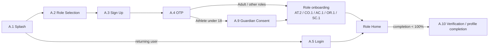
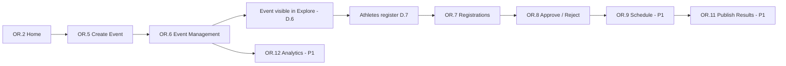

# SportX India — Screen Inventory (v2, MVP)

> Replaces the old Flutter screen inventory. Built from the old inventory + `FEATURE_DOCUMENTATION.md` (13 UI screenshots).
> Companion document: `MVP_FEATURE_LIST.md`.

**Priority legend**

| Tag | Meaning |
|---|---|
| **P0** | MVP launch — must ship |
| **P1** | MVP+ — ship right after launch / if time allows |
| **P2** | Post-MVP — designed for, not built now |

**Roles in this version:** Athlete / Parent, Coach, Academy, Event Organizer, Talent Scout, Admin (internal).
**Removed vs. old inventory:** the separate *Sponsor / Brand* role. Sponsorships now exist as an **Opportunity type** that Academy, Organizer, Coach, Scout and Athlete roles can post/browse (see decision in `MVP_FEATURE_LIST.md` §9).

**ID prefixes:** `A` Auth/Onboarding · `S` Shared shell · `D` Shared detail/forms · `AT` Athlete · `CO` Coach · `AC` Academy · `OR` Organizer · `SC` Scout · `AD` Admin.

---

## 1. App architecture

```text
Bottom nav (all roles):  [Home] [Explore] [(+) Create] [Community] [More]

Home       -> role-specific dashboard (AT.1 / CO.2 / AC.2 / OR.2 / SC.2)
Explore    -> S.2 (tabs differ slightly by role)
Create     -> S.8 launcher (tiles differ by role)
Community  -> S.12 Network (P1)  |  Groups (P2)  |  Events (P1)
More       -> S.15 account hub (rows differ by role)

Header icons (root screens): search -> S.5, bell -> S.16, avatar -> own profile
Messages are reached from More and from profile "Message" buttons (S.17)
```

---

## 2. Auth & Onboarding (shared)

| # | Screen | Purpose | Key elements | Navigates to | Pri |
|---|---|---|---|---|---|
| A.1 | Splash | Load, auth check, route | Logo, "Let's defeat history" tagline, loader | A.2 or role Home | P0 |
| A.2 | Welcome / Role Selection | First-time role pick | 5 role cards: Athlete/Parent, Coach, Academy, Organizer, Talent Scout; "Login" link | A.3 | P0 |
| A.3 | Sign Up | Register | Phone/email, OTP/password, T&C + privacy checkbox | A.4 | P0 |
| A.4 | OTP Verification | Verify phone/email | OTP input, resend timer | A.9 (if minor) or role onboarding | P0 |
| A.5 | Login | Returning user | Phone/email, password/OTP toggle | Role Home | P0 |
| A.6 | Forgot / Reset Password | Recover account | Phone/email, OTP, new password | A.5 | P1 |
| A.7 | Language Selection | App language | English / Hindi / Gujarati list | Previous | P1 |
| A.8 | Permissions Primer | Ask for location, notifications, media | Rationale cards, Allow / Skip | Role Home | P1 |
| A.9 | Guardian Consent | Required when athlete DOB < 18 | Guardian name, phone, OTP, consent text | Role onboarding | P0 |
| A.10 | Verification Request & Status | Apply for blue check | Document/ID upload, org proof, status (Pending / Verified / Rejected) | Back to Profile | P0 |

Role onboarding wizards: **AT.2, CO.1, AC.1, OR.1, SC.1** (see role sections).

---

## 3. Shared shell screens

| # | Screen | Purpose | Key elements | Navigates to | Pri |
|---|---|---|---|---|---|
| S.1 | Home shell | Common Home layout, role content plugged in | Header (logo, search, bell badge, avatar), profile-completion card, leaderboard strip, shortcut cards, feed | Role Home screens | P0 |
| S.2 | Explore — All | Grouped discovery | Search, category tabs (All / Athletes / Coaches / Academies / Events [/ Venues]), "See All" sections, Opportunities strip | S.3, detail screens | P0 |
| S.3 | Explore — Category List | Filtered list for one entity type | Result count, sort, filter chips, cards with Follow/Connect/View, bookmark | D.1–D.6, S.4 | P0 |
| S.4 | Filter & Sort Sheet | Reusable filters | Sport, state/city, age group, position, level, facilities, price, date, sort (Relevant / Nearest / Rating) | Filtered list | P0 |
| S.5 | Universal Search + Results | Cross-entity search | Search field, recent searches, grouped results, empty state | Detail screens | P0 |
| S.6 | Leaderboard | Ranked discovery | Category tabs, sport chips, location + age dropdowns, podium (top 3), ranks 4–10, Follow, View Full | D.1–D.3 | P0 (Athletes) / P1 (others) |
| S.7 | Leaderboard Info | How points work | Criteria text, point rules | Back | P1 |
| S.8 | Create Launcher | Role-specific action grid | Tiles (see role sections), Quick Post chips (Photo, Video, Text, Achievement; Poll P2) | Create flows | P0 |
| S.9 | Create Post | Publish text/photo/video post | Text, media picker, hashtags, audience, post | Feed / Post detail | P0 |
| S.10 | Upload Media | Add to profile gallery | Picker, caption, sport tag, upload progress | Profile > Media | P0 |
| S.11 | Add / Edit Achievement | Medal, certificate, record, milestone | Title, sport, level, year, certificate upload | Achievements list | P0 |
| S.12 | Community — Network | Suggested people/orgs | Search, chips (Athletes / Coaches / Academies), Follow | Profiles | P1 |
| S.13 | Community — Groups | Interest/professional groups | Group cards, member counts, Join | S.14 | P2 |
| S.14 | Group Detail | Group page | Members, posts | Back | P2 |
| S.15 | More Menu | Account hub | Profile summary card (stats, completion, View Profile), role-specific rows, Logout | Child screens | P0 |
| S.16 | Notifications | Activity feed | Tabs (All / People / Opportunities / Events / Mentions — role-adapted), Mark all as read, grouped timeline, unread dots, actions (Follow back) | Source screen | P0 |
| S.17 | Messages Inbox | Conversation list | Tabs Chats / Requests, search, unread badges | S.18 | P0 |
| S.18 | Chat Thread | 1-to-1 chat | Messages, text input, report/block menu; media attach P1 | Back | P0 |
| S.19 | Connections | Network management | Tabs Followers / Following / Connections / Requests; accept, decline, cancel, remove | Profiles, S.18 | P0 |
| S.20 | Saved | Bookmarks | Tabs: Athletes, Coaches, Academies, Posts, Opportunities/Events | Detail screens | P0 |
| S.21 | My Activity | Own posts, achievements, events, applications | Segmented list | Items | P1 |
| S.22 | Settings & Privacy | Account settings | Profile visibility, who can message/connect, notifications, language, blocked users, change password, delete account | S.23, A.5 on logout | P0 |
| S.23 | Blocked Users / Safety Centre | Manage blocks and reports | Blocked list, unblock, report status | Back | P0 |
| S.24 | Help & Support | Support | FAQs, report a problem, contact SportX | Back | P0 |
| S.25 | About SportX | Legal | About, terms, privacy policy, community guidelines | Back | P0 |
| S.26 | Report Sheet | Report user/post/listing | Reason dropdown, notes, submit; confirmation | Back | P0 |
| S.27 | Post Detail | Single post | Media, like/comment/save, comments list, overflow (report) | Author profile | P0 |
| S.28 | Media Viewer | Full-screen photo/video | Swipe, share, report | Back | P0 |
| S.29 | Logout Confirm | Sign out dialog | Confirm / Cancel | A.5 | P0 |
| S.30 | Share Sheet / Deep Link | Share profile/event externally | Link, WhatsApp, copy | Back | P1 |

---

## 4. Shared detail & transactional screens

| # | Screen | Purpose | Key elements | Navigates to | Pri |
|---|---|---|---|---|---|
| D.1 | Athlete Profile (own & public) | Digital sports portfolio | Cover, avatar, verified badge, stats (posts, connections, sports, achievements), completion bar, bio; tabs Overview / Posts / Achievements / Media / Connections; CTAs Edit, Share, View as Public (own) or Follow / Connect / Message (others); Shortlist (scout) | AT.3, S.18, SC.6 | P0 |
| D.2 | Coach Profile | Coach credentials | Level, experience, specialization, age groups, languages, rating; tabs About / Posts / Programs / Achievements; Follow / Connect / Message | D.11, S.18 | P0 |
| D.3 | Academy Profile | Academy listing | Cover, logo, rating, sports, age range, staff count, facilities, established; tabs About / Programs / Facilities / Events / Reviews; Follow, Message, Enquire | D.11, D.13, D.6 | P0 |
| D.4 | Organizer Profile | Organizer identity | Stats (events, participants, collaborations), tabs About / Events / Venues / Team / Media; Follow, Share | D.6 | P0 |
| D.5 | Scout Profile | Scout credibility | Organization, sports focus, experience, availability, rating; tabs About / Shortlisted / Reports / Activity (own) — public view shows About + Activity only | S.18 | P0 |
| D.6 | Event / Trial Detail | Full event info | Cover, dates, venue, sport, age/category, fee, slots + progress, organizer, status; tabs Overview / Schedule / Gallery; Register CTA; Save, Share, Report | D.7 | P0 |
| D.7 | Event Registration Form | Register athlete/team | Personal/team details, category, documents upload, consent, submit | D.8 | P0 |
| D.8 | Registration Confirmation | Success | Summary, status (Pending/Approved), View My Registrations | AT.9 | P0 |
| D.9 | Opportunity Detail | Scholarship / sponsorship / tryout / camp | Provider, eligibility, benefits/amount, deadline, apply info | D.10 | P0 |
| D.10 | Opportunity Apply / Pitch Form | Apply with profile | Pitch text, auto-attached profile, documents, submit; confirmation | AT.8 | P0 |
| D.11 | Program Detail | Training program | Title, age group, duration, mode (online/offline), price, schedule, provider; Enquire | D.12 | P0 |
| D.12 | Enquiry Form | Contact coach/academy about a program or listing | Message, preferred batch, submit; creates chat thread | Confirmation → S.18 | P0 |
| D.13 | Facility / Venue Detail | Facility info | Images, type, capacity/size, amenities, location | Back | P0 |
| D.14 | Reviews List | Ratings & reviews | Average, distribution, review cards | D.15 | P1 |
| D.15 | Write Review | Submit rating | Stars, text, submit (only after verified interaction) | D.14 | P1 |
| D.16 | Map View | Nearby academies/venues | Map pins, list sheet | D.3, D.13 | P2 |
| D.17 | Team Page / Find-Add Team | Team listing and recruitment | Team info, members, open spots | — | P2 |

---

## 5. Athlete / Parent

| # | Screen | Purpose | Key elements | Navigates to | Pri |
|---|---|---|---|---|---|
| AT.1 | Athlete Home | Dashboard | "Hi, {name}", completion card + Complete Now, leaderboard strip (sport chips), shortcut cards (Opportunities; Academy/Coach/Training), feed tabs (For You / Following / Athletes / Coaches / Academies / Events), Recommended Athletes | S.6, S.3, D.x | P0 |
| AT.2 | Onboarding — Preferences | Capture sport(s), age group, level, city | Sport chips, DOB, level, city picker | AT.1 | P0 |
| AT.3 | Edit Profile | Edit identity | Photo/cover, name, role, location, age group, college, interests, bio, social links | D.1 | P0 |
| AT.4 | Manage Sports | Multi-sport data | Primary sport badge, playing role, level, experience, Add Another Sport | D.1 | P0 |
| AT.5 | Achievements & Certificates | Manage list | Cards, add/edit/delete, certificate preview | S.11 | P0 |
| AT.6 | Profile Completion Checklist | Drive completion | Percent, missing items with deep links | AT.3–AT.5 | P0 |
| AT.7 | View as Public | Preview public profile | Read-only D.1 as visitors see it | AT.3 | P1 |
| AT.8 | My Opportunities | Applied / Saved / Created | Segmented list, status chips | D.9 | P0 |
| AT.9 | My Registrations | Events/trials registered | Status (Pending/Approved/Rejected), cancel | D.6 | P0 |
| AT.10 | Guardian / Parent Controls | Parent manages minor's account | Consent status, messaging restrictions, visibility | S.22 | P0 |

Athlete **Create** tiles: Create Post (P0), Add Achievement (P0), Upload Media (P0), Create Opportunity (P1), Create Event (P1), Find/Add Team (P2), Add Academy (P1), Add Coaching Service (P1).
Athlete **More** rows: My Profile, My Opportunities, My Activity, My Achievements & Certificates, Saved, Settings & Privacy, Help & Support, About, Logout.

---

## 6. Coach

| # | Screen | Purpose | Key elements | Navigates to | Pri |
|---|---|---|---|---|---|
| CO.1 | Onboarding — Coach Setup | Multi-step profile | Certifications (e.g. BCCI Level 2), experience, sports, specializations, age groups, languages, fees, location | CO.2 | P0 |
| CO.2 | Coach Home | Dashboard | Greeting + completion, Coaches leaderboard strip, shortcut cards, recent enquiries, feed | S.6, CO.4, S.17 | P0 |
| CO.3 | Edit Coach Profile | Edit | Credentials, summary, specialization chips, languages, fees, media | D.2 | P0 |
| CO.4 | My Training Programs | Manage programs | Tabs Active / Drafts / Past, + Add Program, program cards (age, duration, mode, price) | CO.5, D.11 | P0 |
| CO.5 | Create / Edit Program | Program form | Title, sport, age group, duration, mode, price, schedule, description, Save draft / Publish | CO.4 | P0 |
| CO.6 | My Events | Events coach created | Reuses OR.4 list | OR.5 | P1 |
| CO.7 | My Opportunities / Achievements | Lists | Reuses AT.8 / AT.5 | — | P1 |
| CO.8 | Go Live / Webinar | Host live session | Schedule, title, start | — | P2 |

Coach **More** rows: My Profile, My Training Programs, My Events, My Opportunities, My Achievements, Saved, My Connections, My Activity, Notifications, Messages, Settings & Privacy, Help & Support, Logout.

---

## 7. Academy

| # | Screen | Purpose | Key elements | Navigates to | Pri |
|---|---|---|---|---|---|
| AC.1 | Onboarding — Academy Setup | Multi-step listing | Name, sports, age range, facilities, location + map pin, fees, established year, photos, logo | AC.2 | P0 |
| AC.2 | Academy Home | Dashboard | Greeting + completion, Academies leaderboard strip, Opportunities + Find Talent cards, summary tiles (enquiries, registrants), feed | AC.6, S.17, SC-style discovery | P0 |
| AC.3 | Edit Academy Profile | Edit | All listing fields, gallery | D.3 | P0 |
| AC.4 | Academy Programs | Manage programs | Reuses CO.4 / CO.5 | CO.5 | P0 |
| AC.5 | Our Athletes | Enrolled/associated athletes | Age chips (All, U-8…U-19), search, rows with rating, View Profile | D.1, AC.10 | P1 |
| AC.6 | Events / Trials | Academy events | Tabs Upcoming / Past, + Create Event, cards with registered counts | OR.5, OR.6 | P0 |
| AC.7 | Facilities | Facility list | Tabs All / Grounds / Indoor / Gym / Other, + Add Facility | AC.8, D.13 | P0 |
| AC.8 | Add / Edit Facility | Facility form | Name, type, size/lanes, amenities, images | AC.7 | P0 |
| AC.9 | My Scholarships / Opportunities | Manage posted scholarships/sponsorships | List + status, create/edit | D.9 | P0 |
| AC.10 | Add / Invite Athlete | Link athlete to academy | Search or invite by phone; athlete must accept | AC.5 | P1 |
| AC.11 | My Staff / Recruit Staff | Staff listing, openings | Staff cards, post opening | — | P2 |
| AC.12 | My Collaborations | Partnerships | Org list | — | P2 |

Academy event creation/registrants reuse **OR.5–OR.8**.
Academy **Create** tiles: Post (P0), Training Program (P0), Event/Trial (P0), Scholarship/Opportunity (P0), Facility/Venue (P0), Photos/Videos (P0), Recruit Staff (P2), Go Live (P2), Poll (P2).

---

## 8. Event Organizer

| # | Screen | Purpose | Key elements | Navigates to | Pri |
|---|---|---|---|---|---|
| OR.1 | Onboarding — Organizer Setup | Org profile | Name, logo, event types, sports, location, website, established year | OR.2 | P0 |
| OR.2 | Organizer Home | Dashboard | Greeting + completion, Upcoming Events, summary metrics (events, participants), quick actions (Create Event, Manage Registrations, Analytics; Promote P2) | OR.4, OR.7, OR.12 | P0 |
| OR.3 | Edit Organizer Profile | Edit | Details, cover, logo | D.4 | P0 |
| OR.4 | My Events | Portfolio | Tabs Upcoming / Ongoing / Completed, + Create Event, cards with registered counts | OR.5, OR.6 | P0 |
| OR.5 | Create / Edit Event | Multi-step form | Type (tournament / trial / camp), sport, dates, venue, age/categories, fee (display), slots, eligibility, documents required, cover, publish/draft | OR.6 | P0 |
| OR.6 | Event Management | Manage one event | Cover, status, "320 / 500 slots" bar, fee, tabs Overview / Registrations / Schedule / Gallery; Manage Event CTA; Share; Edit; Close registrations | OR.7, OR.9, OR.10 | P0 |
| OR.7 | Registrations / Participants | Review registrants | Tabs All / Approved / Pending (/ Rejected), search, filter, checkboxes, status chips, bulk Approve/Reject, Export List | OR.8 | P0 |
| OR.8 | Registrant Detail | Full submission | Personal details, documents, approve/reject with reason | OR.7 | P0 |
| OR.9 | Schedule Editor | Fixtures/timetable | Day/slot list, add/edit | OR.6 | P1 |
| OR.10 | Event Gallery | Photos/videos | Upload grid | OR.6 | P1 |
| OR.11 | Results Publishing | Brackets / final results | Result entry/upload, publish | OR.6 | P1 |
| OR.12 | Event Analytics | Performance | Event selector, period pills, Views / Registrations (Revenue P2) / Inquiries, line chart, top sources | OR.6 | P1 |
| OR.13 | My Venues / Add Venue | Venue listing | Venue cards, add/edit form | D.13 | P1 |
| OR.14 | Post Announcement | Update to registrants/followers | Title, message, target event | Feed | P1 |
| OR.15 | Promote Event | Boost visibility | Placement, duration | — | P2 |
| OR.16 | My Team / Staff | Add co-organizers | Invite, role | — | P2 |
| OR.17 | My Collaborations | Partnerships | List | — | P2 |

Organizer **Create** tiles: Event (P0), Opportunity (P0), Venue (P1), Announcement (P1), Photo/Video (P0), Go Live (P2), Poll (P2), Add Staff (P2).

---

## 9. Talent Scout

| # | Screen | Purpose | Key elements | Navigates to | Pri |
|---|---|---|---|---|---|
| SC.1 | Onboarding — Scout Setup | Identity & professional details | Organization / Independent, sports focus, experience, availability region, languages, location | SC.2 | P0 |
| SC.2 | Scout Home | Dashboard | "Find the next big talent", completion, Top Talents (This Week) podium, quick actions (Discover Talents, Attend Trials, Top Performers, Shortlisting), Upcoming Trials & Events, feed | S.3, SC.4, S.6 | P0 |
| SC.3 | Edit Scout Profile | Edit | Summary, organization, sports focus, experience, availability | D.5 | P0 |
| SC.4 | Discover Talents | Athlete search with scout filters | Cards (age • sport • location, rating, role/level tags), filters: sport, age group, position, level, location, achievements | D.1 | P0 |
| SC.5 | Shortlisted Talents | Pipeline | Tabs All / Under Review / Final, search, checkboxes, status chips (High Potential / Good Potential / Under Review), Compare CTA | D.1, SC.7 | P0 |
| SC.6 | Add to Shortlist Sheet | Save athlete | Status, tags, private note | SC.5 | P0 |
| SC.7 | Compare Talents | Side-by-side | 2–3 athletes, assessment scores | Back | P1 |
| SC.8 | Talent Report | Evaluation of one athlete | Tabs Overview / Performance / Potential / Notes; key info; assessment bars (technical, fitness, match awareness, mental, overall); conclusion; Save to Shortlist | SC.5 | P1 |
| SC.9 | My Scouting Reports | Report list | Report cards, filter by sport/status | SC.8 | P1 |
| SC.10 | Add Observation | Quick note | Athlete, text, rating, optional media | SC.8 / SC.5 | P0 |
| SC.11 | Scouting Opportunities | Trials / scholarships / camps | Tabs All / Trials / Scholarships / Camps, search, filter | D.6, D.9 | P0 |
| SC.12 | Create Scouting Opportunity | Post a scouting call | Reuses opportunity form (D.9 create variant) | SC.11 | P0 |
| SC.13 | Contact Athlete / Parent | Platform-mediated outreach | Connection request / enquiry form with purpose; minors route to guardian | Confirmation | P0 |

Scout **Create** tiles: Add Talent Shortlist (P0), Create Talent Report (P1), Add Scouting Opportunity (P0), Add Event/Trial (P1), Upload Photo/Video (P0), Add Observation (P0), Share Opportunity (P1), Poll (P2), Go Live (P2).
Scout **More** rows: My Profile, My Shortlisted Talents, My Scouting Reports, My Opportunities, My Events/Trials, My Connections, Saved, My Activity, Notifications, Messages, Settings & Privacy, Help & Support, Logout.

---

## 10. Admin (internal web dashboard)

| # | Screen | Purpose | Key elements | Navigates to | Pri |
|---|---|---|---|---|---|
| AD.1 | Admin Login | Internal login | Email/password, 2FA | AD.2 | P0 |
| AD.2 | Admin Dashboard | Platform health | Tiles (new users by role, pending verifications, open reports, active events), recent activity | AD.3–AD.10 | P0 |
| AD.3 | User Management | Find/suspend users | Filter by role/status, user detail, suspend/ban | AD.4 | P0 |
| AD.4 | Verification Queue | Review blue-check requests | Documents, approve/reject with reason | AD.3 | P0 |
| AD.5 | Content Manager | Manage records | Filterable table (academies, coaches, events, opportunities, programs, facilities, posts) | AD.6 | P0 |
| AD.6 | Record Edit | Add/edit/delete | Full record form | AD.5 | P0 |
| AD.7 | Moderation Queue | Reported items | Reports, reasons, linked content preview | AD.8 | P0 |
| AD.8 | Moderation Detail | Take action | Approve, reject, remove, warn, suspend/block | AD.7 | P0 |
| AD.9 | Category / Master Manager | Sports, cities, age groups, positions | Editable lists | Back | P0 |
| AD.10 | Expiry Rules | Auto-expire listings | Rule list, add/edit | Back | P0 |
| AD.11 | Leaderboard Config | Point rules, reset | Weights, season controls | Back | P1 |
| AD.12 | Broadcast Notification | Platform announcement | Audience, message, schedule | Back | P1 |

---

## 11. Screen count summary

| Section | P0 (MVP) | P1 (MVP+) | P2 (Post-MVP) | Total |
|---|---|---|---|---|
| Auth & Onboarding | 7 | 3 | 0 | 10 |
| Shared shell | 24 | 4 | 2 | 30 |
| Shared detail & forms | 13 | 2 | 2 | 17 |
| Athlete / Parent | 9 | 1 | 0 | 10 |
| Coach | 5 | 2 | 1 | 8 |
| Academy | 8 | 2 | 2 | 12 |
| Organizer | 8 | 6 | 3 | 17 |
| Talent Scout | 10 | 3 | 0 | 13 |
| Admin | 10 | 2 | 0 | 12 |
| **Total** | **94** | **25** | **10** | **129** |

Role onboarding, create/edit forms and detail screens are counted once; screens reused by several roles (e.g. OR.5–OR.8 for Academy, D.x profiles, S.x shell) are not double counted.

---

## 12. User flows (screen level)

### 12.1 Onboarding (all roles)



### 12.2 Discovery (all roles)

```text
Home shortcut / Explore tab (S.2)
 -> Search (S.5) or pick category tab
 -> Filter & Sort (S.4)
 -> S.3 list -> tap card
 -> Detail (D.1 Athlete / D.2 Coach / D.3 Academy / D.6 Event / D.9 Opportunity)
 -> Action: Follow | Connect | Message (S.18) | Enquire (D.12) | Register (D.7) | Save | Report (S.26)
```

### 12.3 Athlete — find & register for a trial

```text
AT.1 Home -> "Opportunities" card -> S.3 (Events, filtered: Trials)
 -> D.6 Trial Detail -> Register
 -> D.7 Registration Form (details + documents)
 -> D.8 Confirmation (Pending)
 -> AT.9 My Registrations
 -> S.16 Notification: "Approved / Rejected" -> D.6
```

### 12.4 Athlete — apply for scholarship / sponsorship

```text
AT.1 -> Opportunities -> S.3 (Scholarships | Sponsorships)
 -> D.9 Opportunity Detail -> Apply
 -> D.10 Pitch Form (profile auto-attached) -> confirmation
 -> AT.8 My Opportunities (Applied) -> notification on decision
```

### 12.5 Athlete — build portfolio

```text
More (S.15) -> My Profile (D.1)
 -> AT.6 completion checklist
 -> AT.3 Edit Profile / AT.4 Manage Sports / S.11 Add Achievement / S.10 Upload Media
 -> AT.7 View as Public -> A.10 request verification
```

### 12.6 Athlete — find an academy / coach and enquire

```text
AT.1 -> "Academy, Coach & Training Centre" card -> S.3 (Academies | Coaches | Training)
 -> S.4 filters (location, sport, age, facilities)
 -> D.3 Academy / D.2 Coach -> D.11 Program Detail
 -> D.12 Enquiry -> S.18 Chat thread
 -> Provider replies (S.16 notification)
```

### 12.7 Athlete — connections & chat

```text
S.3 (Athletes) -> D.1 other athlete -> Connect
 -> S.19 Requests (receiver: Accept / Decline)
 -> on Accept: S.17 Inbox -> S.18 Thread
 -> Overflow: Report (S.26) / Block (S.23)
Rule: chat opens only after accepted connection or enquiry thread; minors restricted (see feature list §8)
```

### 12.8 Create & post (all roles)

```text
(+) Create (S.8) -> tile
 -> S.9 Create Post | S.10 Upload Media | S.11 Add Achievement | role form (event, program, facility, opportunity…)
 -> Publish -> Feed / owning list -> followers receive notification
```

### 12.9 Coach / Academy — publish a program and handle enquiries

```text
CO.2 / AC.2 -> CO.4 My Training Programs -> + Add Program
 -> CO.5 Form -> Save draft or Publish (appears in D.2/D.3 + Explore)
 -> Enquiry arrives (S.16 + S.17 Requests tab)
 -> S.18 reply -> athlete enrolls offline (MVP: no payment)
```

### 12.10 Academy — run a trial and review registrants

```text
AC.2 -> AC.6 Events/Trials -> + Create Event -> OR.5 form -> Publish
 -> athletes register (D.7)
 -> AC.6 -> OR.6 Event Management -> OR.7 Registrations
 -> OR.8 Registrant Detail -> Approve / Reject
 -> Export List -> Close registrations
```

### 12.11 Academy — facilities & athletes

```text
AC.2 -> More -> My Facilities -> AC.7 -> AC.8 Add Facility -> D.13 shown on D.3 Facilities tab
AC.2 -> More -> My Athletes -> AC.5 -> AC.10 Invite -> athlete accepts -> appears in Our Athletes
```

### 12.12 Organizer — end-to-end event



### 12.13 Talent Scout — discover, shortlist, report, contact

```text
SC.2 Home -> SC.4 Discover Talents (S.4 filters) -> D.1 Athlete Profile
 -> SC.6 Add to Shortlist (status + note)   [or SC.10 Add Observation]
 -> SC.8 Talent Report (P1) -> Save to Shortlist
 -> SC.5 Shortlisted Talents (All / Under Review / Final) -> SC.7 Compare (P1)
 -> SC.13 Contact Athlete/Parent -> connection/enquiry -> S.18 chat once accepted
Parallel: SC.11 Scouting Opportunities -> SC.12 Create -> athletes apply
```

### 12.14 Report & moderation

```text
Any content -> overflow -> S.26 Report (reason + notes) -> confirmation
 -> AD.7 Moderation Queue -> AD.8 Detail -> Approve | Remove | Warn | Suspend
 -> reporter + reported user get S.16 notification (outcome)
Block: S.18 overflow -> Block -> S.23 manage blocked
```

### 12.15 Admin — verification & content

```text
AD.1 Login -> AD.2 Dashboard
 -> AD.4 Verification Queue -> review docs -> Approve (blue check) / Reject (reason)
 -> AD.5 Content Manager -> AD.6 Edit/Delete
 -> AD.9 Master lists / AD.10 Expiry rules
```

### 12.16 Notifications routing

```text
S.16 item tap ->
  follow / connection  -> S.19 or D.1
  like / comment / mention -> S.27 Post Detail
  new enquiry / message -> S.18
  event nearby / deadline -> D.6
  opportunity match -> D.9
  registration update -> AT.9 / OR.7
  verification update -> A.10
```
